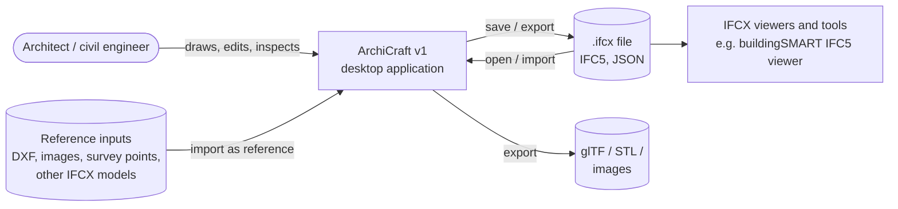
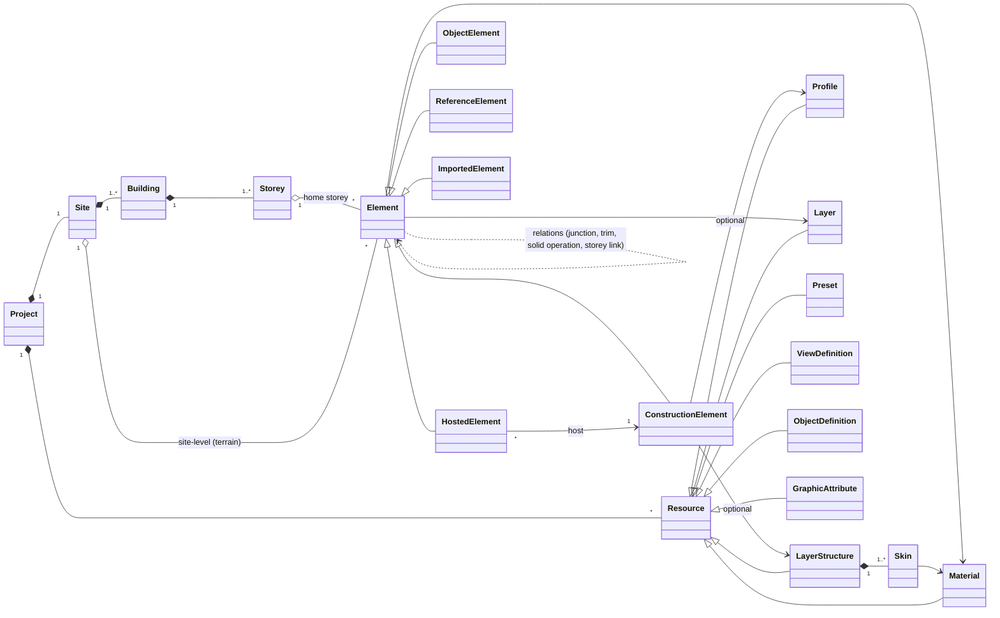

# ArchiCraft — Software Requirements Specification

| | |
|---|---|
| **Document** | Software Requirements Specification (SRS) for ArchiCraft v1 |
| **Version** | 0.1 — draft for review |
| **Date** | 2026-10-16 |
| **Owner** | Alexander Partsch |
| **Status** | Draft. Not yet reviewed against the technology-stack decision record. |
| **Basis** | Graphisoft Archicad Knowledge Base (offline corpus of 313 articles, scraped 2026-10-16), buildingSMART IFC5-development repository (commit `1a63082`, 2026-09-08), IFCX schema registry ifcx.dev |

## Executive summary

**ArchiCraft v1 is a single-user, offline desktop application for drawing buildings as precise 3D models and saving them as IFCX (IFC5).** It is built for architects and civil/structural engineers.

- **What v1 does:**
  - Project set-up with storeys, grids, units and location.
  - Plan views generated live from the model, and 3D views; both are editable.
  - Precise numeric input with snapping and inference guides.
  - Element tools: walls with layered structures and clean junctions, slabs, columns, beams, single- and multi-plane roofs, openings, doors and windows, rule-based stairs, terrain from survey points and contours, free-form solids, and associative solid operations and trims.
  - With priority Should: railings, curtain walls, and section/elevation views.
  - IFCX is the native format with full round-trip of the parametric model.
- **What v1 does not do:** collaboration, BIM information management (property sets, classifications, schedules, model checking), drawing sheets and publishing, MEP and structural analysis, photorealistic rendering (Section 8).
- **Key decisions:**
  - IFCX as the native format, with the parametric data in a declared `archicraft::` namespace (D-1).
  - IFCX `ifcx_alpha` pinned, behind a versioned adapter (CON-2, IFX-090).
  - One home storey per element (D-3).
  - One material concept (D-5).
  - Order-independent, reference-line-based junctions (D-6).
- **Size:** 589 requirements — 315 Must, 211 Should, 63 Could — plus 8 end-to-end acceptance scenarios (Section 7) and an informative increment plan (Appendix F).
- **Main risks:**
  - IFCX is a pre-standard with few consumers: mitigated by an isolated adapter, conformance tests against buildingSMART's reference implementation, and an optional IFC 4 export (D-4).
  - Geometric robustness of junctions, Boolean operations and roofs: mitigated by fixtures and regression tests (Appendix D.7, NFR-MNT-005).
  - Performance on large models (NFR-PERF).
  - The breadth of the Must scope: mitigated by the increments in Appendix F.

---

## Contents

0. [About this document](#0-about-this-document)
1. [Introduction](#1-introduction)
2. [Overall description](#2-overall-description)
3. [Domain model](#3-domain-model)
4. [Functional requirements](#4-functional-requirements)
5. [External interface requirements](#5-external-interface-requirements)
6. [Non-functional requirements](#6-non-functional-requirements)
7. [Verification and acceptance](#7-verification-and-acceptance)
8. [Out of scope for v1 and roadmap](#8-out-of-scope-for-v1-and-roadmap)
9. [Open issues and decisions](#9-open-issues-and-decisions)
- [Appendix A — Glossary](#appendix-a--glossary)
- [Appendix B — Archicad concept map](#appendix-b--archicad-concept-map)
- [Appendix C — Annotated IFCX example](#appendix-c--annotated-ifcx-example)
- [Appendix D — Default values and design rules](#appendix-d--default-values-and-design-rules)
- [Appendix E — Knowledge-base source index](#appendix-e--knowledge-base-source-index)
- [Appendix F — Suggested implementation increments (informative)](#appendix-f--suggested-implementation-increments-informative)

---

## 0. About this document

### 0.1 Purpose of this document

This SRS defines **what** ArchiCraft v1 must do and how well it must do it. It is the contract between product ownership and implementation. Together with the separate technology-stack decision record (which defines **how**), it is the basis for planning the implementation (work breakdown into beads issues is a later step and deliberately not part of this document).

The document is technology-neutral on purpose. Where a requirement constrains the technology (for example, offline operation or the IFCX file structure), the constraint is stated as a requirement, not as a choice of library.

### 0.2 How the document was derived

- **Domain behaviour** (how architects and engineers expect a building modeler to work) was derived from the Graphisoft Archicad Knowledge Base. The corpus was read cluster by cluster (user interface and project structure, precise input and editing, walls/slabs/columns/beams, roofs/solids/openings/terrain, stairs/railings, doors/windows/objects/curtain walls, views/materials/export, 2D attributes/annotation, product evolution). Every requirement group cites the knowledge-base articles it is based on (Appendix E).
- Archicad is used as a **reference for proven workflows, not as a blueprint**. ArchiCraft uses neutral terminology (Appendix B maps Archicad terms to ArchiCraft terms), deliberately simplifies where Archicad carries decades of legacy, and avoids pain points the knowledge base documents.
- **IFCX requirements** were derived from the buildingSMART IFC5-development repository (file schema `schema/ifcx.tsp`, composition and validation reference code in `src/ifcx-core`, example files) and the published schema files on ifcx.dev.

### 0.3 Version history

| Version | Date | Change |
|---|---|---|
| 0.1 | 2026-10-16 | First complete draft, revised after an independent review (60 findings: 2 High, 16 Medium, 42 Low; all addressed). |

---

## 1. Introduction

### 1.1 Purpose

ArchiCraft is a desktop application in which architects and civil engineers draw buildings as precise 3D models. Version 1 focuses on one outcome: **a user can model a building — site, storeys, walls, slabs, columns, beams, roofs, openings, doors, windows, stairs, railings, terrain and free-form parts — and save it as a valid IFCX file** that other IFCX-capable tools can read.

### 1.2 Product vision and v1 goal

- **Vision:** an approachable, fast and precise building modeler whose native file format is the open buildingSMART standard IFCX (IFC5), so that models are open by default instead of being locked into a proprietary format.
- **v1 goal:** a single-user, offline drawing tool for 3D building models. It provides architectural element tools with sensible parametric behaviour (storey-linked heights, automatic wall junctions, openings that cut their hosts), plan and 3D views that are both editable, precise numeric input and snapping, and IFCX as the save format.
- **Explicit non-goals for v1:** collaboration of any kind (teamwork, cloud, sharing, review workflows) and "BIM-specific" information management (property sets, classification systems beyond the IFC class, schedules and quantity take-off, model checking, MEP, structural or energy analysis, renovation phasing, design options, drawing sheets and publishing). See Section 8.

### 1.3 v1 scope at a glance

| Capability | v1 priority | Section |
|---|---|---|
| Project files, templates, autosave, recovery | Must | 4.1 |
| Storeys, reference levels, units, location and datum | Must (reference levels, geographic coordinates: Should; several buildings: Could) | 4.2 |
| Plan views generated from the model, 3D views, navigation, cut planes and section box | Must | 4.4 |
| Section and elevation views | Should | 4.4 |
| Plan graphics: pens, line types, fills, cut fills from materials | Must (paper-scale line weights, hatch catalogue: Should; pen tables, overrides: Could) | 4.5 |
| Precise input, snapping, guides, selection, editing and transformation | Must (persistent guide lines, contour detection, selection regions, criteria selection: Should) | 4.6–4.8 |
| Grids (structural axes) | Must | 4.10 |
| Walls, slabs, columns, beams; layer structures and profiles; junctions | Must (segmented and inclined members, sloped slabs: Should) | 4.11–4.15 |
| Roofs (single- and multi-plane), trim, solid operations, free-form solids | Must (shells: Could) | 4.16, 4.22 |
| Openings, doors and windows | Must | 4.17, 4.18 |
| Stairs with rule-based solver | Must (winders, spirals: Should) | 4.20 |
| Railings, curtain walls | Should | 4.19, 4.21 |
| Terrain from survey points and contours | Must | 4.23 |
| Objects and component library | Must for doors, windows and generic objects (furniture library, linked libraries, save-as-component: Should) | 4.24 |
| Materials and appearance | Must (textures: Should) | 4.27 |
| 2D construction lines, arcs and polylines | Must (further shapes and dimensions: Should; text: Could) | 4.26 |
| Spaces (rooms) | Could | 4.25 |
| IFCX as native format with full round-trip | Must | 5.2 |
| Opening third-party IFCX | Should | 5.2.9 |
| DXF and image underlays; glTF, STL and image export | Should (DWG, PDF, IFC 4 export: Could) | 5.3 |
| Collaboration, BIM information management, documentation, MEP, analysis, rendering | Out | 8 |

### 1.4 Intended audience

| Reader | Uses this document to |
|---|---|
| Product owner | Confirm scope and priorities; resolve the open issues in Section 9. |
| Implementers (humans and coding agents) | Derive the work breakdown, design the architecture together with the technology-stack record, and write acceptance tests. |
| Testers | Derive test cases from requirement IDs and the acceptance scenarios in Section 7. |

### 1.5 Definitions

Terms are defined in [Appendix A](#appendix-a--glossary). Archicad terms and their ArchiCraft equivalents are listed in [Appendix B](#appendix-b--archicad-concept-map).

### 1.6 References

| ID | Reference |
|---|---|
| R1 | Graphisoft Archicad Knowledge Base, <https://community.graphisoft.com/t5/Knowledge-Base/ct-p/tkb>; offline corpus in the main checkout under `kb-scraper/archicad-kb/` (git-ignored, regenerate with `kb-scraper/scrape_archicad_kb.py`). Articles are cited by their numeric ID, see Appendix E. |
| R2 | buildingSMART IFC5-development repository, <https://github.com/buildingSMART/IFC5-development>, commit `1a63082` (2026-09-08): file schema `schema/ifcx.tsp`, reference composition/validation code `src/ifcx-core`, examples (Hello Wall, PCERT sample scene, Tekla House, ACCA building, Georeferencing, Domestic Hot Water). |
| R3 | IFCX schema registry, <https://ifcx.dev> (source <https://github.com/buildingSMART/IFCx.dev>): `@standards.buildingsmart.org/ifc/core/ifc@v5a.ifcx`, `…/ifc/core/prop@v5a.ifcx`, `…/ifc/ifc-mat/ifc-mat@v1.0.0.ifcx`, `@openusd.org/usd@v1.ifcx`. |
| R4 | buildingSMART IFC5 viewer, <https://ifc5.technical.buildingsmart.org/viewer/>. |
| R5 | IFCX "not-use-cases" draft (NUC 1–13), `web/nuc/index.html` in R2 (status: draft for review). |
| R6 | buildingSMART Data Dictionary (bSDD) IFC 4.3 class URIs, `https://identifier.buildingsmart.org/uri/buildingsmart/ifc/4.3/class/<IfcClass>`. |
| R7 | ISO/IEC/IEEE 29148:2018, *Systems and software engineering — Life cycle processes — Requirements engineering* (structure and quality criteria for requirements). |
| R8 | ArchiCraft technology-stack decision record (in preparation, separate document). |
| R9 | buildingSMART International, "IFCX – Core & Modularisation Project Update", press item dated 2026-08-26, <https://www.buildingsmart.org/?p=33789> (accessed through a search index on 2026-10-16; the page itself rejected direct retrieval). |

### 1.7 Conventions

**Requirement format.** Each requirement has a unique, stable identifier, a priority and, where applicable, its knowledge-base sources:

> **WAL-003** · M — The system shall … *(KB 303968, 303922)*

- Identifiers are `<AREA>-<NNN>`. Numbers are never reused; deleted requirements are marked *withdrawn*. Requirements are grouped by topic, so a number reflects when a requirement was added, not its position.
- **Priorities** (MoSCoW, relative to the v1 release):
  - **M — Must:** v1 cannot ship without it.
  - **S — Should:** planned for v1; may slip to a v1.x update only by explicit decision.
  - **C — Could:** desirable; implemented if capacity allows, otherwise moved to the roadmap.
  - Items that are out of v1 ("Won't") are not written as requirements; they are listed in Section 8.
- "**shall**" marks a requirement, "**should**" a recommendation, "**may**" a permission. Could requirements are mostly phrased with "may": they are optional, but once implemented they are verified like any other requirement. Notes and rationale are informative.
- *KB nnnnnn* refers to a knowledge-base article ID (Appendix E). *R2*, *R3* … refer to Section 1.6.
- **Verification:** every requirement is verified by automated or manual **test** unless it is marked *(inspection)*, *(analysis)* or *(demonstration)*.
- Lengths are in metres unless stated otherwise; defaults quoted in requirements are initial values that users can change.

---

## 2. Overall description

### 2.1 Product perspective

ArchiCraft is a new, self-contained desktop application. It is not an add-on to another CAD system and it does not require a server. The model lives in memory while the user works and is persisted as an IFCX file.



### 2.2 Product functions (overview)

1. **Project and structure** — create projects from templates; define site, building, storeys (levels) and structural grids; set units, origin and geographic location.
2. **Views** — per-storey plan views generated from the 3D model, a 3D view with orbit/walk navigation, section boxes and visual styles, optional section and elevation views; all model views are editable.
3. **Precise input** — numeric entry while drawing, snapping with inference guides, guide lines, grids, user origin, measuring.
4. **Element tools** — walls, slabs, columns, beams, roofs, openings, doors, windows, stairs, railings, curtain walls (simplified), terrain, free-form solids, generic objects, 2D construction geometry.
5. **Editing** — selection, transformations, polygon and edge editing, splitting/trimming/joining, arrays, parameter transfer, solid operations.
6. **Appearance** — materials with colour and opacity, layered (composite) wall/slab/roof structures, plan display of cut and projected geometry.
7. **Persistence and exchange** — IFCX as native format with full round-trip of the parametric model, import of third-party IFCX, reference underlays, and export of common 3D formats.

### 2.3 User classes and characteristics

| User class | Characteristics | Key needs |
|---|---|---|
| **Architect** (primary) | Trained in at least one CAD/BIM tool (Archicad, Revit, Vectorworks, AutoCAD); works mostly in plan view and checks in 3D; models from concept to design development. | Fast wall/slab/opening workflows, correct junctions, legible plan view, doors/windows/stairs/roofs, materials, pleasant 3D. |
| **Civil / structural engineer** | Thinks in grids, levels and member sizes; needs precise numeric input; models load-bearing structure, foundations and the site. | Grids, columns/beams/slabs/footings, exact elevations, terrain, reliable dimensions. |
| **Student / occasional user** | Limited CAD experience; learns by doing. | Discoverable tools, good defaults, templates, undo, clear prompts. |
| **Downstream consumer** (does not use ArchiCraft) | Opens the `.ifcx` in a viewer or another tool. | Valid IFCX, correct spatial hierarchy, IFC classes, names, materials and watertight geometry. |

### 2.4 Operating environment

- Desktop operating systems: Windows 11 (x64) and macOS (current and previous major version, Apple silicon) are required; Linux (x64, current Ubuntu LTS) is planned with priority Should (NFR-PORT-001…003).
- Input by mouse with scroll wheel, trackpad, and keyboard; optional 3D mouse and pen (Section 5.4).
- A GPU supporting a current hardware-accelerated graphics API; minimum and reference hardware are defined in NFR-PERF-001.
- Fully functional without network access.

### 2.5 Design and implementation constraints

| ID | Constraint |
|---|---|
| CON-1 | **IFCX is the native project format and the primary exchange format** (see Section 5.2 and decision D-1). |
| CON-2 | IFCX is a pre-standard (`ifcx_alpha`). In August 2026 buildingSMART's IFCX Core & Modularisation project plan passed the next stage of approval and was looking for sponsors (R9); further breaking changes are expected. The IFCX reader/writer must therefore be isolated behind a versioned adapter (NFR-MNT-004). |
| CON-3 | Single-user, offline desktop application. No accounts, no server components, no telemetry without opt-in. |
| CON-4 | Technology choices (language, UI toolkit, rendering, geometry kernel, libraries) are made in the technology-stack decision record (R8). This SRS must not be read as preferring a technology. |
| CON-5 | No Graphisoft code, content, library parts or trademarks are used or shipped. The knowledge base serves as domain reference only; articles are cited, not reproduced. |
| CON-6 | Third-party components must be license-compatible with the intended distribution model (NFR-LEG-001). |

### 2.6 Assumptions and dependencies

| ID | Assumption / dependency |
|---|---|
| ASM-1 | The IFCX standard schema files on ifcx.dev (R3) stay available. ArchiCraft bundles copies of the versions it writes against, so it does not depend on their availability at run time. |
| ASM-2 | IFC class codes and URIs follow the convention of the buildingSMART examples: IFC 4.3 class names with bSDD URIs (R6). |
| ASM-3 | The buildingSMART reference implementation (`src/ifcx-core` in R2) and the IFC5 viewer (R4) are accepted as the conformance oracle for "valid IFCX" until buildingSMART publishes a formal validation service. |
| ASM-4 | Length unit in IFCX files is the metre, as in all buildingSMART examples; the IFCX FAQ states that units will be documented later. |
| ASM-5 | Users have hardware at least at the "minimum" level of NFR-PERF-001. |

---

## 3. Domain model

This section defines the concepts the functional requirements refer to. It is a conceptual model, not a class design.



### 3.1 Spatial structure

- **Project** — the document; it holds settings (units, location, tolerances), resources and one site.
- **Site** — the plot; it holds the building(s) and site-level elements such as terrain. The project location (latitude, longitude, altitude of project zero, angle of true north, optional projected coordinates) belongs here.
- **Building** — v1 requires one building per project; several buildings with their own storey sets are a Could (STR-014).
- **Storey** (level) — a named horizontal datum with an **elevation** relative to project zero and a **height** to the next storey. Storeys are ordered; the index 0 storey is the ground floor and negative indices are basements. Every element belongs to exactly one **home storey**. The plan view of a storey is cut by a horizontal **cut plane** at a configurable height above the storey elevation.

### 3.2 Elements

An **element** is anything the user places in the model. Every element has:
- a stable identity (UUID);
- a **kind** (the tool that created it);
- a user-visible **name/ID** (for example `W-012`);
- a home storey;
- a **layer**;
- an **IFC class**, defaulted by its kind;
- its **geometry parameters**;
- its **appearance** (material, or a layer structure, or a profile);
- **flags**: locked, auxiliary (ELM-014), position interior/exterior;
- **relations** to other elements.

| Category | Members | Characteristics |
|---|---|---|
| **Construction elements** | Wall, slab, column, beam, roof, shell, curtain wall, stair, railing, free-form solid, terrain | Have a closed 3D body. Take part in junctions, openings, trims and solid operations. Are drawn cut or projected in plan. |
| **Hosted elements** | Opening, door, window | Have exactly one host construction element, move with it and cut it (and optionally further elements). |
| **Object elements** | Furniture, fixtures, equipment, generic components | Instances of an **object definition** (a parametric or mesh-based component). They do not cut other elements. |
| **Reference elements** | Grid, guide line, 2D line/arc/polyline/fill, text, dimension, underlay | Support drawing and reading the model. Grids are written as `IfcGrid` (GRD-006); 2D construction geometry may be written as `IfcAnnotation` (ANN-010). Text, dimensions, guide lines and underlays are not written as IFCX elements. |
| **Imported elements** | Elements read from third-party IFCX | Have mesh geometry without ArchiCraft parameters. Can be transformed, re-layered and deleted, but not edited parametrically (IFX-082). |

### 3.3 Relations

The model is **associative**: the relations below are stored with the model, kept across save and open, and re-evaluated automatically when any participating element changes.

| Relation | Meaning |
|---|---|
| Storey link | An element's base and/or top is defined as an offset from a storey elevation, so it follows storey changes. |
| Host | A hosted element is positioned relative to its host and cuts it. |
| Junction | Walls (and beams) whose ends or segments meet are cleaned up according to junction rules and skin priorities. |
| Trim | An element is trimmed by a roof, shell or slab (keeping one side). |
| Solid operation | A target element is modified by an operator element (subtract, intersect, add). |
| Annotation binding | A dimension or label references element geometry or a datum. |

### 3.4 Project resources

Resources are named, project-wide definitions that elements refer to by stable ID. Editing a resource updates every element that uses it (KB 303731, 303850, 336887).

| Resource | Content |
|---|---|
| **Material** | Name, short code, description. Appearance: colour, opacity, optional texture (Section 4.27). Plan display: cut-fill and cover-fill patterns with pens. Category, mapped to the IFCX material category (IFX-041). **Intersection priority**, used to resolve how the skins of meeting elements join (WAL-023). |
| **Layer structure** | Ordered list of skins (material, thickness, role *core*/*finish*/*other*). Used by walls, slabs and roofs. |
| **Profile** | A closed 2D cross-section, parametric (rectangle, circle, I, T, L, U, hollow sections) or user-drawn. Used by columns, beams and, where supported, walls and railings. |
| **Layer** | Visibility and locking category for elements, such as *Walls exterior*, *Structure* or *Furniture*. |
| **Preset** | Named set of tool settings, for example "Exterior wall 36.5 masonry". |
| **View definition** | Saved camera or view range, visibility and display settings (Section 4.4). |
| **Object definition** | Parametric or mesh-based component (doors, windows, furniture), from the built-in library or imported. |
| **Graphic attributes** | Pens (colour and weight by role), line types and fill patterns used in 2D views (Section 4.5). |

### 3.5 Coordinates, datums and units

- **Project origin** (0, 0, 0): the reference point of all model coordinates. Its Z value is **project zero**, the datum all storey elevations refer to.
- **User origin**: a temporary origin the user can place and rotate to enter coordinates relative to existing geometry. It does not change model coordinates.
- **Survey point / location**: relates project coordinates to geographic or projected coordinates and to sea level (STR-011, STR-012). Model coordinates stay near the origin (NFR-ACC-004).
- Internal length unit is the metre and internal angle unit the radian. Display and input units are project settings (STR-009, NFR-L10N-003).

---

## 4. Functional requirements

Requirement areas and identifier prefixes:

| § | Area | Prefix | § | Area | Prefix |
|---|---|---|---|---|---|
| 4.1 | Project and file management | PRJ | 4.17 | Openings | OPN |
| 4.2 | Project structure, location and units | STR | 4.18 | Doors and windows | DW |
| 4.3 | Workspace and user interface | UI | 4.19 | Curtain walls | CW |
| 4.4 | Views and navigation | VIEW | 4.20 | Stairs | STA |
| 4.5 | Plan display and graphic attributes | DSP | 4.21 | Railings | RAI |
| 4.6 | Drawing input and precision | INP | 4.22 | Free-form solids and solid operations | SOL |
| 4.7 | Selection | SEL | 4.23 | Terrain and site | TER |
| 4.8 | Editing and transformation | EDT | 4.24 | Objects and component library | OBJ |
| 4.9 | Common element behaviour | ELM | 4.25 | Spaces | SPC |
| 4.10 | Grids | GRD | 4.26 | 2D drafting and annotation | ANN |
| 4.11 | Walls | WAL | 4.27 | Materials and appearance | MAT |
| 4.12 | Slabs | SLB | 4.28 | Layers and visibility | LAY |
| 4.13 | Columns | COL | 4.29 | Measurement and element information | MEA |
| 4.14 | Beams | BEA | 4.30 | Undo, redo and history | UND |
| 4.15 | Layer structures and profiles | PRF | 4.31 | Preferences | SET |
| 4.16 | Roofs and shells | ROF | | | |

### 4.1 Project and file management

*(KB 303897, 303892, 303997, 303976, 629554, 325598, 303545)*

- **PRJ-001** · M — A new project shall be created from a template that supplies project settings, storeys, layers, materials, layer structures and views. A default template shall ship with the product. *(KB 303897, 303892)*
- **PRJ-002** · S — Users shall be able to save a project as their own template and choose it when creating a project. *(KB 303897)*
- **PRJ-003** · M — The system shall provide New, Open, Save, Save As, Close, Recent projects and Quit. The first save asks for a name and location. The window title shows the project name and an unsaved-changes indicator. Closing or quitting with unsaved changes asks the user to save, discard or cancel. *(KB 303997, 303976)*
- **PRJ-004** · M — The system shall write recovery data automatically, at a configurable interval (default 5 minutes), to a location separate from the project file. After an abnormal termination it offers to restore that state at the next start. The project file is not overwritten until the user saves (NFR-REL-002). *(KB 303997)*
- **PRJ-005** · M — Saving shall be atomic and keep backup versions (NFR-REL-001, NFR-REL-003). Backups shall not appear in the default project listing of the open dialog. *(KB 303997)*
- **PRJ-006** · S — If a project file is already open in another ArchiCraft instance, the system shall warn the user and offer to open it read-only. *(KB 303997)*
- **PRJ-007** · M — Project-level settings shall be stored in the project file, so every user who opens it sees the same values. This covers units, storeys, location, layers, materials, layer structures, profiles, presets, views, tessellation tolerances (IFX-034), cut-plane defaults and stair rule defaults. Personal settings (panel layout, shortcuts, theme, navigation scheme) shall be stored outside the project file; opening a project shall never change them. *(KB 303897, 303976, 303831)*
- **PRJ-008** · M — When a file is damaged or partly invalid, the system shall load all valid parts. It shall then present a report of every skipped, repaired or placeholder object with the reason, and shall never omit objects silently (NFR-REL-004). *(KB 325598, 303545)*
- **PRJ-009** · S — A start screen shall offer New (with template choice), Open, and a searchable list of recent projects with thumbnails. *(KB 629554, 303976)*
- **PRJ-013** · C — A sample project may be offered on the start screen. *(KB 629554, 303970)*
- **PRJ-010** · S — Project information (name, number, description, client, address, author) shall be editable and written to IFCX: name and description on the project node, everything else in the ArchiCraft namespace. *(KB 303897)*
- **PRJ-011** · S — At least two projects shall be open at the same time in separate windows, so that elements can be copied between them (SW-003).
- **PRJ-012** · S — An imperial default template (feet-inches) shall ship in addition to the metric template (O-11).

### 4.2 Project structure, location and units

The storey (level) structure is the backbone of plan views, element heights and the IFCX spatial hierarchy. In the reference product, storey operations are destructive: deleting a storey silently deletes its elements and clears the undo history. ArchiCraft shall avoid this. *(KB 303954, 303987, 303692, 364093, 303722, 336571)*

- **STR-001** · M — The system shall maintain an ordered list of storeys. Each storey has a name, a signed elevation relative to project zero, and a positive storey height (the distance to the next storey; for the top storey, a nominal height that elements linked to the storey above use instead). Storeys are numbered automatically: the ground storey is 0, storeys above are positive and storeys below are negative. *(KB 303954)*
- **STR-002** · M — Changing a storey's height shall shift all storeys above it by the difference. Changing a storey's elevation shall change the height of the storey below. The user may choose, per edit, to keep the other storeys' elevations instead. *(KB 303954)*
- **STR-003** · M — Storeys shall be insertable above or below a selected storey, renamable and deletable. This is available in a storey dialog and in the project browser's context menu, and the browser updates immediately. *(KB 303954, 303987)*
- **STR-004** · M — Before a storey that contains elements is deleted, the system shall show the number of affected elements. The user then chooses to delete them or move them to another storey, keeping their absolute position. *(KB 303954)*
- **STR-005** · M — Every storey operation (insert, delete, rename, change of elevation or height) shall be undoable and shall not clear the undo history (UND-002). *(KB 303954)*
- **STR-006** · M — When storey elevations or heights change, elements whose base or top is linked to a storey shall follow (ELM-005, ELM-006). *(KB 303954, 303722)*
- **STR-007** · S — Besides storeys, the system shall support named reference levels: project zero, sea level, and user-defined levels. Elevations can be entered and displayed relative to any of them, while stored elevations stay relative to project zero. *(KB 303692, 364093)*
- **STR-008** · M — The project shall define the plan cut-plane height above the storey elevation (default 1.10 m), overridable per storey. *(KB 303790, 303692)*
- **STR-009** · M — The project shall define:
  - the length unit (m, cm, mm, feet-inches, decimal feet, inches) and its display precision;
  - the angle unit and its display precision;
  - the slope format;
  - the area and volume display units.

  Changing a unit shall never change stored geometry (NFR-L10N-003). *(KB 303897, 303822)*
- **STR-010** · M — The decimal separator and digit grouping shall default to the operating-system locale, with an in-app override that takes effect without a restart (NFR-L10N-004). *(KB 336967)*
- **STR-011** · M — The project shall hold **one** vertical datum: the altitude of project zero above sea level. Every import, elevation readout and IFCX export uses it, and no import shall require entering it a second time. *(KB 337074, 337306, 303777, 336742)*
- **STR-012** · M — The project location shall include the **survey point** (the coordinates of the project origin in the surveyor's projected coordinate system) and the angle between project north and true north. Imports with world coordinates (TER-003, XCH-001) use it to convert to project coordinates, and IFCX export writes it (IFX-070). *(KB 303897, 303954, 337074, 303777)*
- **STR-013** · M — A project shall have one site and one building, with editable names. *(KB 303954)*
- **STR-015** · S — The project location shall also include latitude and longitude and the EPSG code of the projected coordinate reference system. *(KB 303897, 339130)*
- **STR-014** · C — A project may contain several buildings on one site, each with its own storey set. *(KB 336729, 303692)*

### 4.3 Workspace and user interface

*(KB 303976, 303892, 303964, 303987, 304155, 303831, 669627, 629539, 671758)*

- **UI-001** · M — The main window shall contain:
  - a menu bar;
  - a tool palette grouped into selection, modelling, 2D/annotation and view tools;
  - a properties panel (inspector);
  - a project browser;
  - a tab bar for open views;
  - a view-control bar (zoom, fit, view rotation, drawing scale, active display settings and the restriction indicator of VIEW-043);
  - a status line with the prompt for the next input step.

  *(KB 303976, 303964)*
- **UI-002** · M — The properties panel shall show the active tool's defaults when nothing is selected and the selected elements' values otherwise. With several elements selected, it shows how many are selected and how many of those are editable, marks fields whose values differ, and applies an edited field to all editable selected elements. *(KB 303976, 303892, 303879)*
- **UI-003** · M — Every tool shall have a full settings dialog with collapsible sections: geometry and positioning, plan display, model and appearance. It includes a live preview, and the same dialog edits tool defaults and selected elements. *(KB 303892, 303969)*
- **UI-004** · S — Panels shall be dockable, floatable and hideable, and the layout persists per user. *(KB 303976)*
- **UI-005** · M — Context menus on the canvas, on project-browser items and on tabs shall offer the commands relevant to what was right-clicked. *(KB 303987, 304155)*
- **UI-006** · M — Open views shall be shown as tabs, with next/previous-tab shortcuts. A closed view can be reopened from the project browser. *(KB 303970)*
- **UI-007** · S — Two or more views shall be displayable side by side, for example plan and 3D, with the selection synchronized between them. *(KB 303970, 304155)*
- **UI-008** · M — The system shall ship default keyboard shortcuts for at least the commands listed in Appendix D.8. They use Cmd on macOS and Ctrl elsewhere and avoid combinations reserved by the operating system. Single-key tool shortcuts shall not fire while a text field has focus. *(KB 303831, 669406)*
- **UI-009** · S — Shortcuts shall be reassignable for any command, with conflict detection: reassigning detaches the shortcut from its previous command after confirmation. A complete shortcut list is viewable. *(KB 303831)*
- **UI-010** · S — Light, dark and follow-system themes shall be provided. The 2D and 3D canvas background is configurable, and drawing colours whose contrast ratio against the canvas background is below 3:1 are adjusted automatically. *(KB 669627)*
- **UI-011** · S — Tools and commands shall have tooltips with a short description and their shortcut. *(KB 629539)*
- **UI-012** · M — A problems panel shall list elements with failed geometry, missing definitions or broken references. Clicking an entry selects the element and zooms to it (NFR-REL-006, OBJ-005).
- **UI-013** · C — Toolbars may be user-customizable. *(KB 303976)*
- **UI-014** · S — Every list that can exceed one screen (project browser, materials, layer structures, profiles, presets, layers, saved views, components) shall have an incremental search field. *(KB 338192, 396973)*
- **UI-015** · S — Dialogs and panels shall be resizable and remember their size and splitter positions between sessions. *(KB 304065, 396973, 672706)*
- **UI-016** · S — Project resources (materials, layer structures, profiles, presets, saved views) shall be organizable in nested folders by drag and drop, without affecting references (DSP-003). *(KB 338192, 378760)*
- **UI-017** · M — Every command shall be reachable from a menu or the command palette and be bindable to a shortcut, without the user first adding it to a toolbar. *(KB 308009, 598955)*

### 4.4 Views and navigation

There is one model and many **views** of it. A view combines a *viewpoint* (view type, position, direction, projection) with *display settings* (filters, cut planes, style, scale). Edits in any view appear in all views. In the reference product, visibility is the intersection of many independent per-window filters, and this is the root of its "missing elements" troubleshooting guide. ArchiCraft keeps the set of filters small and always shows when one is active. *(KB 303918, 303987, 303970, 303545, 303400, 304005, 304155, 303790, 303692, 303665, 670286)*

**Views and the project browser**

- **VIEW-001** · M — All views shall be derived from the single model; an edit in one view shall appear in all open views (NFR-PERF-006). *(KB 303918, 303987)*
- **VIEW-002** · M — The view types shall be *plan* (one per storey) and *3D*. A new project shall contain a plan view per storey and one perspective and one parallel 3D view. *(KB 303987, 303970)*
- **VIEW-059** · S — *Section* and *elevation* view types shall be provided (VIEW-030), and a new project shall contain four elevations. *(KB 303987)*
- **VIEW-003** · M — The project browser shall list storeys (highest first), 3D views, sections, elevations and saved views, with folders for saved views. Double-click opens an item in a tab and marks it active; single click selects it; a context menu offers rename, delete, settings and "save as view". New storeys, sections and elevations appear automatically. *(KB 303987, 303970, 303954)*
- **VIEW-004** · M — A **saved view** shall store camera or zoom and rotation, drawing scale, layer states, element-kind filters, storey range, cut planes, hidden elements, display style and sun settings. Opening it re-applies the state to the current model (not to a snapshot). A saved view can be redefined from the current window, keeping its ID and name, and is visually distinguishable from plain viewpoints. *(KB 303987, 303897, 303400, 701058)*

**Plan views**

- **VIEW-010** · M — A storey's plan view shall be generated by a horizontal cut plane at the cut-plane height (STR-008), within a view range:
  - elements intersected by the cut plane are drawn **cut** (cut outline and cut fill, DSP);
  - elements between the cut plane and the bottom limit are drawn **projected**: uncut lines, plus cover fill where defined;
  - elements between the cut plane and the top limit may be drawn **overhead**, in a dashed, lighter style that can be switched off.

  The bottom limit defaults to the storey elevation and the top limit to the next storey's elevation. Both are adjustable per view. *(KB 303790, 303987, 303731, 303850)*
- **VIEW-011** · M — Elements shown on storeys other than their home storey shall follow their display range (ELM-008) and be drawn in the project-wide remote-storey style. *(KB 303954, 304095, 303773)*
- **VIEW-012** · S — Each plan view shall be able to override the cut-plane height and view range, for example for split levels within one storey. *(KB 303692)*
- **VIEW-013** · S — Every 2D view shall have a drawing scale (default 1:100). Line weights, hatch spacing and annotation sizes are given in paper units at that scale (DSP-019); zooming does not change the scale. *(KB 303964, 303731, 339158)*
- **VIEW-014** · M — 2D navigation shall support:
  - panning by middle-button drag or two-finger trackpad drag;
  - zooming by wheel or pinch about the cursor position;
  - fit to window and zoom to selection;
  - previous/next zoom with at least 20 stored steps.

  *(KB 303964)*
- **VIEW-060** · S — A 2D view shall be rotatable (for example to align with a building wing) without rotating the model. *(KB 303964)*
- **VIEW-015** · S — A plan view shall be able to show another storey (or a view) as a faint trace underlay. The underlay's opacity is adjustable, it can be offset and rotated, and it can be switched off with one command. *(KB 662860, 303987)*

**3D views**

- **VIEW-020** · M — 3D views shall support perspective and parallel projection, switchable with one command. The perspective camera has an eye position, a target and a field of view, each editable numerically and by direct manipulation. Parallel projection offers top, front, side, isometric, dimetric and custom presets (custom: rotation angles and azimuth). *(KB 303400, 304012, 336560)*
- **VIEW-021** · M — 3D navigation shall support:
  - orbit, as a persistent mode and temporarily while a modifier and the middle button are held, without leaving the active tool;
  - pan and zoom as in 2D;
  - fit to window and zoom to selection;
  - setting the orbit pivot by clicking an element.

  Navigation presets are configurable (SET-003). *(KB 303958, 303831, 669406, 303400)*
- **VIEW-022** · M — An **align view to surface** command shall turn the camera to look perpendicular to a picked face, cut faces included, in both projections. *(KB 303665, 303778, 640561, 303870)*
- **VIEW-023** · S — Vertical correction ("two-point perspective") shall be a persistent camera property that keeps vertical edges vertical. *(KB 303665)*
- **VIEW-024** · C — A first-person walk mode for perspective views may be provided, with configurable eye height and mouse-look plus keyboard movement. *(KB 303958, 304041, 304030)*
- **VIEW-025** · M — All element tools and edit commands shall work in 3D views on the working plane (INP-015). *(KB 303962, 303442)*

**Section and elevation views**

- **VIEW-030** · S — Section and elevation views shall be defined by a marker in a plan view: cut or view line, direction, depth and optional horizontal limits. They are derived live from the model with the same cut and projection rules as plans (VIEW-010). Moving the marker updates the view, and the view can be opened from its marker. *(KB 690743, 303415)*
- **VIEW-031** · S — Section and elevation views shall show storey level lines labelled with storey name and elevation, and grid axes (GRD-004). *(KB 336729, 303744)*
- **VIEW-032** · S — In section and elevation views, elements shall be selectable, movable and stretchable (heights, elevations, node positions). *(KB 303405, 701203)*
- **VIEW-058** · C — New elements may be drawn directly in section and elevation views, beyond the cases of OPN-013 and WAL-011. *(KB 303405, 701203)*

**Visibility control**

- **VIEW-040** · M — In 3D, section and elevation views, the user shall be able to hide the selected elements (in this view only, without changing layers), show only the selection or the contents of a marquee, and restore everything with one *show all* command. Show all still honours layer visibility. *(KB 304155, 304005)*
- **VIEW-041** · M — 3D views shall offer filters by element kind and by storey range (all storeys, or from–to, optionally trimming elements at the range limits). *(KB 304005, 303400)*
- **VIEW-042** · M — 3D views shall support cut planes: several user-defined planes, positioned by two points in an orthogonal view or numerically with an explicit side to remove, plus a **section box** with interactive handles. Cut planes have a global on/off toggle. Cut solids are displayed closed (capped), with a uniform colour or the elements' own materials. *(KB 303400, 303778, 640561)*
- **VIEW-061** · S — A 3D cut plane shall be bindable to a storey elevation plus offset, so that views of several storeys stay aligned. *(KB 701058, 303575)*
- **VIEW-043** · M — Whenever a view has an active restriction (kind filter, storey range, region, cut plane, hidden elements, isolation), the view shall show a persistent indicator, and one command shall clear all restrictions. *(KB 303545, 304005, 304155, 303400)*
- **VIEW-044** · S — A region filter drawn in plan (rectangle or polygon) shall show what lies inside or outside it, either trimming elements at its boundary or keeping them whole. Elements cut by it stay selectable. *(KB 304005, 303400)*
- **VIEW-045** · S — The selection shall be kept when switching views. Commands shall show the current selection in 3D or in the plan, zoomed to it. *(KB 304155)*
- **VIEW-046** · C — An exploded display may offset storeys vertically by a configurable distance, for the viewport and image export. *(KB 691828)*
- **VIEW-047** · M — View filters, hidden elements and cut planes shall never change the model geometry or the standard (non-`archicraft::`) IFCX content (IFX-068). *(KB 303400, 303425)*

**Display styles**

- **VIEW-050** · M — 3D views shall provide the display modes *shaded*, *shaded with edges*, *hidden line* and *wireframe*, with adjustable edge thickness. Transparent materials render see-through, and transparency can be switched off for performance. *(KB 303400, 670286, 336847)*
- **VIEW-051** · S — Named display styles shall be project resources that bundle the display mode, transparency, an optional monochrome override, background colours, edge settings and shadows, applied per view. Shipped presets: *shaded*, *simple shaded*, *white model* (with and without shadows), *hidden line*, *wireframe* and *technical drawing*. *(KB 670286, 303665, 640561, 304012, 708003)*
- **VIEW-052** · S — A directional sun, defined by azimuth and altitude, shall cast real-time shadows, switchable per style. The sun position can also be computed from the project location and true north (STR-012) for a date and time, with shadows updating live while date and time change. *(KB 670286, 303866, 304012, 691885)*
- **VIEW-053** · S — Higher-quality lighting (ambient occlusion, soft shadows, sky light) shall be selectable. These effects are reduced automatically during navigation and editing so the performance targets are met. *(KB 670286, 396969)*
- **VIEW-054** · M — 3D views shall meet the performance targets of NFR-PERF-003 automatically, through level-of-detail and culling, without the user having to simplify the model. *(KB 303400, 396969)*
- **VIEW-055** · S — A view shall be able to hide doors and windows while keeping their openings, and to show doors and windows in a schematic or a detailed 3D representation. *(KB 303400, 303846)*
- **VIEW-056** · S — Backgrounds shall be solid or gradient sky and ground colours. *(KB 670286, 303584)*
- **VIEW-062** · C — A background image may be shown behind 3D views. *(KB 303586, 671769)*
- **VIEW-057** · C — A sun study may be exported as an image sequence of the current view for a date range, time range and interval. *(KB 691885)*

### 4.5 Plan display and graphic attributes

2D views are legible because every line and hatch comes from a small set of shared, project-wide graphic attributes: pens (colour and weight by role), line types and fill patterns. The cut hatch of an element comes from its material. v1 needs this attribute system in a compact form. Archicad's 255-pen matrix, per-scale pen-set families and rule-based graphic overrides are out of scope (Section 8). *(KB 303731, 303850, 303473, 336887, 354590)*

- **DSP-001** · M — Every 2D graphic property of an element (outline pen, line type, cut-fill pattern and pens, cover fill) shall be a reference to a project-level attribute. Editing the attribute shall update all referencing elements in all views without editing the elements. *(KB 303731, 303850, 303473)*
- **DSP-002** · M — Every new project shall contain a default attribute set (pens, line types, fills, materials with cut fills) that is sufficient to draw and read a plan without defining any attribute. *(KB 303473, 303731, 303850)*
- **DSP-003** · M — Every attribute (pen, line type, fill, material, layer structure, profile) shall have a stable internal ID, a display name, an optional short code (for example `MW1`) and a description. Elements and views shall reference attributes by ID, so renaming never breaks a reference. Deleting an attribute that is in use shall require choosing a replacement. *(KB 336887, 303681)*
- **DSP-004** · M — Every line shall get its weight from its pen (DSP-001). Cut outlines shall be drawn visibly heavier than projected outlines at every zoom level, and no line shall be drawn thinner than one device pixel. *(KB 303731, 354590)*
- **DSP-019** · S — Line weights shall be specified in paper millimetres, including a hairline weight, and resolved against the view's drawing scale (VIEW-013). A view option switches between true weights and uniform thin lines. *(KB 303731)*
- **DSP-005** · S — The default pen table shall be organized by roles, each with colour and weight:
  - structural cut line, non-structural cut line, uncut (projected) line, overhead line;
  - cut-fill foreground, cover-fill foreground, fill background;
  - drafting line, annotation line, annotation text;
  - screen-only feedback (selection, pre-selection, guides, snap markers).
  
  Default weights at 1:100: hairline, 0.13, 0.18, 0.25, 0.35 and 0.50 mm. Screen-only pens shall never appear in exported images or drawings. *(KB 303731)*
- **DSP-006** · S — The user shall be able to edit a pen's colour, weight and description; the description is shown wherever pens are selectable. *(KB 303731)*
- **DSP-007** · C — Several named pen tables (for example "colour", "monochrome", "dark canvas") may be defined and selected per view. Switching changes only colours and weights; element pen references are untouched. *(KB 303731)*
- **DSP-008** · S — At least six built-in line types (solid, dashed, dotted, dash-dot, centre, hidden) shall be provided. Each is defined by repeating dash and gap lengths in millimetres, with a flag for paper-size or model-size scaling. *(KB 303473)*
- **DSP-009** · M — Each fill shall declare the roles it may serve: *cut* (cut surfaces of construction elements), *cover* (visible top surfaces in plan), *drafting* (2D fills). Element settings shall offer only the fills valid for the role being edited. *(KB 303850)*
- **DSP-010** · M — The system shall provide solid fills (foreground pen, optional background pen or transparency) and at least one hatch fill each for concrete, masonry, timber, insulation and soil, each hatch with angle, spacing and pen. *(KB 303850, 303913)*
- **DSP-020** · S — The hatch catalogue shall contain at least eight hatch fills (parallel lines, cross-hatch, diagonal, brick/masonry, concrete, insulation, earth, wood grain), each with paper- or model-size scaling, and allow a per-element override of hatch rotation and origin. *(KB 303850, 303913)*
- **DSP-011** · M — The cut fill of a construction element, or of each skin of a layered element, shall come from its material (MAT-001). Changing a material's cut fill shall update every element that uses it. *(KB 303850, 336887)*
- **DSP-012** · S — Touching cut regions of the same material (for example the cores of two joined walls) shall be drawn as one region without a seam. Separator lines between the skins of a layered element shall be drawn with their own pen and can be switched off per view. *(KB 303850, 303731, 362907)*
- **DSP-013** · S — Hatches shall be drawn without moiré. When the hatch spacing falls below 3 device pixels, a flat tone shall be drawn instead, and with hatches shown, plan navigation shall meet NFR-PERF-004. *(KB 303850, 674971)*
- **DSP-014** · M — Lines in 2D views shall be anti-aliased with correct caps and joins at every zoom level, without relying on hardware multisampling. *(KB 354590)*
- **DSP-015** · S — Doors, windows and objects shall support at least two plan detail levels (*simplified*, *detailed*), chosen per view and overridable per element. *(KB 339620, 303969)*
- **DSP-016** · C — A view may apply simple, non-destructive display overrides from an ordered rule list. Criteria: element kind, storey, layer, material. Effects: pen, line type, fill, 3D colour. The top-most matching rule wins. Presets shall include "all cut fills solid (poché)" and "colour by storey". Overrides never change model data. *(KB 339157, 362907, 362911)*
- **DSP-017** · C — A view option may show layered elements in full, as core only, or without finish skins. *(KB 339158)*
- **DSP-018** · S — 2D rendering shall match golden reference images on every supported platform within a per-pixel tolerance defined in the test plan. *(KB 354590)*

### 4.6 Drawing input and precision

Every tool and edit command is a sequence of point inputs, and every point input gets the same aids: snapping, inference guides, constraints, locks and numeric entry. This **point-input service** is specified once here, and all tools refer to it. *(KB 303816, 303902, 303960, 303967, 303965, 303434, 303962, 671765, 303972, 303973, 304008)*

- **INP-001** · M — Every point the user defines shall pass through one shared point-input service, which provides snapping, inference guides, constraints and numeric entry with identical behaviour at every step. This covers element creation, transforms, reshaping, guides, measuring and dimensioning. Each step shows a live preview of the result and a prompt naming the expected input. *(KB 303816, 303902, 303972, 303973, 303965, 304008)*
- **INP-002** · M — During point input, a tracker next to the cursor shall show the live distance and angle from the previous point and, on demand, the X, Y and Z values, in working units. When an element is stretched, the tracker shows the resulting total length by default and the length change on demand, and accepts either as typed input. *(KB 303816, 303902, 304008)*
- **INP-003** · M — The user shall be able to type a value during point input without first focusing a field. The first keystroke goes to the active field; Tab moves between fields; Enter commits the point; Esc cancels only the current step of the command. *(KB 303816, 303973)*
- **INP-004** · M — Numeric point entry shall support relative polar coordinates (distance, angle), relative Cartesian coordinates (ΔX, ΔY, ΔZ) and absolute coordinates. Absolute coordinates are measured from the project origin, the user origin (INP-014) or a temporarily marked snap point. A single key switches between polar and Cartesian fields. *(KB 303816, 303967)*
- **INP-005** · M — Typed lengths shall accept unit suffixes (mm, cm, m, ft, in, ′, ″) and imperial fractions (for example `3'-4 1/2"`) in any project unit setting. *(KB 303816)*
- **INP-022** · S — Typed values shall accept arithmetic (+ − × ÷) and field addressing (for example `X3`, `A35`). *(KB 303816, 396973)*
- **INP-006** · M — While a constraint modifier is held, the cursor shall be restricted to the nearest allowed direction: horizontal, vertical, or a multiple of a configurable angle increment (default 45°). Directions are measured from the X axis or from the construction-grid orientation. Alternatively, the cursor is held on the nearest guide, including vertical guides in 3D. *(KB 303816, 303434, 303965, 303974, 671765)*
- **INP-007** · M — During point input, a key command shall lock the X coordinate, the Y coordinate or the distance from the previous point. The lock is drawn as a temporary guide and lasts until the point is committed or the lock is released. *(KB 303967, 303416)*
- **INP-023** · S — The angle from the previous point shall be lockable in the same way (INP-007). *(KB 303967)*
- **INP-008** · M — In 2D and 3D views, the cursor shall snap within a configurable screen radius (pixels) to:
  - element nodes and handles;
  - points on edges;
  - edge midpoints and division points (INP-010);
  - real intersections;
  - perpendicular foot points;
  - tangent points;
  - arc and circle centres;
  - the axis points of columns and beams.

  The cursor glyph distinguishes at least: no snap, on edge, on node, on intersection, perpendicular, tangent, and the command states copy, multiple copy, trim target and choose side. *(KB 303960, 303902, 671765, 304001, 303848, 304010)*
- **INP-024** · S — The cursor shall also snap to polygon centroids. *(KB 304065)*
- **INP-009** · M — When several snap candidates are within range, the winner shall be chosen by a documented, fixed precedence: node, then intersection, then division point, then guide intersection, then edge, then guide, then grid. A key shall cycle through the candidates in range, just as Tab cycles selection candidates (SEL-001).
- **INP-010** · M — Hovering an edge shall show division snap points of exactly one active mode: half; N equal parts (N = 2…100); a percentage from the nearer end; a repeated fixed distance from the nearer end; or the best equal division nearest a target distance. A scope option limits the points to between nodes, between intersections with other elements, or the whole element. *(KB 303967, 671765, 303416)*
- **INP-011** · M — The user shall be able to mark points and edges as snap references by hovering for a configurable dwell time (default 1.0 s, Appendix D.1) or instantly with a key. Marked references generate temporary inference guides: horizontal, vertical, angle increments, parallel, perpendicular, tangent, the bisector of two marked edges, and the line through two circle centres. Guide intersections are snappable. Marks clear when the input ends or on Esc. *(KB 303967, 303902, 303434, 671765)*
- **INP-012** · S — Persistent guide lines (infinite lines, segments, circles and arcs) shall be placeable in plan and 3D views. They are stored per view, snappable (including their division points), excluded from export and from the model, and creatable by dragging from the view border onto an edge, which aligns them to it. They can be moved with a numeric offset (also as a copy), deleted individually, by sweep or all at once, and hidden globally. *(KB 303965, 303434, 303902)*
- **INP-013** · M — A drafting grid shall be provided, configured per view type (one plan grid shared by all storeys):
  - an invisible snap grid with X/Y steps;
  - a visible construction grid with main and auxiliary spacing, rotation and local origin, whose intersections are snappable.

  In 3D, the working plane carries the same grid. *(KB 303902, 303962)*
- **INP-014** · M — A **user origin** shall be placeable and rotatable at any point (for example a building corner) to display and enter coordinates relative to it, and resettable to the project origin. It does not change model coordinates. *(KB 303816, 303967)*
- **INP-015** · M — In 3D, input shall happen on a **working plane** that can be horizontal at a typed elevation (default: the active storey elevation), vertical through two points, defined by three points, or picked from a face. A command makes the view look perpendicular to the working plane. *(KB 303442, 303889, 303962)*
- **INP-016** · M — In 3D views, snapping shall also find faces (point on face), and, from the last point, inference guides parallel to the X, Y and Z axes.
- **INP-017** · S — Individual elements, layers or references shall be excludable from producing snap targets without being hidden. Elements can also be locked against editing while they still provide snap targets. *(KB 671765)*
- **INP-018** · S — **Contour detection:** with a creation tool active, a key shall switch to contour detection. Clicking then previews and creates an element of the active kind from the clicked edge or chain of connected edges, or from the smallest closed region bounded by existing elements around the clicked point. It works in plan and 3D and preserves arcs. *(KB 303966, 303902, 656349, 669891)*
- **INP-019** · C — With gravity enabled, newly placed columns, walls, objects and stairs may take the elevation of the highest slab, roof or terrain surface under the pointer. *(KB 303421)*
- **INP-020** · S — Click-click input shall be the default. Press-drag-release input is selectable as a user preference. *(KB 303816)*
- **INP-021** · S — While an element is placed or moved, the system shall show live distances from it to the nearest context elements (grid axes, walls, columns, beams). The user can change which edge is the reference and type a distance to place the element. *(KB 396973, 378760)*

### 4.7 Selection

*(KB 304007, 304006, 303963, 303966, 303831, 303879, 304155)*

- **SEL-001** · M — The element under the cursor shall be highlighted before it is clicked and identified in a short info label. A key (Tab) cycles the highlight through overlapping candidates, and a click selects the highlighted candidate. *(KB 304007, 303831)*
- **SEL-002** · M — Clicking shall select elements by their body or surface as well as by their edges and nodes; an option limits picking to edges and nodes. Shift-click toggles an element in the selection, and Esc or a click on empty space clears the selection. While a creation tool is active, a held modifier selects instead of creating. *(KB 304007)*
- **SEL-003** · M — Area selection shall support rectangle, rotated rectangle and polygon shapes, each with three containment modes: fully inside; partially inside; and direction-dependent (left-to-right = fully inside, right-to-left = partially inside). *(KB 304007, 304006)*
- **SEL-004** · M — *Select all* shall act on the active tool's element kind (all kinds when the selection tool is active), limited to the current view, or to the selection region if one exists. *(KB 304007, 304006)*
- **SEL-010** · S — *Select similar* shall select the elements of the same kind and the same preset, material or layer structure as the selection. *(KB 304007)*
- **SEL-005** · S — A persistent selection region shall be drawable that stays after it is drawn. It can be moved and removed, and covers the current storey or all storeys. It limits *select all* and edit commands, and moving it stretches the nodes inside it. *(KB 304006, 303972, 303973)*
- **SEL-006** · S — Criteria-based selection shall combine element kind with parameters (at least storey, layer, material, layer structure, dimensions, name/ID and IFC class). Criteria use the operators equals, not equals, contains and does not contain. Results can be added to or removed from the selection, criteria values can be filled from a picked element, and named criteria sets are saved in the project. *(KB 303963, 303378, 671766)*
- **SEL-007** · M — Elements on hidden layers or hidden by view filters shall not be selectable. Locked elements are selectable but not editable (ELM-013). *(KB 303879, 303918)*
- **SEL-008** · M — Compound elements (stairs, railings, curtain walls, segmented beams and columns, free-form solids) shall have an edit mode in which their parts are selectable: segments, faces, edges, vertices, frames, panels, steps. *(KB 303950, 303442, 303716, 303813)*
- **SEL-009** · C — Named selection sets may be stored and recalled.

### 4.8 Editing and transformation

Commands work on a prior selection and are reachable from the menu, the context menu, the contextual edit palette and shortcuts. The reference product overloads modifier-click gestures (one gesture trims, splits, extends or places markers depending on context). ArchiCraft shall offer explicit commands with previews and keep gestures only as accelerators. *(KB 303972, 303973, 303974, 304001, 679333, 303658, 688027, 303848, 303416, 304211, 304004, 671766, 303609)*

- **EDT-001** · M — Any selection shall be transformable by:
  - **move** (by a vector);
  - **rotate** (centre, reference direction, then target direction or typed angle);
  - **mirror** (about an axis defined by two points);
  - **vertical move** (by a signed ΔZ).

  All defining points use INP-001, and the result is previewed live. *(KB 303972, 303973, 303974, 304001, 304006)*
- **EDT-022** · S — Mirroring shall also be possible about a plane in 3D. *(KB 303889)*
- **EDT-002** · M — Every transform shall have a copy variant (keeps the original) and a multiple-copy variant (every further click places another copy until Esc or double-click). The variants are switchable during the operation with a modifier, and the cursor shows the active variant. *(KB 304001, 303965)*
- **EDT-003** · S — A single command shall rotate the selection by +90° or −90° about the centre of its bounding box. *(KB 688027)*
- **EDT-004** · M — An **array** command shall offer linear, radial, vertical-stack and rectangular (two-direction) arrays, with the methods: count and spacing; count distributed between a start and an end; spacing with the count set by the cursor; and count with the spacing set by the cursor. An optional vertical displacement per copy is available, and vertical arrays can assign home storeys by elevation (ELM-007). *(KB 679333, 303658, 688027)*
- **EDT-005** · S — Copies shall be distributable along a picked path (line, arc, polyline, spline, wall reference line) with an optional offset. Their orientation is unchanged or aligned to the path. *(KB 679333, 303658)*
- **EDT-006** · S — A selection shall be resizable numerically, by a target size or a scale factor, about a chosen reference point. Elements whose parameters cannot be scaled (for example a wall's thickness) are scaled in position only, and the user is told. *(KB 688027)*
- **EDT-007** · M — Free-form solids and imported elements shall be rotatable about any axis in 3D, and objects about the vertical axis. Other elements allow only the transforms their parameters can represent; the system tells the user when a requested transform cannot be applied instead of ignoring it. *(KB 303889, 303973, 303972)*
- **EDT-025** · S — Objects shall be rotatable about any axis in 3D. *(KB 303889, 303973)*
- **EDT-008** · M — Clicking a node or edge of a selected element shall open a contextual edit palette with the commands for that part, plus the whole-element transforms. Node commands: move node, insert node, delete node, fillet/chamfer corner. Edge commands: offset edge, offset all edges, curve edge (make an arc), straighten edge. The palette remembers the last-used command. *(KB 303972, 304211, 304008)*
- **EDT-009** · M — Nodes and edges shall be stretchable by dragging, with numeric input. *(KB 303972, 304006)*
- **EDT-010** · M — **Offset** shall move one edge or all edges of a polygon-based element by a typed distance. Offset copy shall create a parallel copy of lines, polylines, arcs and walls at a typed distance.
- **EDT-023** · S — Offset copy shall also copy a chain of connected walls as a joined chain.
- **EDT-011** · M — **Trim** shall remove the clicked portion of a linear element (line, arc, polyline segment, wall, beam) back to the nearest intersections. If a selection exists, only the selected elements act as cutting boundaries. *(KB 303848)*
- **EDT-012** · M — **Extend** shall lengthen or shorten linear elements to a picked boundary, or to the boundary's extension. Walls and beams are adjusted along their reference line, and a picked wall face can be the boundary. *(KB 303848)*
- **EDT-013** · M — **Split** shall divide linear and polygon-based elements (including slabs, roofs and terrain) by a picked edge, a guide or a temporary two-point line. The user chooses which part stays selected. *(KB 303416, 303848)*
- **EDT-024** · S — Elements shall also be splittable by a plane in 3D. *(KB 303848)*
- **EDT-014** · S — Fillet (radius) and chamfer (distance) shall be applicable to one corner or all corners of a polyline or polygon-based element, with per-corner values and without exploding the element. *(KB 304211)*
- **EDT-015** · S — Polygon-based elements shall support adding and subtracting a drawn polygon to or from their outline (union and difference of outlines).
- **EDT-016** · M — Delete, cut, copy and paste shall be available. Paste places at the same position, or at a picked point, and can paste onto another storey at the same relative elevation. *(KB 303831)*
- **EDT-017** · M — With several elements selected, editing shall work as follows (UI-002):
  - for mixed element kinds, only parameters common to all kinds are offered;
  - fields with differing values show a mixed state;
  - committing a value assigns it to every selected editable element, including those that already had it.

  *(KB 304004, 671766, 303891)*
- **EDT-018** · M — Polygons and profiles shall be validated on creation and on every edit:
  - duplicate consecutive vertices and zero-length edges are removed automatically;
  - polygons with fewer than three distinct vertices or zero area, self-intersecting outlines and zero-thickness skins are rejected or repaired with a message;
  - any remaining invalid element is listed in the problems panel (UI-012).

  *(KB 303609)*
- **EDT-019** · M — The model tolerance (NFR-ACC-003) shall govern merging nearly coincident vertices. Edges shorter than 0.1 mm and sliver angles below 0.1° that result from editing shall be repaired automatically or listed in the problems panel (UI-012), so that input inaccuracies cannot produce invalid geometry. Both thresholds are project settings (Appendix D.1). *(KB 303609)*
- **EDT-020** · M — Every operation that a modifier gesture can trigger (trim, split, extend, parameter pick-up and inject, contour detection) shall also be available as an explicit command with a preview.
- **EDT-021** · C — Align and distribute commands may align the selection to an edge or line, or distribute it at equal spacing.

### 4.9 Common element behaviour

These requirements apply to all element kinds unless a kind's section says otherwise. *(KB 303976, 303892, 303954, 304095, 303773, 336571, 303879, 303423, 364093)*

- **ELM-001** · M — Every tool shall have default settings, stored in the project (and therefore in templates), that apply to new elements. Tool defaults and selected elements are edited through the same properties panel and dialog (UI-002, UI-003). *(KB 303976, 303892)*
- **ELM-002** · S — Users shall be able to save a tool's settings as a named **preset**, apply a preset to new or selected elements, and manage presets per tool (rename, delete, reorder, search). Presets are stored in the project and template. Templates supply presets (PRJ-001), every settings dialog (UI-003) offers preset selection, and applying a preset also sets the element's layer. *(KB 303892, 303714)*
- **ELM-003** · S — **Parameter transfer:** the user shall be able to pick up an element's settings into the active tool's defaults and inject them into other elements, in plan, section and 3D views. A latch mode keeps pick-up or inject active without holding keys. Between different element kinds, only the compatible settings are transferred. *(KB 303831, 303892, 303378, 303393, 645278)*
- **ELM-004** · M — Every element shall have an editable name.
- **ELM-019** · S — New elements shall get an automatically incremented ID per kind with a configurable prefix (for example `W-001`, `D-001`).
- **ELM-005** · M — Every element shall have exactly one home storey; new elements default to the storey of the active plan view. The element's base is an offset from the home storey's elevation (positive or negative), and the absolute elevation is shown as well. Changing an element's home storey shall keep its absolute position (relink), unless the user explicitly chooses to keep the offset. *(KB 303954, 336571, 303855)*
- **ELM-006** · M — The top of vertical elements (walls, columns, curtain walls, stairs and storey-spanning openings) shall be either a fixed height or linked to a storey, absolute or relative to the home storey (for example "home + 1"), plus an offset. When storey elevations change, linked elements shall follow. *(KB 303954, 303722)*
- **ELM-007** · M — After an element is moved vertically (by dragging, elevating or editing its elevation), the system shall offer to re-associate it with the storey at its new elevation. A bulk command shall re-associate the selected elements with the storeys matching their elevations without moving them. *(KB 336571)*
- **ELM-008** · M — Every element shall have a storey display range that sets the plan views it is drawn in:
  - home storey only;
  - all storeys it intersects (walls, columns, beams, roofs, stairs, curtain walls);
  - home storey plus one up, one down, or both;
  - all storeys.

  The element is editable wherever it is displayed. Its outline on other storeys is drawn in a project-wide, configurable style (default: dashed, separate settings for above and below). *(KB 303954, 304095, 303773)*
- **ELM-009** · S — For slabs, roofs and terrain, a custom display range of N storeys up and M down shall be possible, with outline and cover fill set independently. *(KB 304095)*
- **ELM-010** · M — Every element shall be on exactly one layer (LAY-001). New elements take the layer of the tool's defaults.
- **ELM-011** · M — Every element shall have an IFC class, defaulted by its kind (Table 5-1). The class shall be user-selectable:
  - for free-form solids, objects and imported elements, from the list in Appendix D;
  - for walls: `IfcWall` or `IfcFooting`;
  - for slabs: `IfcSlab`, `IfcFooting` or `IfcCovering`;
  - for beams: `IfcBeam`, `IfcMember` or `IfcFooting`;
  - for columns: `IfcColumn` or `IfcMember`.

  *(KB 336990, 336571, 339166)*
- **ELM-012** · S — Elements shall carry a *position* (exterior or interior), written as `IsExternal` (IFX-022) and usable by display overrides (DSP-016). *(KB 364093)*
- **ELM-020** · C — Elements may carry a *structural function* (load-bearing or non-load-bearing), usable by display overrides (DSP-016). *(KB 364093)*
- **ELM-013** · M — Individual elements shall be lockable independently of their layer. A locked element rejects move, delete, resize and parameter changes and shows ghosted handles when selected. On hover, the system tells whether the element or its layer causes the lock. *(KB 303879)*
- **ELM-014** · S — Elements shall be markable as **auxiliary**. Auxiliary elements are drawn ghosted, are not picked by default (they can be with a modifier or filter), and are excluded from the building elements written to IFCX. They still act as operators of solid operations and trims. *(KB 303423, 303414, 336860, 701068)*
- **ELM-015** · S — Elements shall be groupable. Clicking one member selects the group; groups can be nested, ungrouped and temporarily suspended. *(KB 303831)*
- **ELM-016** · M — Deleting a host shall delete its hosted elements, and copying a host shall copy its hosted elements. Both are undoable. *(KB 303969, 303775)*
- **ELM-017** · M — Numeric parameters shall be range-checked. Invalid values are rejected with an explanation (NFR-REL-005), and dependent values (for example a stair's riser count) update live while editing.
- **ELM-018** · M — Each element kind shall offer plan display options for its cut, projected and overhead parts, at least *projected*, *projected with overhead* and *cut only* where meaningful. *(KB 303790, 303788)*

### 4.10 Grids

Structural grids (named axes) are a core aid for engineers and for any rectilinear building. They differ from the drafting grid of INP-013, which is a pure snap aid. *(KB 303962, 303744)*

- **GRD-001** · M — The system shall provide orthogonal grid systems. Each defines two sets of axes with individual spacings, axis labels (configurable series such as A, B, C… and 1, 2, 3…), label bubbles at one or both ends, extension lengths, a rotation angle and an origin.
- **GRD-007** · C — Radial grid systems may be provided.
- **GRD-002** · M — Individual grid axes shall be addable, deletable, movable and renamable, with their spacings editable numerically.
- **GRD-008** · S — The spacings of grid axes shall be shown as a dimension chain.
- **GRD-003** · M — Grid axes and their intersections shall be snap targets in all views (INP-008).
- **GRD-004** · M — A grid system shall be visible on all storeys of a chosen range (default: all storeys).
- **GRD-009** · S — Grid systems shall also be visible in section and elevation views, with filters by axis name and storey. *(KB 303744)*
- **GRD-005** · S — Columns shall be placeable at all intersections of selected grid axes in one command, and beams along selected grid axes between intersections (COL-002, BEA-010).
- **GRD-006** · S — Grids shall be written to IFCX as `IfcGrid` with one curve per axis (Table 5-1).

### 4.11 Walls

Walls are line-based elements drawn by their **reference line**. Junctions are detected from reference-line contact, never from overlapping bodies, and skins meeting at a junction are resolved by material priority. Junction quality is the most visible quality criterion of a wall modeler. *(KB 303968, 303922, 336945, 303405, 669891, 303407, 303722, 364093)*

**Geometry and input**

- **WAL-001** · M — Straight walls shall be created by entering the reference line in four modes: single segment; chained (one wall per segment, consecutive walls joined); rectangle; and rotated rectangle (four mutually joined walls). *(KB 303968)*
- **WAL-002** · M — Arc walls shall be created by centre, radius and sweep; by three points on the arc; or by tangent continuation of the previous segment. The exact arc shall be stored. A full circle entered in one operation shall be one closed circular wall, with no seam artefact in any view or in the export. *(KB 303968, 669891)*
- **WAL-003** · M — A wall shall have:
  - a thickness, a layer structure or a profile (PRF);
  - a reference-line location: exterior face, centre, interior face, core exterior face, core interior face, or a custom offset;
  - a base offset relative to the home storey (positive or negative);
  - a top that is a fixed height or linked to a storey (ELM-006).

  The direction of the reference line defines the wall's exterior and interior sides. *(KB 303968, 303922, 303722)*
- **WAL-004** · M — Changing a wall's thickness or structure shall keep its reference line in place and move the faces. *(KB 303968)*
- **WAL-005** · M — A command shall move the reference line of selected walls to another location without moving the wall body or its hosted elements. *(KB 336945, 303407)*
- **WAL-006** · M — A command shall flip a wall's sides: its layer structure and exterior side swap while the reference line stays in place. *(KB 303968)*
- **WAL-007** · M — While drawing, a key shall cycle the reference-line location. The reference line and its direction shall be shown while drawing and when a wall is selected. A view option shows the reference lines of all walls and beams; it never affects exported data. *(KB 303968, 303922, 303831)*
- **WAL-008** · S — Trapezoidal walls shall have separate start and end thicknesses. The face on the reference-line side stays straight along the reference line. *(KB 303968)*
- **WAL-009** · S — Single-material polygonal walls shall have an arbitrary closed plan outline (straight and arc edges) extruded between base and top. *(KB 303968)*
- **WAL-035** · C — Polygonal walls may use layer structures. *(KB 303968)*
- **WAL-010** · S — Inclined walls shall have one face inclined, or both faces inclined independently, by an angle from vertical. Openings in inclined walls follow the inclination. *(KB 303405, 303549)*
- **WAL-011** · S — A wall shall have an optional elevation outline: a polygon of straight and arc edges drawn in the wall's elevation plane (gable, arched top, stepped base). It is stored as an editable property of the wall, with no helper elements. *(KB 303405)*

**Junctions**

- **WAL-020** · M — Walls shall be joined where their reference lines touch: end to end (L), end to body (T) or crossing (X). Bodies and all skins are then trimmed or extended in 3D. Walls whose bodies overlap without touching reference lines stay unjoined. *(KB 303922, 303968)*
- **WAL-021** · M — An auto-join option, on by default, shall extend or trim the end of a wall being drawn or edited so that it meets another wall's reference line when it comes within snap tolerance of it. *(KB 303968, 303922)*
- **WAL-022** · M — A join command shall extend or trim two selected walls or beams until their reference lines meet. An unjoin command shall separate them. *(KB 303922)*
- **WAL-023** · M — At junctions between walls, and between walls, columns and beams, skins shall be resolved by material intersection priority (MAT-001). A higher-priority skin cuts through the lower-priority skins of the other element. Touching skins with the same material and priority merge into one region without a boundary line. *(KB 303922, 303722, 364093)*
- **WAL-024** · S — The priority of an individual skin in a layer structure shall be overridable without changing the material's priority elsewhere. *(KB 364093)*
- **WAL-025** · S — **Join groups** shall be an element property, independent of layers and visibility. Elements in different join groups, or in the reserved "never join" group, are not joined or cleaned up against each other. *(KB 303922, 303405)*
- **WAL-026** · M — Junction results shall not depend on the order in which walls were created or edited. Where three or more walls of equal priority meet, a documented deterministic rule applies. *(KB 303922, 303407)*
- **WAL-036** · S — A per-wall junction order shall override the deterministic rule of WAL-026. *(KB 303922)*
- **WAL-027** · M — Junction cleanup, solid operations and cut fills shall be derived from the same 3D geometry. Plan cuts, sections, 3D views and exported IFCX then agree, and no element kind shows its cut fill only in some views. *(KB 303407, 303922)*

**Editing**

- **WAL-030** · M — Splitting a wall at a point shall create two joined walls. Hosted elements stay with the part they lie in. *(KB 336945)*
- **WAL-031** · S — Two or more walls that touch end to end, are collinear (or lie on the same circle) and have identical settings shall be mergeable into one wall, keeping all hosted elements. *(KB 336945)*
- **WAL-032** · C — Parallel, touching walls may be combined into one wall with a combined cross-section, so that one opening cuts through all of them. *(KB 336945, 303549)*
- **WAL-033** · M — Walls shall support direct manipulation with numeric input: move an endpoint; drag a face to change the thickness; offset the whole wall in parallel; curve or straighten it; change its arc radius. *(KB 304004)*
- **WAL-034** · S — Vertical elements with internal voids (chimneys, flues, shafts) shall be modellable with profiles containing holes or with vertical openings (OPN-006). They appear hollow in 3D, sections and plan cuts and join cleanly with the surrounding walls. *(KB 303407)*

### 4.12 Slabs

*(KB 303407, 669891, 303418, 364093, 303549, 303722)*

- **SLB-001** · M — Slabs shall be created from a closed outline of straight and arc edges. The outline is drawn (polygon, rectangle, rotated rectangle, circle) by snapping to existing wall faces, wall reference lines, wall core faces, 2D shapes or other elements' outlines, or, with contour detection (INP-018, S), traced from them in one pick. *(KB 303407, 669891, 364093, 303549)*
- **SLB-002** · M — A slab shall have a thickness or a layer structure, and a reference plane (top or bottom of the slab) at an offset from the home storey. The default is the top of the slab at the storey elevation. *(KB 303418, 303722)*
- **SLB-009** · S — The slab reference plane shall also be selectable as the top or bottom of the core. *(KB 303722, 669891)*
- **SLB-003** · M — A slab shall be able to contain any number of holes, which are editable like the outline and can be drawn or traced. *(KB 303407)*
- **SLB-004** · M — A slab edge traced from or snapped to a curved wall's reference line or face shall coincide with it exactly, and coincident curves shall be tessellated identically for display and export. *(KB 669891)*
- **SLB-005** · S — Slab edges shall have an edge angle, vertical by default and settable per edge. *(KB 303892)*
- **SLB-006** · S — Slabs shall support an inclined top and optionally an inclined bottom: sloped slabs of constant thickness, and tapered slabs such as flat roofs with falls. No roof, terrain or boolean workaround shall be needed. *(KB 303418)*
- **SLB-007** · M — Slabs, walls, columns and beams that meet shall be cleaned up by material priority in 3D, sections and plan cuts (WAL-023). *(KB 303407, 364093)*
- **SLB-008** · M — Slab outlines and holes shall be editable with the polygon editing commands (EDT-008, EDT-015). The slab elevation can be changed numerically or by dragging in section, elevation or 3D views. *(KB 303407)*

### 4.13 Columns

*(KB 303947, 303948, 303944, 303407)*

- **COL-001** · M — A column shall have a rectangular (width × depth), circular (diameter) or profile cross-section; a base offset; a fixed height or storey-linked top; an anchor point chosen from nine cross-section points; and a rotation about its axis. *(KB 303947, 303948)*
- **COL-002** · M — Columns shall be placed with one click, with an optional second click for the rotation. Placement at grid intersections is covered by GRD-005.
- **COL-003** · M — The top and bottom end cuts shall be horizontal (default) or at a custom angle, editable numerically and by handle. *(KB 303948)*
- **COL-004** · S — Columns shall support an inclination (angle from vertical and direction).
- **COL-005** · S — Columns shall support multiple segments along their axis, each with its own cross-section, material, uniform or tapered size, and fixed or flexible length (BEA-005, BEA-006). *Acceptance:* a 6.00 m column with fixed segments of 0.20 m, 0.40 m (corbel 1.40 m wide) and 0.30 m (taper from 1.40 m to 0.60 m) has a 5.10 m flexible segment, which becomes 6.10 m when the column is stretched to 7.00 m. *(KB 303947, 303944)*
- **COL-006** · M — Columns shall join walls, beams and slabs by material priority (WAL-023). *(KB 303897)*

### 4.14 Beams

*(KB 303950, 303948, 303944, 669919, 674976, 364093)*

- **BEA-001** · M — A beam shall be created between two picked points. It has a width and height (or a profile); an anchor point chosen from nine cross-section points; a lateral offset of its axis; a roll angle about its own axis; an elevation relative to the home storey; and an inclination set by the end elevations or a pitch angle. *(KB 303950, 303948, 669919, 364093)*
- **BEA-002** · M — Each beam end shall have an end cut that is vertical (default), horizontal or at a custom angle, editable numerically and by handle in plan and 3D. *(KB 303948, 303944, 669919)*
- **BEA-003** · S — End cuts shall be definable as arbitrary planes (angles about both cross-section axes), so that a mitre visible in plan needs no 90° roll. *(KB 669919)*
- **BEA-004** · M — Beams shall join each other, walls and columns by axis contact (L, T, X) and material priority, as walls do (WAL-020, WAL-023). *(KB 303922)*
- **BEA-005** · S — Beams shall support multiple segments along their axis. Each segment has its own cross-section, material, uniform or tapered size (start and end width and height), and fixed or flexible length; flexible lengths are percentage shares of the length not taken by fixed segments. Each joint has its own cut plane. *Acceptance:* the double-pitch precast beam of Appendix D (fixture F4) can be modelled and stretched. *(KB 303944, 303948, 303950)*
- **BEA-006** · S — Segment operations shall include: insert (a copy of the selected segment), remove, reorder, copy and paste segment settings (also between elements), swap start and end sizes, split at a picked point, and drag a joint with numeric input. *(KB 303944, 303950, 303947)*
- **BEA-007** · S — Beams shall accept notches and holes as openings (OPN-001). *(KB 674976, 303549)*
- **BEA-008** · M — In plan, beams below the cut plane shall be drawn projected and beams above it as overhead outlines (default dashed), with an optional axis line. Angled end cuts appear correctly in both representations. *(KB 669919)*
- **BEA-009** · C — Beams curved in plan may be supported.
- **BEA-010** · S — Beams shall be enterable as chains (like walls) and, per GRD-005, along grid axes.

### 4.15 Layer structures and profiles

One cross-section technology serves walls, beams, columns, railings and sweeps: a layer structure for planar elements (walls, slabs, roofs), and a profile for linear elements. *(KB 303787, 303722, 364093, 303549, 664125, 303405, 303950, 303786, 303784)*

- **PRF-001** · M — The system shall provide named layer structures, usable by walls, slabs and roofs. Each is an ordered list of skins, and each skin has a material, a thickness and a role (*core*, *finish* or *other*). A structure has at least one core skin and supports at least 48 skins. *(KB 303787, 303722, 364093)*
- **PRF-002** · M — Editing a layer structure shall update every element that uses it. *(KB 303787)*
- **PRF-003** · M — Core faces shall be available as reference positions for wall reference lines (WAL-003), door/window reveals (DW-008) and snapping, and (with SLB-009) for slab reference planes. *(KB 303722, 669891)*
- **PRF-004** · M — The system shall provide named profiles, usable by columns and beams. A profile is edited in a profile editor: one or more closed regions, holes allowed, each region with a material; an insertion origin; and flags for the element kinds that may use it. Editing a profile shall update every element that uses it. *(KB 303549, 664125, 303405, 303787, 303950)*
- **PRF-010** · S — Profiles shall also be usable by walls and railings, and shall allow per-edge material overrides. *(KB 303549, 303787)*
- **PRF-005** · M — Parametric standard profiles shall be available: rectangle, circle, rectangular and circular hollow sections, I/H, T, L, U/C and Z shapes defined by their dimensions. *(KB 303549)*
- **PRF-011** · S — A catalogue of standard steel sections (for example IPE, HEA, HEB, HEM, UPE, L; W, C, HSS) shall be provided. *(KB 303549, 303670)*
- **PRF-006** · S — A profile shall be creatable from existing geometry: 2D shapes copied from any view, the cross-section of a selected wall, beam or column, or a set of selected adjacent walls. *(KB 303549, 303405, 336945)*
- **PRF-007** · S — Profiles shall have a nominal width and height and horizontal and vertical stretch zones. When an element's size differs from the nominal size, only the geometry inside the stretch zones scales. For example, a profiled wall can follow a storey-linked height while its footing keeps its dimensions. *(KB 303549, 303950, 303787)*
- **PRF-008** · C — Profiles may have named offset parameters bound to one or more edges, which elements override per instance (and per end of a tapered segment). *(KB 303786, 303784, 303787, 664125, 303791)*
- **PRF-009** · S — When elements are copied between projects, the layer structures, profiles and materials they reference shall be brought along. Name conflicts are resolved by the user's choice: use existing, keep both (rename), or overwrite. *(KB 303549)*

### 4.16 Roofs and shells

Roofs are the main reason for associative trimming (SOL-030…). The knowledge base explains trimming and editing roofs in depth but not how roofs are created. The creation parameters below follow common practice in architectural modelers and are to be validated with users (open issue O-9). *(KB 303428, 679317, 303448, 303877, 303652)*

- **ROF-001** · M — The system shall provide a **single-plane roof** defined by:
  - an outline polygon in plan;
  - a **pivot line**: the line in plan along which the roof's reference surface lies at the pivot elevation;
  - the slope side;
  - the **pitch**, entered as angle, percent or rise/run;
  - the pivot elevation relative to the home storey;
  - a thickness or a layer structure (PRF).
- **ROF-002** · M — A single-plane roof shall be input by drawing the pivot line, indicating the slope side, and drawing the outline as a rectangle, rotated rectangle or polygon. The outline may extend beyond the pivot line on either side.
- **ROF-003** · M — The system shall provide a **multi-plane roof** generated from a closed pivot polygon. Each polygon edge has a pitch, an eaves overhang and an edge type (*sloped* or *gable*). All planes, hips, valleys and ridges shall be computed automatically, including for non-convex footprints and for different pitches per edge. *Acceptance:* an L-shaped footprint with all six edges sloped at 35° yields six planes with five hips, one valley and a ridge along the centre line of each wing, with adjacent planes meeting without gaps or overlaps (within 0.1 mm); setting two opposite end edges to *gable* yields vertical gable ends.
- **ROF-004** · M — The pivot polygon of a multi-plane roof shall be creatable by drawing it, by picking an existing closed polygon, or from the outline of selected walls. When created from walls, the pivot elevation defaults to the top of those walls.
- **ROF-005** · S — A multi-plane roof shall support additional break levels (height above the pivot elevation and pitch above it), for mansard and similar roofs.
- **ROF-006** · M — The eaves cut of each roof edge shall be selectable: plumb (vertical), square (perpendicular to the roof plane), horizontal, or a custom angle.
- **ROF-007** · M — Roof layer structures shall be measured perpendicular to the roof plane. The pivot elevation refers to a selectable reference surface: bottom of the structure, top of the structure, or top of the core skin.
- **ROF-008** · M — Pitch, pivot elevation, overhangs, edge types and the outline shall be editable numerically and by direct manipulation (dragging the pivot line, edges and nodes), and the roof shall regenerate immediately (NFR-PERF-006).
- **ROF-009** · S — A multi-plane roof shall be splittable into independent single-plane roofs, after a warning that the shared definition is lost. *(KB 303428, 303877)*
- **ROF-010** · S — Two roofs shall be joinable so that both are trimmed associatively to their line of intersection (ridge or valley), for example a dormer roof meeting the main roof.
- **ROF-011** · S — For each roof the system shall show computed values: ridge elevation, eaves elevation, and the plan area and sloped area of each plane (MEA-003).
- **ROF-012** · M — Roofs shall host openings (OPN-001). Roof windows are covered by DW-021.
- **ROF-013** · C — The system may provide a shell element: an extruded, revolved or ruled membrane of constant thickness, with side flip, contour editing and holes. Until shells exist, vaults are modelled as free-form solids (SOL-001). *(KB 303448)*
- **ROF-014** · C — The system may convert a faceted surface (a set of free-form solid faces, or terrain) into a group of planar roofs, one per planar face. *(KB 303652)*

### 4.17 Openings

An opening is a void with a host, independent of doors and windows: for example a slab opening for a stair, a shaft, a niche or a duct penetration. Slab holes drawn as part of the slab polygon are covered in SLB. *(KB 303941, 339166, 701203, 303414, 304089)*

- **OPN-001** · M — The system shall provide an opening element that has exactly one host element, is positioned relative to that host, moves with it and is deleted with it. Hosts shall be walls, slabs and roofs. *(KB 303941, 304089)*
- **OPN-012** · S — Beams, columns, free-form solids and terrain shall also be able to host openings. *(KB 674976, 304089)*
- **OPN-002** · M — An opening shall be able to cut further elements besides its host. The user can add and remove cut elements and reassign the host. Moving a cut element that is not the host shall not move the opening. *(KB 303941)*
- **OPN-003** · M — Opening cross-sections shall be rectangular, circular or an arbitrary polygon. *(KB 701203, 303941)*
- **OPN-004** · M — An opening shall be oriented perpendicular to the host face or vertically. *(KB 701203)*
- **OPN-013** · S — An opening's profile shall also be drawable in a section or elevation view. *(KB 701203, 672706)*
- **OPN-005** · M — Opening depth shall be *through* (the full thickness of every cut element) or *limited* by start and end offsets from the host face. *Acceptance:* a limited opening from 0 to 0.40 m in a 0.50 m wall leaves a 0.10 m thick back (niche). *(KB 701203)*
- **OPN-006** · S — A vertical opening shall be able to span a range of storeys (shaft), cutting every slab and roof in that range, and shall follow later changes of storey elevations. *(KB 701203)*
- **OPN-007** · M — Openings shall be placeable in plan and 3D views with a live preview over the host under the pointer. *(KB 303941)*
- **OPN-008** · S — The faces an opening creates (reveal and end faces) shall default to the materials of the cut elements and be overridable separately. Overrides shall also work when an opening face coincides with a skin boundary. *(KB 339166)*
- **OPN-009** · S — In plan, vertical openings through slabs shall be drawn with their outline and an optional cross symbol, configurable per view.
- **OPN-010** · C — An opening whose cross-section is a shared profile (PRF) may update everywhere when the profile changes. *(KB 303414)*
- **OPN-011** · C — The system may report the net void volume of an opening within the elements it cuts, for example the excavation volume of an opening in terrain (MEA-002). *(KB 304089)*

### 4.18 Doors and windows

Doors and windows are parametric components hosted in walls (roof windows in roofs). They cut a void in their host, and their position is defined along three independent axes: along the wall, through the wall and in height. *(KB 303969, 303688, 336950, 339620, 671763, 303895)*

- **DW-001** · M — Doors and windows shall exist only in a host wall. They take their storey association from the host, move with it and are deleted with it. Without a valid host under the pointer, the tool shall give clear feedback and create nothing. *(KB 303969, 303775)*
- **DW-021** · S — Roof windows shall be placeable in roofs, with the same host rules as DW-001. *(KB 598955)*
- **DW-002** · M — During placement the system shall show a live preview of the door or window and its void on the host under the pointer. Where several hosts are candidates (junctions, overlaps), a single key shall cycle through them. *(KB 303969)*
- **DW-003** · M — The exterior side of a door or window shall be taken from the host face nearest the pointer at the position click and shown in the preview. It shall be reversible later without changing position, size or opening configuration. *(KB 303969)*
- **DW-004** · M — After the position click, the user shall choose the opening configuration with a preview: for hinged leaves, one of four combinations (hinge left/right × opening towards either side); for sliding leaves, the sliding direction. Each can be changed independently afterwards. *(KB 303969)*
- **DW-005** · M — A horizontal anchor (left, centre, right) shall define which point coincides with the pointer at placement and stays fixed when the width changes. *(KB 303969)*
- **DW-006** · M — Width and height shall be numeric parameters of the wall opening. They apply to new elements when nothing is selected and to the selection otherwise, and the element and the void shall update immediately. *(KB 303969, 303688)*
- **DW-007** · M — The vertical position shall be defined by a pinned edge (sill or head), a reference (host wall base, host wall top, or any storey) and an offset. Resizing keeps the pinned edge fixed. The reference storey may differ from the host's storey and can be reassigned. *(KB 303969)*
- **DW-008** · M — The position through the wall shall be a reveal offset measured from the wall's exterior face, interior face or, for layered walls, a core face. *(KB 303969)*
- **DW-009** · M — A door or window shall cut all skins of its host, the void shall update live when either changes, and deleting the door or window shall restore the host. *(KB 303969, 303432)*
- **DW-010** · M — A rectangular empty opening type (no frame, no leaf) shall use the same placement, anchor and reveal rules. *(KB 303969, 304055)*
- **DW-022** · S — Arched and round-headed empty openings shall be provided. *(KB 303432, 328665)*
- **DW-011** · M — The built-in catalogue shall contain at least:
  - doors: single-leaf hinged, double-leaf hinged, single sliding (pocket or surface-mounted), and doors with sidelight and/or transom as parameters;
  - windows: fixed, side-hung, tilt-and-turn, top-hung, horizontal sliding, multi-sash windows with configurable columns and rows (each sash with its own opening type), and windows with transom or sidelight as parameters;
  - empty openings.

  *(KB 303969, 671763)*
- **DW-012** · M — Doors and windows shall at least expose: frame width and depth; leaf or sash thickness; number and division of leaves or sashes; opening angle shown in plan; glazing build-up (thickness); threshold on/off; sill boards inside and outside on/off with depth; and a material per part (frame, leaf, glazing, sill). The inspector shall be driven by each type's parameter schema. *(KB 303969, 671763)*
- **DW-013** · M — Plan symbols shall be generated from the parameters (never one definition per size). Doors show the leaf and swing arc, or the sliding direction. Windows show frame, sash and glass lines and sill boards. The symbol masks the host's cut fill inside the opening. *(KB 339620)*
- **DW-014** · S — The catalogue shall offer a category tree, thumbnails, search, and a preview in plan, elevation and 3D that can show either side. *(KB 303969)*
- **DW-015** · S — For each door and window, the inspector shall show read-only derived values: sill and head elevation, nominal size, and clear opening width and height (accounting for frame and leaf). Components shall expose named key points (jamb faces, clear-opening edges) that snapping and dimensioning can target. *(KB 671763)*
- **DW-016** · S — Corner windows shall span the junction of two walls, with a corner connection of frame or corner post and a connection angle per side. Options a type does not support shall be shown disabled with the reason. *(KB 336950, 303688)*
- **DW-023** · C — Corner windows may use a frameless mitred-glass connection. *(KB 336950, 303688)*
- **DW-017** · S — Handedness shall be reported in plan labels and the inspector according to a selectable convention. The default convention is defined in Appendix D.
- **DW-018** · M — Doors and windows shall be written to IFCX as `IfcDoor` / `IfcWindow` occurrences with a `Void` child and material parts (IFX-036); with IFX-050 and IFX-051, as occurrences of shared types.
- **DW-019** · M — Doors and windows shall be placeable in arc walls as straight units aligned to the chord, with the void cutting the full curved wall thickness. Curved units are covered by DW-020.
- **DW-020** · C — Curved doors and windows may follow the curvature of arc walls.

### 4.19 Curtain walls

A simplified curtain wall is in scope with priority S: a regular grid of frames and panels along a path, with named reusable classes. The full feature depth of the reference system (19 priorities, junction hardware, the long frame and panel catalogues) is optional. If curtain walls slip, glazed façades are modelled as walls with windows. *(KB 303813, 303804, 303795, 303788, 336836, 303810, 662401)*

- **CW-001** · S — The system shall provide a curtain wall defined by a base path in plan (straight segments; arcs C), a base elevation and a height or storey-linked top (ELM-006). Boundary frames are placed inside, centred on or outside the path. *(KB 303813, 662401)*
- **CW-002** · S — The grid pattern shall consist of columns and rows with individual sizes and a distribution mode per axis: *fixed sizes*, *best fit* (the pattern ends exactly at the segment end), or *number of divisions*. In the flexible modes, each column and row has a lock; at least one column and one row must remain flexible. *(KB 303804)*
- **CW-003** · S — Frame classes shall be named, project-wide definitions with a rectangular section (width, depth, offset to the glazing plane) and a material. The defaults are *boundary*, *corner*, *mullion* and *transom*; boundary and corner classes cannot be removed. *(KB 303813, 303795)*
- **CW-004** · S — Panel classes shall be named, project-wide definitions of type *glass* or *solid*, each with thickness and material. *(KB 303813, 303810)*
- **CW-010** · C — *Layered* panels (ordered skins), *door/window insert* panels and *custom component* panels may be added. *(KB 303810, 662401)*
- **CW-005** · S — In an edit mode the user shall be able to select individual frames and panels, reassign their class, and delete a division frame (merging the adjacent panels). Overrides apply to that instance only and survive later edits of the grid where the cell still exists. *(KB 303804, 303813, 662401)*
- **CW-006** · S — Where frames cross, mullions shall run through and transoms shall be trimmed by default. *(KB 303795)*
- **CW-011** · C — Per-class intersection priorities may decide which frames run through. *(KB 303795)*
- **CW-007** · S — In plan, curtain walls shall be drawn symbolically by default (frames as rectangles, panels as lines). *(KB 303788)*
- **CW-012** · C — Curtain walls may be drawn projected in plan. *(KB 303788)*
- **CW-008** · C — A curtain wall may be trimmed by roofs like other elements (SOL-030), with frames and panels following the trimmed outline. *(KB 331716)*
- **CW-009** · S — Curtain walls shall be written to IFCX as `IfcCurtainWall` with `IfcMember` (frames) and `IfcPlate` (panels) children (Table 5-1).

### 4.20 Stairs

The stair is a parametric assembly generated from a plan baseline, the levels it connects and a rule set. The core contract is the **rise/going solver**: an integer number of equal risers that fits the levels exactly, and a going that satisfies all enabled design rules. Silent failure (a rule-violating or incomplete stair) is the worst outcome reported in the knowledge base. Simple ramps are modelled as sloped slabs (SLB-006); a ramp mode of the stair tool is C (STA-050). *(KB 303358, 303668, 303670, 303685, 304145, 303753, 303759, 303645, 303671, 303689, 303716, 640555)*

**Geometry and solver**

- **STA-001** · M — The system shall provide a parametric stair defined by a plan **baseline** (at least two nodes), a width, a home storey, a top storey link, a bottom offset, a top offset and a rule set. Changing any input shall regenerate all steps, landings and supports without manual repair. *(KB 303358, 303668, 303753)*
- **STA-002** · M — The stair body shall lie left of, centred on or right of the baseline, with an offset. Input shall be possible upward (first click at the bottom) or downward. During input, the preview in plan and 3D shows the live riser count. *(KB 303358, 640555)*
- **STA-003** · M — The total rise shall be computed as (top-storey elevation − home-storey elevation) + top offset − bottom offset, and re-evaluated whenever a linked storey changes. *Tests:* storeys at 0 and 3.000 m with both offsets 0.100 m give 3.000 m; storeys at 0 and 3.400 m with bottom offset 0.100 m and top offset 0 give 3.300 m. *(KB 303668, 303670)*
- **STA-004** · M — The stair shall have N equal risers, N a positive integer, with riser height R = total rise / N. The user sets N directly or a target R, in which case the system chooses the integer N that keeps R within the enabled bounds and reports the actual R. *Tests:* 3.000 m / 19 gives R ≈ 157.89 mm; 3.300 m / 22 gives R = 150.00 mm. *(KB 303668, 303670)*
- **STA-005** · M — The rule set shall have independent enable flags and min/max values for:
  - riser height R;
  - going G;
  - step formula 2R + G;
  - ratio R/G;
  - sum R + G;
  - pitch atan(R/G);
  - minimum walking-line distance from the inner edge.

  Defaults are in Appendix D. Bounds are inclusive. *(KB 303668, 304145, 303685)*
- **STA-006** · M — The selectable values of N shall be limited to those for which R lies within the enabled riser bounds and a going satisfying the other enabled rules exists. *Test:* with the default rules and a total rise of 3.000 m, N ∈ {15, 16, 17, 18, 19, 20}. *(KB 303668)*
- **STA-007** · M — When the going is free, the permitted going range shall be computed as the intersection of all enabled constraints for the current R and shown to the user. *Test:* default rules with R = 150 mm give 300 mm ≤ G ≤ 350 mm. *(KB 303668, 303685)*
- **STA-008** · M — When the user fixes the going, the system shall use exactly that value and list every violated enabled rule with its actual and limit value. *Tests:* R = 150, G = 300 gives 2R+G = 600 and no violation; R = 150, G = 250 gives 2R+G = 550, reported against the 600 minimum. *(KB 303670, 304145)*
- **STA-009** · M — While placing and editing, the system shall display R, G, 2R + G, N and the pitch, for example "19 R × 157.9 mm, 2R+G = 616 mm". *(KB 303358, 303668)*
- **STA-010** · M — Goings shall be measured along a walking line, by default at half the stair width. Its distance from the inner edge is configurable and checked against the rule minimum. *(KB 303668, 304145)*
- **STA-011** · M — If no stair satisfies the enabled rules and the drawn geometry, the system shall not output a rule-violating stair silently. It shall name the conflicting rules, offer alternatives (change N, relax a bound, unlock the baseline, change an offset) and keep the last valid stair meanwhile. *(KB 303759, 303757, 304145)*

**Shapes, landings and winders**

- **STA-020** · M — Straight, L-shaped, U-shaped and arbitrary polyline stairs shall be supported. Baseline segments have the type *flight* or *landing*, and every interior corner has a turning type, at least *landing*. *(KB 303358, 303753)*
- **STA-021** · M — A landing corner shall have two riser offsets (before and after the corner). Each is fixed or a minimum, in length units or in multiples of the going, optionally linked to be equal and optionally constrained to sum to one going. An offset of 0 places the riser flush with the landing edge. *(KB 303759, 303668, 640555)*
- **STA-022** · M — Inserting a node on a flight shall create an automatic landing. Its length is at least the configured minimum (length or number of goings), and any surplus from whole-step quantization is placed at the landing start, at its end, or split equally, as configured. *(KB 303685, 304145)*
- **STA-023** · M — Both flights of a half-landing stair shall be able to get the same riser count, and equal riser offsets at both corners shall produce a symmetric U-stair. *Test:* 22 risers with one landing give 11 + 11. *(KB 303668, 303670)*
- **STA-024** · M — The bottom and the top of the stair shall each start or end with a riser or with a tread. *(KB 303671)*
- **STA-025** · S — The system shall provide equal-angle winders, as a corner turning type and as a baseline segment type. The first and last winder risers are perpendicular to the walking line at the configured offsets, intermediate risers have equal angular spacing, and the count is set by a fixed number, a maximum number or an optimum going width (at least 2 winder steps). *Test:* a 90° L-turn with 3 winder goings and offsets of 0.5 and 0.3 goings gives risers every 30° between the first and the last winder riser. *(KB 303759, 303645)*
- **STA-026** · C — Equal-going winders with the single-point construction (risers fan from one centre point, with counts before and after the middle step). Other constructions are out of v1 (Section 8). *(KB 303645, 303757)*
- **STA-027** · S — Curved and spiral flights shall be defined by an arc baseline with a centre point. The radius is measured at the baseline, and the steps are divided at equal angles. *(KB 303671, 303690, 303693)*
- **STA-028** · S — On curved walking lines, goings shall be measurable along the chord or along the arc, selectable per stair, and the rules are evaluated with the selected measure. For an arc of radius r and sweep θ, the arc measure is r·θ and the chord measure is 2r·sin(θ/2). *(KB 304145)*
- **STA-029** · S — A **lock baseline** option shall be provided. Turned off, flights between turns lengthen or shorten automatically so that all enabled rules are met exactly. With it turned on, the node positions are authoritative and only the step distribution adapts. *(KB 304145)*

**Structure, finish and display**

- **STA-040** · M — The finish shall provide tread and riser thickness, tread overhang (nosing projection), tread and riser gaps, an open-riser (tread-only) mode, and separate settings for flights and landings. *(KB 303670, 303693, 303675)*
- **STA-041** · S — Flight and landing structures shall be selectable independently: none, or monolithic with a smooth or stepped underside (stepped: separate vertical and horizontal thickness), each with a material. *(KB 303716, 303670)*
- **STA-042** · C — Stringer and beam supports (closed or open stringers left/right, profile, offset, end cuts) may be provided. *(KB 303670, 303730, 303700)*
- **STA-043** · S — Treads and risers of the same material shall render as one continuous surface without seam edges. *(KB 303716)*
- **STA-044** · S — If a requested part (for example a stringer corner piece) cannot be built from the available geometry, the system shall report the element and the cause and fall back to a simple joint, never silently omitting geometry. *(KB 304002)*
- **STA-045** · M — In plan, a stair shall be drawn with:
  - step lines;
  - a walking line with a direction arrow and an up/down label;
  - a break line at a configurable height (default: the plan cut-plane height; alternatively a custom height or the n-th riser).

  The part below the break line is drawn solid, the part above it dashed. *(KB 303689)*
- **STA-046** · S — By default a stair shall appear on its home storey and on the storey above, where only the part above the break line is drawn. The display range can be extended to all storeys the stair intersects (ELM-008). *(KB 303689)*
- **STA-047** · C — Riser or tread numbering in plan may be shown, with a start index, every n-th step and a stop step. *(KB 303689)*
- **STA-048** · S — A whole stair shall be convertible into plain free-form solids, one per part (SOL-004). *(KB 303675, 303669, 303690, 303693)*
- **STA-049** · S — Stairs shall be usable as targets and operators of solid operations (SOL-020), for example to cut a stair into terrain. *(KB 304214)*
- **STA-050** · C — A ramp mode may provide a step-less flight with fixed or limited pitch, width and landings, and a plan symbol with walking line and up/down label but without step lines. *Test:* a pitch fixed at 5° and a rise of 0.500 m give a horizontal length of ≈ 5.715 m. *(KB 303746)*
- **STA-051** · M — Stairs shall be written to IFCX as `IfcStair` with `IfcStairFlight`, `IfcSlab` (landing) and, where present, `IfcMember` (stringer) children (Table 5-1). Solver inputs and results are stored in the ArchiCraft namespace.
- **STA-052** · S — Stair rule presets for DIN 18065 and ÖNORM B 5371 / OIB-RL 4 shall ship, with values verified against the standards (O-4).

### 4.21 Railings

Railings are in scope with priority S: a parametric component set along a path, associative to stair and slab edges. A free pattern editor and user-authored components are out of v1. *(KB 303691, 303674, 303684, 303742, 669948, 304213, 303714)*

- **RAI-001** · S — A railing shall be defined by a 3D polyline reference line whose nodes carry independent elevations. It has a segment height, a side of the reference line (left, centre, right) and an offset. *(KB 303691, 304213, 303684)*
- **RAI-002** · S — A railing shall be attachable to stair edges and slab edges by picking them. It shall follow the host when the host changes, unless set to *static*. A railing can continue from a stair edge onto the slab the stair arrives at as one continuous element. *(KB 303691, 304213)*
- **RAI-003** · S — A railing shall support a top rail, a handrail, intermediate rails, end and corner posts, inner posts, balusters and infill panels (glass or solid). Each component is switchable and has its own profile shape, size, material and vertical position. *(KB 303674, 669948, 303742)*
- **RAI-004** · S — Components shall be distributed along each segment by one of three modes, with start, centre or end alignment:
  - a fixed number of divisions;
  - a fixed pattern length;
  - equal distribution with a maximum length: bays = ⌈length / max⌉ and bay length = length / bays.

  *Test:* a length of 4.300 m with a maximum of 1.200 m gives 4 bays of 1.075 m. *(KB 669948, 303742, 303684)*
- **RAI-005** · S — On stairs, the railing pattern shall be settable to repeat every n treads, with a post on each riser line and a chosen number of balusters per tread. End posts reach the floor. *Test:* a pattern length of 1 tread with 3 divisions gives balusters at 1/3 and 2/3 of each tread between the posts. *(KB 303684)*
- **RAI-006** · S — Rail ends shall accept an extension length (0 allowed) and an end shape. Rails at corners shall connect mitred or be disconnected. *(KB 303674, 669948)*
- **RAI-007** · S — Whole-railing presets shall be provided, at least *glass balustrade*, *vertical bars* and *horizontal rails/cables* (ELM-002). *(KB 303714, 669948)*
- **RAI-008** · C — A railing may be draped on terrain, with posts at equal distances along the path. *(KB 304213)*
- **RAI-009** · S — In plan, railings shall be drawn with their components cut or projected. A railing attached to a stair uses the stair's break line (STA-045). *(KB 303689)*
- **RAI-010** · S — Railings shall be written to IFCX as `IfcRailing` with their components as parts (Table 5-1).

### 4.22 Free-form solids and solid operations

Free-form solids let users model whatever the parametric tools cannot express. Solid operations (subtract, intersect, add) and associative trimming are the general mechanism for non-standard shapes, gable walls under roofs and buildings set into terrain. In the reference product all three user intents — static crop, associative trim and Boolean operation — reduce to one associative Boolean engine with presets. ArchiCraft shall be built the same way. *(KB 303423, 303428, 679317, 303448, 303442, 303369, 303476, 336990, 336571)*

**Free-form solids**

- **SOL-001** · M — The system shall create free-form solids:
  - as a box;
  - as an extruded polygon, rectangle or circle with a height;
  - by converting selected elements (SOL-004).

  *(KB 303442)*
- **SOL-010** · S — Free-form solids shall also be creatable by revolving a profile around an axis, by sweeping a profile along a 2D or 3D path, and by merging several selected free-form solids. *(KB 303442, 303476, 303649)*
- **SOL-002** · M — The vertices, edges and faces of a free-form solid shall be selectable individually or in any combination, and movable, rotatable and scalable in 3D with numeric input. This includes push/pull of a face along its normal or a chosen axis by a typed distance. *Acceptance:* raising the top face of a 1 m cube by 1.000 m yields a 1 × 1 × 2 m box. *(KB 303442, 336990)*
- **SOL-003** · M — Free-form solids shall support a material per face, and per edge a smooth/hard shading flag and a visible/hidden display flag. *(KB 303442, 329186)*
- **SOL-004** · M — Any selected model element, including elements modified by solid operations and imported elements, shall be convertible into free-form solids. Conversion keeps the evaluated geometry and face materials, after confirmation that the parametric definition is lost. *(KB 336990, 303442, 336571)*
- **SOL-005** · S — The system shall provide refinement commands for free-form solids: merge coplanar faces, smooth-merge faces, curve-merge edges, change the segmentation of curved edges and faces, fillet and chamfer edges, and stretch by face, edge or vertex. *(KB 303442, 303369, 329186)*
- **SOL-006** · S — When a free-form solid is created from curved input or converted from a curved element, the segmentation shall be user-controllable and by default no coarser than the export tessellation of IFX-034. *(KB 303369)*
- **SOL-007** · S — A profile swept along a 3D path shall keep a continuous orientation, without flips or twists at direction changes, including between non-coplanar segments. *(KB 303476)*
- **SOL-008** · M — Free-form solids shall be closed, manifold volumes. Operations that would open the volume shall be rejected or repaired (NFR-REL-005).
- **SOL-011** · C — Open sheets may be used as construction aids; they are always auxiliary (ELM-014). *(KB 336860)*
- **SOL-009** · M — The IFC class of a free-form solid shall be user-selectable (ELM-011). *(KB 336990, 336571)*

**Solid operations**

- **SOL-020** · M — The system shall provide solid operations — *subtract*, *intersect*, *add* — between a set of target elements and a set of operator elements. They apply to every element with a closed body, including terrain and free-form solids. *(KB 303423, 679317, 303428)*
- **SOL-021** · M — Subtraction shall offer variants in which the operator body is first extruded upward (+Z) or downward (−Z) to infinity. For example, a roof then removes everything of a wall above the roof's underside, and a slab removes all terrain above it. *(KB 303423, 303428, 336990, 701068)*
- **SOL-022** · M — Solid operations shall be associative. Any change to an operator or target (move, reshape, thickness, slope, profile) shall update the result in all views without a manual rebuild, and relations shall persist through save and open. *Acceptance:* moving an operator by 0.10 m moves the cut by 0.10 m without further action. *(KB 303423, 303414, 701068, 336860)*
- **SOL-023** · M — For a selection, the user shall be able to select its related targets or operators, see which elements modify an element, and remove relations: against all targets, all operators, or only the other selected elements. Deleting an operator or removing a relation shall restore the target's unmodified geometry. *(KB 303423)*
- **SOL-024** · M — One operation may involve several targets and several operators. An element may be the target of some operations and the operator of others, including mutual relations. Every operator shall act with its own unmodified body, so that results do not depend on evaluation order and cannot loop. *(KB 303423, 336860)*
- **SOL-025** · M — Operators shall keep their effect when hidden, ghosted or shown as wireframe, and shall remain selectable and editable in these states. *(KB 303423, 303414, 336860)*
- **SOL-026** · S — For each operation, faces newly created on the target shall take either the operator's or the target's materials, as chosen by the user. *(KB 303423, 303414)*
- **SOL-027** · S — Explicit solid operations shall take effect regardless of automatic junction priorities. Where an automatic junction conflicts with an explicit operation, the explicit operation prevails. *(KB 303423, 303414)*
- **SOL-028** · M — Results of solid operations shall be identical in 3D, plan, section and elevation views and in the geometry exported to IFCX. *(KB 303423, 701068)*

**Trimming and cropping**

- **SOL-030** · M — Selected walls, columns, beams and free-form solids shall be trimmable associatively to one or more roofs, shells or slabs. The user picks the part to keep (or, with a modifier, the part to remove), and a preview highlights the part that will remain. *(KB 679317, 303448, 303428)*
- **SOL-031** · M — Trimming an inclined element shall cut only where the element passes through the roof or shell surface, never where it leaves the roof's plan footprint. *Acceptance:* a wall inclined 15° outward under a hip roof keeps its full base after trimming. *(KB 303428)*
- **SOL-032** · S — Each roof and shell shall define its trimming volume: downward (footprint from the roof outline or from the pivot line), upward, or a finite, user-editable volume. Trimming volumes shall be displayable on demand. *(KB 303428, 303448)*
- **SOL-033** · S — A non-associative **crop** shall permanently cut the selected elements above or below a plane: the plane of a single-plane roof, a picked face, or a plane through three points. The result does not change when the reference later moves or is deleted. *(KB 679317, 303428)*

### 4.23 Terrain and site

The knowledge base identifies the terrain pipeline as the biggest friction point. Each source format (survey points, contour lines, point clouds) needs multi-step, multi-tool conversions, and the datum has to be entered twice. ArchiCraft shall import points and contours directly and keep a single project datum. *(KB 303894, 303777, 337074, 336878, 304118, 336860, 337306, 303953, 336742)*

- **TER-001** · M — The system shall provide a terrain element that is a closed solid. Its top surface is a triangulated irregular network (TIN) through 3D points and optional breaklines, inside an editable boundary polygon. Its bottom is flat, at a user-defined elevation or thickness. *(KB 303777, 303894, 337074)*
- **TER-002** · M — Terrain shall be creatable by drawing a boundary and adding points with elevations; from a survey point file (TER-003); and from 2D contour polylines (TER-004). *(KB 303894, 337074)*
- **TER-003** · M — Survey point import shall read text/CSV files with X, Y, Z (and optionally a point number or code) per line. The delimiter (space, tab, comma, semicolon), the unit and the decimal separator shall be selectable, and quoted values tolerated. The points shall be placed either at their original coordinates (converted to project coordinates through the project location, STR-012) or graphically, and the project datum applied as the vertical offset. A preview shall show the point count and extents before import. *(KB 337074, 337306)*
- **TER-004** · M — The user shall be able to pick existing 2D polylines into a selected terrain as breaklines (contours) and assign one elevation to all vertices of a picked contour in one action. Picking linework without a selected terrain shall not create new terrain silently. *(KB 303894, 303777)*
- **TER-005** · M — Terrain points, breaklines and the boundary shall be editable in plan and 3D: add, move and delete points and breaklines, with numeric elevation input. *(KB 303777, 303894)*
- **TER-006** · M — Building elements shall be able to cut the terrain associatively. For example, a basement slab subtracted with upward extrusion (SOL-021) removes the soil above it, and a path slab intersected with the terrain follows the grade. *(KB 303423, 679317, 336860)*
- **TER-007** · S — In plan, the terrain shall be drawable with contour lines from a base elevation and interval, with every n-th line as a major contour labelled with its elevation. Contours update automatically when the terrain changes, can replace or accompany the triangulation edges, and can be converted to static 2D lines on request. *(KB 303953, 336860, 303894)*
- **TER-008** · S — Terrain display in 3D shall be selectable as smooth or faceted. *(KB 303777)*
- **TER-009** · S — Terrain shall be creatable from DXF points, blocks with elevation, and 3D polylines (XCH-001). *(KB 337074)*
- **TER-010** · C — Terrain points may be thinned or simplified with a vertical tolerance, and a terrain may be derived from a point cloud by grid thinning (Section 8 for point clouds as such). *(KB 337306, 631570)*
- **TER-011** · C — A calibrated aerial image may be projected onto the terrain top (planar projection from above) for display in ArchiCraft. It is not exported to IFCX (IFX-042). *(KB 303777)*
- **TER-012** · M — Terrain shall be written to IFCX as `IfcGeographicElement`, a child of the site, with a closed body mesh (Table 5-1, IFX-038). *(KB 336878, 304118)*
- **TER-014** · S — The terrain's top surface shall additionally be written as a separate, non-volumetric `TopSurface` part, so that consumers can recover the TIN. *(KB 336878, 304118)*
- **TER-013** · M — A terrain with 50,000 points shall be created in under 5 s on reference hardware (NFR-PERF-001) and shall not reduce 3D navigation below the targets of NFR-PERF-003. *(KB 337306)*

### 4.24 Objects and component library

Doors, windows, furniture, fixtures and other components are **instances of component definitions**. The reference product's library mechanism is a major source of pain: references by file path, missing parts shown as black dots, duplicates keyed on file names, and versions encoded in names. ArchiCraft shall avoid these. *(KB 303895, 303969, 303432, 336836, 662401, 303775)*

- **OBJ-001** · M — Every project shall have access to a built-in library of component definitions with the doors, windows and empty openings of DW-011 and generic parametric objects (box, cylinder). *(KB 303895, 303969)*
- **OBJ-002** · M — Each component definition shall have:
  - a persistent unique ID, a display name, a version and a category (door, window, furniture, sanitary, equipment, generic);
  - a parameter schema: name, type, unit, default, range and grouping;
  - a parametric 3D geometry and a parametric plan symbol.

  *(KB 303895)*
- **OBJ-014** · S — Component definitions shall be able to provide plan symbols per detail level (DSP-015), named key points and derived values. *(KB 339620, 671763)*
- **OBJ-003** · M — Objects shall be placed by insertion point and rotation (with rotation snapping), at an elevation relative to the home storey, and mirrored on request. Their parameters shall be edited in the inspector. *(KB 303895)*
- **OBJ-004** · M — Instances shall reference definitions by ID and version, never by file name or path. *(KB 303895)*
- **OBJ-005** · M — If a referenced definition cannot be resolved, the project shall still open. Affected instances appear as clearly visible, labelled placeholders (bounding box and name) and remain selectable and deletable. The system shall list all missing definitions and allow relinking them. *(KB 303895)*
- **OBJ-006** · M — Definitions used by a project shall be stored in the project file, so that the project opens on any machine without external libraries.
- **OBJ-007** · S — Linked external library folders shall be supported. Moving a library is a re-point operation, and unlinking keeps instance references so that relinking restores them. A definition found in more than one source shall be reported, with a deterministic, user-controllable precedence. *(KB 303895)*
- **OBJ-008** · S — When a newer version of a used definition is available, the system shall offer to upgrade instances, keeping compatible parameter values. *(KB 303895, 303969)*
- **OBJ-009** · S — A selection of model elements shall be saveable as a reusable component, choosing category, name, destination (project or library folder) and frozen geometry. All categories shall be choosable in the UI, and the component appears in the catalogue immediately. *(KB 303432, 336836, 662401)*
- **OBJ-010** · S — Mesh files (glTF, OBJ) shall be importable as component definitions (XCH-007). *(KB 336836)*
- **OBJ-011** · S — Identical instances shall share one geometry definition in memory and in IFCX (IFX-050), so that thousands of instances stay interactive. *(KB 336836, 303775)*
- **OBJ-012** · C — Components may expose on-canvas handles for their main parameters (width, depth, height, arc rise). *(KB 328665)*
- **OBJ-013** · S — The built-in library shall add at least 30 furniture and fixture definitions: furniture (tables, chairs, sofas, beds, wardrobes), kitchen units, sanitary fixtures (WC, washbasin, bathtub, shower tray), simple vegetation and vehicles. *(KB 303895)*

### 4.25 Spaces

Rooms and zones with area calculation are BIM information management in the sense of this SRS. v1 therefore includes only a simple space element with priority C. *(KB 303897, 303892)*

- **SPC-001** · C — A space element may be provided, with a name, a number, a boundary polygon (drawn, or detected by clicking inside a region bounded by walls, INP-018), a storey-linked height and a plan stamp showing name, number and area. It is exported as `IfcSpace` (Table 5-1).
- **SPC-002** · C — A space boundary detected from walls may update automatically when the bounding walls move.

### 4.26 2D drafting and annotation

v1 is a 3D modeller. 2D elements are construction aids, tracing input and minimal annotation for reading plans. Drawing sheets and documentation annotation (labels, keynotes, schedules) are out of v1 (Section 8). *(KB 304008, 304010, 303658, 303850, 303802, 672288, 303421, 339158, 701094, 303884, 313972)*

- **ANN-001** · M — Plan views shall offer 2D construction lines (single, or chained with straight and arc segments), polylines, and arcs and circles by centre and radius or by three points. Each 2D element has a pen and a line type. *(KB 304008, 304010)*
- **ANN-011** · S — Further 2D shapes shall be provided: rectangles and rotated rectangles, splines, and arcs and circles tangent to one to three elements (choosing among several solutions). *(KB 304010, 303658)*
- **ANN-012** · C — 2D construction geometry may also be drawn in section and elevation views.
- **ANN-002** · M — 2D elements shall belong to a view (the plan view of a storey, or a section/elevation view) and to a layer. They act as tracing input for contour detection (INP-018) and as cutters for trim and split (EDT-011, EDT-013). *(KB 303966, 303848)*
- **ANN-003** · C — 2D drafting fills may be drawn with drafting fill patterns (DSP-009) and show their area. *(KB 303850, 304008)*
- **ANN-004** · S — Linear dimensions (horizontal, vertical, aligned, chained) shall be placeable by picking points or an edge and then an offset. The value equals the exact distance in the project unit and precision. Dimension points picked on element nodes or edges are associative and update with the element; a dimension whose reference disappears is flagged instead of showing a stale value. *(KB 303802, 672288, 303421)*
- **ANN-005** · S — Level dimensions shall show the elevation of a picked point or element surface relative to a selectable origin: project zero, storey elevation, sea level or user origin. On slabs, roofs and terrain they are associative and can measure the top, the bottom or the top of the core. *(KB 303421, 339158, 701094)*
- **ANN-006** · C — Angle dimensions between two edges (inner or outer angle) and for arcs may be provided. *(KB 303802)*
- **ANN-007** · C — Text blocks may be provided, with font, size in paper units, bold, italic and underline, alignment, pen colour, line spacing and an anchor point that stays fixed when the text grows. One text style editor and style presets serve all text-bearing annotations. *(KB 303884, 313972)*
- **ANN-008** · C — Element labels may show an element's name, material, layer structure or elevation as dynamic fields that update with the model. *(KB 672288, 303808, 339158)*
- **ANN-009** · S — When an associative annotation is copied together with its element, the copy shall refer to the copied element. When the annotation is copied alone, it shall keep referring to the original element. *(KB 303421)*
- **ANN-010** · C — 2D construction geometry may be written to IFCX as `IfcAnnotation` curves (Table 5-1). Text and dimensions are stored in the ArchiCraft namespace only.

### 4.27 Materials and appearance

ArchiCraft uses **one material concept** that carries 3D appearance, the 2D cut representation, the IFC material category and the junction priority. This deliberately simplifies the reference product's split into "building materials" (cut fill, priority) and "surfaces" (appearance), which forces users to duplicate materials only to tune junctions (decision D-5). Per-face overrides and view overrides cover the cases that needed the split. *(KB 303850, 336887, 303922, 364093, 336847, 304012, 303727, 339250, 303440)*

- **MAT-001** · M — A material shall be a project resource with:
  - identity (DSP-003);
  - a category (IFX-041);
  - appearance: base colour and opacity;
  - plan representation: a cut fill with pens, and an optional cover fill;
  - an **intersection priority** (integer 1–999) used for junctions (WAL-023).

  Skins, profile regions, elements and faces reference materials by ID. *(KB 303850, 336887, 303922, 336847)*
- **MAT-008** · S — Materials shall also have a roughness and an optional texture (MAT-005). *(KB 336847, 304012)*
- **MAT-002** · M — Editing a material shall update every element using it in all views, its 2D hatching included. *(KB 303850, 336847)*
- **MAT-003** · M — The default template shall contain at least the following 25 materials, each with a colour, a cut fill and the intersection priority of Appendix D.4: reinforced concrete, concrete, brick, sand-lime brick, aerated concrete, clay block, softwood, glulam, cross-laminated timber, steel, aluminium, glass, mineral wool, EPS/XPS, wood fibre insulation, plaster, render, gypsum board, screed, natural stone, tiles, soil, gravel, membrane, air gap. *(KB 364093, 303922)*
- **MAT-004** · S — Faces of construction elements shall accept a material override for appearance only, without changing the skin material. Examples: a wall's reference side, opposite side and end faces; a slab's top, bottom and edges; a roof's top, bottom and edges; opening reveals (OPN-008). *(KB 303922, 339166)*
- **MAT-005** · S — Textures shall be mapped at a real-world size with rotation and origin, using box mapping per element or planar mapping per face. Commands set the origin by picking a point and the direction by angle or vector. PNG (with alpha) and JPEG are supported. Textures are used in ArchiCraft views and image/glTF export but not in IFCX (IFX-042). *(KB 303440, 303442, 303777, 336847)*
- **MAT-006** · S — A material browser shall offer search, categories and swatch previews, and shall import materials from another project or a material library file by copying them into the project. *(KB 303727, 339250, 396969)*
- **MAT-007** · M — Materials shall be written to IFCX according to IFX-040 and IFX-043, and IFX-041 where implemented.

### 4.28 Layers and visibility

Layers are named visibility and locking categories. Joining behaviour is deliberately **not** coupled to layers (WAL-025), unlike in the reference product. *(KB 303879, 303897, 303918, 303987, 303545, 303922)*

- **LAY-001** · M — The project shall have named layers. Each element is on exactly one layer, and each layer has independent visibility and lock flags. Elements on hidden layers are neither drawn nor selectable; elements on locked layers are drawn but not editable. The system warns when a new element is placed on a hidden or locked layer. *(KB 303879, 303897, 303918)*
- **LAY-002** · M — A layer manager shall create, rename, delete (with reassignment of the elements to another layer), sort and search layers, and show the element count of each layer.
- **LAY-003** · S — **Layer combinations** (named sets of layer states) shall be storable and applicable with one command. Saved views reference a layer combination or store their own layer states (VIEW-004). *(KB 303897, 303987)*
- **LAY-004** · M — The default template shall contain a practical layer set, for example: structure, exterior walls, interior walls, slabs, roof, openings, stairs and railings, terrain, furniture, 2D construction, references.
- **LAY-005** · M — Layer assignment shall be stored in the ArchiCraft namespace in IFCX. Layer visibility shall never affect the standard IFCX content (IFX-068). *(KB 303425)*

### 4.29 Measurement and element information

Quantity take-off is out of v1, but quick geometric readouts are basic modelling aids. *(KB 303902, 303831, 303464, 701068, 304089)*

- **MEA-001** · M — A measure tool shall measure distances (cumulative along several picked points), angles and height differences in 2D and 3D views. It uses snapping (INP-001), reports in working units and creates no model element. *(KB 303902, 303831)*
- **MEA-006** · S — The measure tool shall also measure the area of a picked polygon. *(KB 303902)*
- **MEA-002** · S — For the current selection, the system shall show length, area, height and volume where applicable. Values are summed over the selected elements of one kind, and include the length of a selected polyline or spline. *(KB 303464)*
- **MEA-003** · S — The properties panel shall show derived values per element:
  - walls: reference-line length, the length of both faces, net volume after openings and solid operations;
  - slabs: top and bottom area, perimeter, net volume;
  - roofs: ridge and eaves elevation, area of each plane;
  - columns and beams: length, volume;
  - doors and windows: DW-015;
  - stairs: STA-009.

  *(KB 303464, 701068)*
- **MEA-004** · C — The plan-projected union area of a selection may be measurable (for example roof coverage without double-counting overlaps). *(KB 701068)*
- **MEA-005** · S — A geometry clean-up check shall find duplicate and overlapping elements of the same kind (for example two walls on top of each other) and elements with failed geometry, list them, navigate to each, and drop entries once they are fixed. *(KB 308009, 339130)*

### 4.30 Undo, redo and history

- **UND-001** · M — Every change to the model shall be undoable and redoable: element edits, storey operations, resource and setting changes, imports. There are at least 100 steps (configurable), and the history is not cleared by saving. *(KB 303954)*
- **UND-002** · M — No operation within an open project shall clear the undo history; the history ends when the project is closed. *(KB 303954)*
- **UND-003** · S — During multi-step input (wall chains, polylines, railings, stair baselines), Backspace shall remove the last entered point without cancelling the input. *(KB 304116)*
- **UND-004** · C — A history panel may list the executed commands by name and allow stepping back to any of them.
- **UND-005** · M — Navigation (pan, zoom, camera) shall not create undo steps; previous/next zoom covers view history (VIEW-014).

### 4.31 Preferences

- **SET-001** · M — User preferences shall be stored outside projects (PRJ-007):
  - UI language and theme;
  - navigation scheme;
  - autosave interval and number of backups;
  - snap radius, dwell time and angle increment;
  - tracker behaviour;
  - author name (written to the IFCX header; an e-mail address only if the user enters one);
  - default units for new projects.

  *(KB 303897, 303831, 303816)*
- **SET-002** · M — Project settings shall be stored in the project file as listed in PRJ-007. *(KB 303897)*
- **SET-003** · S — Navigation presets shall include at least:
  - the ArchiCraft default: wheel zooms at the cursor, middle-drag pans, modifier with middle-drag orbits;
  - a trackpad-first preset;
  - presets resembling common CAD and 3D tools.

  *(KB 303958, 303964, 303831)*
- **SET-004** · S — User preferences and shortcuts shall be exportable and importable as a file, for transfer to another computer. *(KB 303831)*
- **SET-005** · S — The application shall offer to check for updates. Checking is enabled only with the user's consent (NFR-SEC-004); updates are downloaded in the background and installed when the user chooses. *(KB 598955, 592045)*

---

## 5. External interface requirements

### 5.1 User interface

The user interface requirements are part of the functional requirements: workspace and panels in Section 4.3, views and navigation in Section 4.4, input and snapping in Section 4.6.

### 5.2 IFCX (native format and primary exchange)

IFCX ("IFC5") is a JSON serialization in which a model is a list of **nodes**. Each node has a `path` (identifier), optional named `children`, optional `inherits` (type-like reuse) and namespaced `attributes`. Several entries may address the same path; when files are **composed**, later entries override earlier ones attribute by attribute, and `null` removes a child or an inheritance. Every attribute must be declared by a schema, either in an imported schema file or in the file's own `schemas` section. Geometry uses OpenUSD-derived attributes: triangle meshes, basis curves, 4×4 transforms and visibility. The current version identifier is `ifcx_alpha` (R2, R3).

Consequences for ArchiCraft:
- IFCX has **no parametric or Boolean geometry**. Files must contain evaluated meshes: openings already cut, junctions already cleaned up. In R2's Hello Wall, adding a third window means replacing the wall's whole body mesh.
- IFCX is **extensible by design** (R5, NUC 4). ArchiCraft can therefore keep its full parametric model in the same file, in its own declared namespace. Generic consumers ignore that namespace and still see a complete, valid model. This is the basis of decision D-1 (IFCX as native format).

#### 5.2.1 File structure and conformance

- **IFX-001** · M — The system shall read and write IFCX files with the `ifcx_alpha` structure defined in R2 (`schema/ifcx.tsp`): a UTF-8 JSON document with the members `header`, `imports`, `schemas` and `data`, and the file extension `.ifcx`.
- **IFX-002** · M — The `header` shall contain `id` (stable dataset identifier of the project, see IFX-013), `ifcxVersion` = `"ifcx_alpha"`, `dataVersion` (version of the dataset, incremented on every save), `author` (the author name from the user preferences, default "ArchiCraft user") and `timestamp` (ISO 8601, UTC).
- **IFX-003** · M — `imports` shall reference the standard schema files the written attributes come from, at the pinned versions of Table 5-2, plus the imports needed by preserved foreign data (IFX-066).
- **IFX-004** · M — The system shall ship local copies of all schema files it writes against, resolve imports from these copies (and from the cache of IFX-066), and never require network access to open, validate or save a file.
- **IFX-005** · M — Every attribute key written to `data` shall be declared by an imported schema or in the file's `schemas` section. (The reference implementation rejects undeclared attributes.)
- **IFX-006** · M — Every file written by the system shall (a) load with schema validation enabled and without errors or composition cycles in the buildingSMART reference implementation (`src/ifcx-core` in R2), and (b) display correctly in the viewer of R2 (`src/viewer` at the pinned commit) and in the hosted IFC5 viewer (R4), with the expected spatial tree, geometry and colours. Item (a) and the spatial tree of (b) are verified by automated tests on the reference models of Section 7.3 (headless browser for the viewer). The visual check of (b) is manual, once per release.
- **IFX-007** · S — Output shall be deterministic: saving an unchanged model twice yields byte-identical files apart from `header.timestamp` and `header.dataVersion`. Node order follows the spatial tree, attribute order is stable, and coordinates are rounded to 10⁻⁶ m with no spurious exponent notation, so that files can be diffed and versioned.
- **IFX-008** · C — The user may choose between compact JSON (default) and indented, human-readable JSON when saving.

#### 5.2.2 Identity and tree structure

- **IFX-010** · M — Every project, site, building, storey, element, element part, type and material written as a node shall have a UUID `path` (RFC 9562). New objects get random UUIDs. Sub-nodes that are regenerated with geometry (bodies, parts, voids, axes) get name-based UUIDs (version 5) derived from their owner's UUID and their role, as in R2's Hello Wall, so that regenerating geometry never changes their identity.
- **IFX-011** · M — Identities shall remain stable across edits, undo/redo, save/open cycles and application updates. Copy, duplicate and array operations shall create new identities. A project created from a template shall get new UUIDs for the project and for every node taken from the template. Save As shall offer *new project* (new UUIDs and a new `header.id`) or *copy of this project* (identities kept). *(R5, NUC 6)*
- **IFX-012** · M — The spatial structure shall be expressed by `children`: `IfcProject` → `IfcSite` → `IfcBuilding` → `IfcBuildingStorey` → elements. Each element that is neither hosted (IFX-015) nor a part of a compound element (IFX-016) shall be a child of exactly one spatial node: its home storey, or the site for site-level elements such as terrain. Hosted elements and parts are contained through their host or compound element.
- **IFX-013** · M — The `IfcProject` node shall be the only root node of the composed tree. `header.id` shall be derived from the project UUID and shall not change when the file is renamed or moved.
- **IFX-014** · M — Child keys shall be unique within their parent, human-readable and stable for the object's lifetime. They shall not change when the user renames the object; the display name is carried by `bsi::ifc::prop::Name`. Recommended form: `<Kind>_<first 8 hex digits of UUID>`, e.g. `Wall_93791d5d`.
- **IFX-015** · M — Hosted elements (doors, windows, openings) shall be children of their host element, as in R2's Hello Wall.
- **IFX-016** · M — Parts of compound elements (stair flights, landings and stringers; railing components; curtain-wall frames and panels; the planes of a multi-plane roof) shall be child nodes of the compound element, each with its own IFC class according to Table 5-1.
- **IFX-017** · M — Element geometry shall be stored in child nodes. A single-material body is a `Body` child. A body with several materials has one child per material part, named by role (for example `Skin_1` … `Skin_n` for layer structures, or `Frame`, `Panel`, `Glazing`). Reference curves are `Axis` children, and opening volumes are `Void` children.

**Table 5-1 — Object to IFC class mapping**

| ArchiCraft object | `bsi::ifc::class.code` | Parent node | Children |
|---|---|---|---|
| Project | `IfcProject` | — (root) | Site(s) |
| Site | `IfcSite` | Project | Building(s), terrain, site-level elements |
| Building | `IfcBuilding` | Site | Storeys |
| Storey | `IfcBuildingStorey` | Building | Elements whose home storey it is |
| Wall | `IfcWall` | Storey | `Body` or skin parts, `Axis`; hosted doors, windows, openings |
| Slab | `IfcSlab` | Storey | `Body` or skin parts; hosted openings |
| Column | `IfcColumn` | Storey | `Body` or parts, `Axis` |
| Beam | `IfcBeam` | Storey | `Body` or parts, `Axis` |
| Footing (class override of wall, slab, beam or column) | `IfcFooting` | Storey | `Body` |
| Roof, single plane | `IfcRoof` | Storey | `Body` or skin parts; hosted openings, windows |
| Roof, multi-plane | `IfcRoof` | Storey | One `IfcSlab` child per roof plane |
| Opening (void) | `IfcOpeningElement` | Host element | `Void` |
| Door | `IfcDoor` | Host wall | `Void`; parts, via its type where IFX-050 applies |
| Window | `IfcWindow` | Host wall or roof | `Void`; parts, via its type where IFX-050 applies |
| Curtain wall | `IfcCurtainWall` | Storey | `IfcMember` (frames) and `IfcPlate` (panels) children |
| Stair | `IfcStair` | Storey | `IfcStairFlight`, `IfcSlab` (landings), `IfcMember` (stringers) |
| Railing | `IfcRailing` | Storey | Parts: posts and rails as `IfcMember`, infill panels as `IfcPlate` |
| Free-form solid | `IfcBuildingElementProxy` by default; user-selectable (ELM-011) | Storey | `Body` or parts |
| Object (furniture, fixtures, equipment) | `IfcFurniture` or `IfcBuildingElementProxy`, per object definition | Storey | Parts via its type |
| Terrain | `IfcGeographicElement` | Site | `Body` |
| Space | `IfcSpace` | Storey | `Body` |
| Grid | `IfcGrid` | Storey | One `Axis_<label>` curve per grid line |
| 2D construction geometry, annotation | `IfcAnnotation` | Storey | Curves |
| Material | — (no class) | Referenced through `inherits` | — |
| Type (shared door/window/object definition) | Class of its occurrences (as in R2) | Referenced through `inherits` | Geometry and part children |

#### 5.2.3 Semantics

- **IFX-020** · M — Every spatial node, element and compound part shall carry `bsi::ifc::class` with `code` (IFC 4.3 class name) and `uri` (bSDD URI, R6) according to Table 5-1.
- **IFX-021** · M — Every project, site, building, storey and element shall carry `bsi::ifc::prop::Name` with its user-visible name. A user-entered description is written as `bsi::ifc::prop::Description`.
- **IFX-022** · S — Walls, slabs, roofs, doors, windows and curtain walls shall carry `bsi::ifc::prop::IsExternal` when the element's position (interior/exterior, ELM-012) is known.
- **IFX-023** · C — Elements may carry basic geometric quantities from `prop@v5a`. Where they are well defined, these are `Height`, `Width`, `Length`, `Depth`, `NetVolume`, `NetArea`, `NetSideArea` and `CrossSectionArea`, computed from the evaluated geometry.
- **IFX-024** · M — Information that IFC 4.x expresses as a predefined type (for example slab *floor / roof / base slab / landing*, or footing *pad / strip*) shall be stored in the ArchiCraft namespace. It shall also be written with a standard attribute as soon as the pinned registry provides one (open issue O-6).
- **IFX-025** · M — Holes that are part of an element's own outline or profile (slab holes, holes in profiles, roof outline cut-outs) are geometry and shall not be written as `IfcOpeningElement`. Only opening elements (OPN), doors and windows shall be written as semantic openings with `Void` children. *(KB 308009)*

#### 5.2.4 Geometry and placement

- **IFX-030** · M — Coordinates shall be written in metres in a right-handed system with +Z up. The model's +Y axis is project north. The relation to true north and to geographic coordinates is defined by the project location (IFX-070, STR-012).
- **IFX-031** · M — Placements shall be written as `usd::xformop.transform`: a 4×4 matrix, row-major, row-vector convention (translation in the fourth row), relative to the parent node, as in R2. A storey node's transform shall translate by the storey elevation. The world position of every exported point shall match the model within 0.1 mm.
- **IFX-032** · M — Bodies shall be written as `usd::usdgeom::mesh` with `points` (array of `[x, y, z]`) and `faceVertexIndices` interpreted as a triangle list. The mesh of every volumetric part shall be closed and 2-manifold once coincident points are merged, consistently oriented (counter-clockwise when seen from outside), and free of degenerate triangles, duplicate triangles and unreferenced points.
- **IFX-033** · M — Exported geometry shall be the evaluated result of all modelling operations: wall and beam junction cleanup, layer-structure intersections, openings and hosted doors/windows, trims to roofs and slabs, and solid operations.
- **IFX-034** · M — Curved geometry shall be tessellated. Defaults: maximum chordal deviation 2 mm and at most 10° per segment (hence at least 36 segments per full circle). The values are user-adjustable per project.
- **IFX-035** · S — Wall reference lines and beam and column axes shall be written as `usd::usdgeom::basiscurves` in an `Axis` child, as in R2's Hello Wall. Grid lines are written the same way (Table 5-1).
- **IFX-036** · M — Every door, window and opening shall have a `Void` child: a closed mesh that encloses the removed volume (it may extend beyond the host's faces), marked `"usd::usdgeom::visibility": {"visibility": "invisible"}` (as in R2). The `Void` shall be a child of the occurrence, not of its type, because it depends on the host's thickness and on the reveal position. Host bodies shall already have that volume removed (IFX-033).
- **IFX-037** · S — Types shall share identical geometry (IFX-050); the system shall not write identical meshes repeatedly.
- **IFX-038** · M — The IFCX mesh schema has no normals, so consumers derive shading from shared vertices; the reference viewer averages normals over shared vertices. Vertices shall therefore not be shared across hard edges: each planar face region gets its own vertices, as in R2's Hello Wall. Vertices are shared only across smooth edges (curved surfaces, free-form solids with soft edges, SOL-003). No single mesh shall have more than 65,535 points, because the reference viewer uses 16-bit indices. Larger bodies, such as terrain, are split into several parts. A split body shall be partitioned into closed sub-solids (for terrain: tiles of the TIN, each extruded down to the terrain bottom), each written as its own `Body_<n>` child; IFX-032 applies to each sub-solid.

#### 5.2.5 Materials and appearance

- **IFX-040** · M — Every material used by at least one element or part shall be written as a node carrying `bsi::ifc::presentation::diffuseColor` (`[r, g, b]`, components 0…1) and `bsi::ifc::presentation::opacity` (0…1). If the material has a category, it shall also carry `bsi::ifc::material` with `code` and `uri`. Elements and parts reference their material via `inherits: { "material": <material path> }`, as in R2.
- **IFX-041** · S — Material categories (`code`/`uri`) shall come from a configurable mapping table, delivered with the default template (initially CONCRETE, MASONRY, WOOD, STEEL, ALUMINIUM, GLASS, INSULATION, GYPSUM, STONE, SOIL, PLASTIC, OTHER), with URIs from a bSDD dictionary (open issue O-7).
- **IFX-042** · C — Physically based appearance (roughness, metalness) may be written as a `gltf::material` attribute declared in-file, as in R2's Domestic Hot Water example. Textures are out of scope for IFCX in v1 because the registry's mesh schema has no texture coordinates (Section 8).
- **IFX-043** · M — Every material node shall carry `bsi::ifc::prop::Name` with the material's name, and every part of a layered or profiled element shall reference a named material, so that consumers can identify each component's material. *(KB 308009, 338192)*

#### 5.2.6 Types

- **IFX-050** · S — Doors, windows and objects that share a definition and differ only in placement shall be written as one type node plus occurrence nodes. The type node holds the class, type-level attributes (for example `bsi::ifc::prop::TypeName`) and the part geometry that does not depend on the host (frame, leaf, glazing). Each occurrence references the type via `inherits: { "type": <type path> }` (the key name is ArchiCraft's choice; R2 uses `windowType` and `TypeProduct`) and carries its own transform, its `Void` (IFX-036) and its occurrence attributes.
- **IFX-051** · S — Mirrored occurrences (for example a door opening to the other side) shall reference a separate type with mirrored geometry. Transforms with a negative determinant shall not be written, because consumers are not required to correct face orientation.

#### 5.2.7 Authoring data (ArchiCraft namespace)

- **IFX-060** · M — Everything needed to restore the editable model shall be stored in attributes with the prefix `archicraft::`. This includes element parameters, reference lines, storey links, junction settings, layer structures, profiles, presets, layers, views and project settings. Examples: `archicraft::element` (common data), `archicraft::wall`, `archicraft::slab`, `archicraft::project`.
- **IFX-061** · M — Every `archicraft::` attribute shall be declared in the file's `schemas` section with a complete value description, so that the file validates on its own (IFX-005).
- **IFX-092** · C — The ArchiCraft schema may be published on ifcx.dev under its own namespace.
- **IFX-062** · M — The ArchiCraft schema shall carry a format version. On opening, the system shall migrate files written by older versions. Files written by a newer version shall open with a warning and shall not be overwritten without explicit confirmation.
- **IFX-063** · M — The standard attributes alone (hierarchy, classes, names, transforms, meshes, curves, materials) shall fully describe the model's geometry and meaning. A consumer that ignores `archicraft::` shall see the same building.
- **IFX-064** · M — Round-trip fidelity: after save and reopen, every element shall be editable with its original parameters, and regenerated geometry shall equal the stored geometry within 0.1 mm.
- **IFX-065** · S — On opening, if stored evaluated geometry deviates from regenerated geometry (for example because another tool edited the file), the system shall list the affected elements. Per element, the user chooses to regenerate from the parameters or to keep the external geometry, in which case the element becomes an imported (non-parametric) element.
- **IFX-066** · S — Attributes and nodes from other namespaces or authors that the system does not interpret shall be preserved unchanged on save, as long as the node they belong to still exists. Preserved attributes keep their schemas: in-file schemas are copied, and imports outside Table 5-2 are kept, with a local copy cached when the file is opened.
- **IFX-067** · M — Project resources that no element uses yet (unused materials, presets, layer definitions, views) shall be stored in `archicraft::project` on the project node rather than as extra root nodes, so the composed tree keeps a single root (IFX-013).
- **IFX-068** · M — The standard IFCX content shall not depend on view state. Elements are written regardless of layer visibility, view filters, hidden elements and cut planes. Auxiliary elements (ELM-014) are not written as building elements; they are kept in the ArchiCraft namespace only. A separate "export visible elements only" IFCX export may exist, and it shall state its effect; it never replaces saving the project. *(KB 303425, 303400)*

#### 5.2.8 Location

- **IFX-070** · S — If a project location is defined (STR-012), the site node shall have a `SurveyPoint` child whose `usd::xformop` places it at the survey point. It carries the projected coordinates as `epsg<code>` (`eastings`, `northings`), the height as an EPSG-named height attribute and, with STR-015, `epsg4326` (`latitude`, `longitude`), as in R2's PCERT and Georeferencing examples. A second reference point on the project +Y axis shall be written the same way, so that consumers can derive the orientation to true north (resolves O-8). The altitude of project zero (STR-011) shall be written as `bsi::ifc::prop::RefElevation` on the site node. The `epsg…` schemas are declared in-file; latitude and longitude use `quantityKind` `"Plane angle"`, and heights, eastings and northings use `"Length"`.

#### 5.2.9 Opening and referencing third-party IFCX

- **IFX-080** · M — The system shall open any IFCX file it has written, with full editability (IFX-064).
- **IFX-081** · S — The system shall open third-party IFCX files and compose them according to R2. Imports are resolved from the bundled schema copies or from local files. Remote URIs are fetched only after user consent. Composition rules: later entries win attribute by attribute, `null` removes children or inheritances, `inherits` is expanded, and children are composed recursively.
- **IFX-082** · S — Elements from third-party files shall become *imported elements*. They keep their geometry, class, name, material and hierarchy position. They can be selected, inspected, hidden, moved, copied, deleted and assigned to layers and storeys, but they cannot be edited parametrically.
- **IFX-083** · S — Composition and validation problems (cycles, unknown references, attributes that violate their schema, unresolved imports) shall be reported with the affected node path. The file shall still open as far as possible (lenient reading, strict writing).
- **IFX-084** · C — The user may link an IFCX file as a read-only **reference model** (for example a structural model or a neighbouring building). It is displayed and snappable, is not merged into the project, and can be reloaded or unlinked.

#### 5.2.10 Evolution of IFCX

- **IFX-090** · M — The IFCX reader and writer shall be versioned. A release writes exactly one IFCX version (currently `ifcx_alpha` against Table 5-2) and reads every version that earlier ArchiCraft releases have written.
- **IFX-091** · S — When buildingSMART publishes a successor of `ifcx_alpha`, ArchiCraft shall provide an automatic migration for existing project files.

**Table 5-2 — Pinned IFCX schema versions (v1)**

| Namespace prefix | Import URI |
|---|---|
| `bsi::ifc::` (class, material, presentation, spaceBoundary) | `https://ifcx.dev/@standards.buildingsmart.org/ifc/core/ifc@v5a.ifcx` |
| `bsi::ifc::prop::` | `https://ifcx.dev/@standards.buildingsmart.org/ifc/core/prop@v5a.ifcx` |
| `bsi::ifc-mat::prop::` (only if material properties are written) | `https://ifcx.dev/@standards.buildingsmart.org/ifc/ifc-mat/ifc-mat@v1.0.0.ifcx` |
| `usd::` (mesh, basiscurves, xformop, visibility) | `https://ifcx.dev/@openusd.org/usd@v1.ifcx` |
| `archicraft::`, `epsg…`, `gltf::material` | Declared in the file's own `schemas` section |

### 5.3 Other exchange formats

IFCX is the only Must exchange format. The formats below support tracing existing information (imports) and presenting or fabricating results (exports).

**Imports**

- **XCH-001** · S — **DXF** (R12 to 2018) shall be importable as a reference underlay or as editable 2D elements (ANN-001). The import offers unit and scale selection, layer mapping and visibility, placement (origin, rotation, or world coordinates through the project location) and the target storey. DXF points, blocks with elevation and 3D polylines can feed terrain creation (TER-009). *(KB 337074, 303422)*
- **XCH-002** · C — **DWG** files may be imported with the same behaviour as DXF.
- **XCH-003** · S — **Raster images** (PNG, JPEG) shall be placeable as plan underlays on a storey. They are calibrated by two reference points and a known distance (or by a known resolution), and can be rotated, made translucent and locked. *(KB 303422, 303777, 662860)*
- **XCH-004** · C — **PDF** pages may be placed as underlays (vector or raster) with calibration. Vector PDF content may also be converted into 2D elements. *(KB 303891, 339177, 303653)*
- **XCH-005** · S — Underlays and references shall be stored with the project, as an embedded copy or a relative link (user's choice), and managed in a reference manager (reload, relink, remove, visibility). They shall never be written to IFCX as model elements. *(KB 303422)*
- **XCH-006** · M — **Survey point files** (text/CSV) shall be importable for terrain (TER-003). *(KB 337074, 337306)*
- **XCH-007** · S — **glTF 2.0 and OBJ** meshes shall be importable as component definitions (OBJ-010), with selection of unit, up axis and insertion point. *(KB 336836)*
- **XCH-016** · C — **STL** files may be importable as free-form solids. *(KB 303597)*
- **XCH-008** · M — **IFCX** files shall be opened according to IFX-080 and, where implemented, imported and referenced according to IFX-081…084.

**Exports**

- **XCH-010** · S — The current view shall be exportable as a PNG or JPEG image at a user-defined pixel size (up to at least 8,000 px on the long side) with an aspect-ratio lock. The image honours the active style, filters, cut planes and background; PNG can have a transparent background. *(KB 303400, 396969)*
- **XCH-011** · S — The visible model shall be exportable as **glTF 2.0** (binary `.glb`). The export keeps a node hierarchy by storey and element, element names, and materials (base colour, opacity, textures). Units are metres, converted to glTF's Y-up convention.
- **XCH-012** · S — Visible geometry shall be exportable as **STL** (binary by default, ASCII optional). The user sets the output unit and scale (for example millimetres at 1:200) and an option to exclude transparent elements. The dialog states that only visible content is written. *(KB 303597, 303846)*
- **XCH-013** · C — A printability report may list open or non-manifold shells and parts thinner than a user-set minimum at the output scale before STL export. *(KB 303597)*
- **XCH-014** · C — **OBJ** (with MTL) export may be provided.
- **XCH-015** · C — **IFC 4.3 / IFC 4 (STEP)** export may be provided, for tools that do not read IFCX yet (decision D-4).

### 5.4 Hardware interfaces

- **HW-001** · M — The system shall support a mouse with scroll wheel and middle button, for navigation according to VIEW-014 and VIEW-021 and context menus on the secondary button.
- **HW-002** · M — The system shall support trackpad two-finger pan and pinch zoom in all views. *(KB 303964)*
- **HW-007** · S — A trackpad orbit gesture (two-finger drag with a modifier) shall be offered in 3D views. *(KB 304207)*
- **HW-003** · M — All numeric entry and all shortcuts shall work from the keyboard (INP-003, UI-008).
- **HW-004** · C — 3D mouse (6-DoF navigation device) support in 3D views.
- **HW-005** · C — Pen-tablet input, treated as a mouse.
- **HW-006** · M — The system shall support multiple monitors and high-DPI displays (NFR-PORT-005).

### 5.5 Software interfaces

- **SW-001** · M — The system shall use the operating system's native file dialogs, register as handler for `.ifcx` files (with user consent during installation), and maintain a list of recently opened projects.
- **SW-002** · S — Files (IFCX, DXF, images, survey point files) dropped onto the application window shall be opened or imported according to their type.
- **SW-003** · S — Elements copied in one open project shall be pasteable into another open project, together with their materials, layer structures and profiles (EDT-016, PRF-009).
- **SW-004** · C — A documented, versioned, out-of-process command interface may allow scripts to query, create and modify elements with explicit units. It batches bulk operations with deferred regeneration and rejects degenerate input. It uses the same command objects as the UI (NFR-MNT-001). *(KB 304061, 339130, 303564)*

---

## 6. Non-functional requirements

### 6.1 Performance and scalability

Reference models (defined in Section 7.3): **RM-S** (single-family house, about 300 elements), **RM-M** (five-storey residential building, about 5,000 elements, about 2 million triangles), **RM-L** (about 20,000 elements, about 8 million triangles).

- **NFR-PERF-001** · M — Performance targets shall refer to two hardware classes:
  - *Minimum* (proposal): Apple MacBook Air M1 with 8 GB RAM, and a Windows laptop with an Intel Core i5-1135G7 (Iris Xe graphics), 8 GB RAM and a 1920×1080 display.
  - *Reference* (proposal): Apple MacBook Air M2 with 16 GB RAM, and a Windows laptop with an Intel Core Ultra 7 155H (Arc graphics) and 16 GB RAM.

  The concrete machines are confirmed together with the technology-stack record (R8, O-15).
  
  All performance targets below are measured on reference hardware unless stated otherwise. *(analysis)*
- **NFR-PERF-002** · M — Opening RM-M shall take ≤ 10 s; saving it ≤ 5 s. Opening RM-L shall take ≤ 30 s.
- **NFR-PERF-003** · M — 3D navigation (orbit, pan, zoom, walk) shall run at ≥ 30 frames/s for RM-M in the default shaded style, with a target of 60 frames/s. RM-L shall run at ≥ 20 frames/s. On minimum hardware, RM-S shall run at ≥ 30 frames/s.
- **NFR-PERF-004** · M — Plan-view panning and zooming shall run at ≥ 30 frames/s for any storey of RM-M.
- **NFR-PERF-005** · M — While drawing, input feedback (cursor snapping, rubber-band preview, tracker values) shall update within 50 ms of pointer movement.
- **NFR-PERF-006** · M — After a single-element edit in RM-M, the plan view and the 3D view shall be updated within 200 ms. This includes recomputing junctions and openings of affected neighbouring elements.
- **NFR-PERF-007** · M — The user interface shall not freeze for longer than 1 s. Operations that take longer (opening, saving, exporting, regenerating all geometry) shall show progress and shall not block viewport navigation, except while a file is being opened. Those that do not change the model shall be cancellable. *(KB 369114, 304207, 303564)*
- **NFR-PERF-008** · S — Memory use with RM-L open shall stay below 4 GB.
- **NFR-PERF-009** · S — Autosave (PRJ-004) shall not block interaction for more than 200 ms on RM-M.

### 6.2 Reliability and data integrity

- **NFR-REL-001** · M — Saving shall be atomic. The file is written to a temporary file in the target folder and then replaces the previous file, so that a crash or full disk can never leave a corrupted or half-written project.
- **NFR-REL-002** · M — After an abnormal termination, at most the work since the last autosave (default interval 5 minutes) shall be lost. On the next start, the system shall offer to recover the autosaved state.
- **NFR-REL-003** · M — Every save shall keep the previous version of the file as a backup copy (configurable number of versions, default 1).
- **NFR-REL-004** · M — On opening, the system shall check the model's referential integrity (hosts, storeys, materials, layers, types). It shall repair what can be repaired deterministically (for example orphaned hosted elements or missing materials replaced by a default) and report the repairs to the user.
- **NFR-REL-005** · M — Operations that would produce invalid geometry (self-intersecting or degenerate polygons, zero thickness, failed Boolean operations) shall be prevented or rejected with an explanatory message. They shall never silently create corrupt elements. *(KB 303609)*
- **NFR-REL-006** · M — A failing element (for example a geometry evaluation that throws) shall not crash the application. The element is flagged, shown with a fallback representation, and listed in a problems panel.
- **NFR-REL-007** · S — The application shall not crash on any file of the fuzzing corpus of Appendix D.9 (malformed IFCX, DXF, image and point files); malformed input is rejected with a message.

### 6.3 Accuracy and numerical robustness

- **NFR-ACC-001** · M — All model coordinates and dimensions shall be stored with at least double precision. Within ±10 km of the project origin, the representation error shall be below 0.01 mm.
- **NFR-ACC-002** · M — Numeric input shall be accepted with a resolution of at least 0.1 mm (metric) or 1/64 inch (imperial); values are stored at full double precision and never rounded to display precision. Parameters in the ArchiCraft namespace are written with round-trip precision; only mesh and curve coordinates are rounded to 10⁻⁶ m (IFX-007).
- **NFR-ACC-003** · M — Geometric coincidence tolerance shall be 0.01 mm. Points closer than the tolerance are treated as identical in snapping, joining and Boolean operations.
- **NFR-ACC-004** · M — Large survey coordinates (for example a projected CRS with 6–7 digit eastings and northings) shall never be used as modelling coordinates. They are handled through the project location's survey point offset (STR-012), so that precision is not lost.
- **NFR-ACC-005** · M — Displayed dimensions and measurements shall be rounded only for display, according to the unit settings (STR-009).

### 6.4 Usability and learnability

- **NFR-USE-001** · M — Usability test: users who know another CAD/BIM tool watch a 15-minute introduction. Within 30 minutes they shall be able to model a single-storey building with exterior and interior walls, a floor slab, two doors, three windows and a gable roof, and save it as IFCX. At least 4 of 5 test users must succeed without assistance. *(demonstration)*
- **NFR-USE-002** · M — All element tools shall follow one consistent interaction model: the same geometry-method choices, the same numeric input and snapping, and the same edit commands for nodes, edges and polygons. *(inspection)*
- **NFR-USE-003** · M — Every multi-step tool shall show the next expected input in a prompt line, together with the available modifier keys and options. *(inspection)*
- **NFR-USE-004** · M — Every change to the model shall be undoable (UND-001). No operation shall ask "are you sure?" when undo is available, except deleting storeys and discarding unsaved changes. Conversions that drop a parametric definition (SOL-004, ROF-009, STA-048) may show one notice with a "do not show again" option.
- **NFR-USE-005** · S — All commands shall be reachable through a searchable command palette that shows their keyboard shortcut. *(inspection)*
- **NFR-USE-006** · S — Defaults (templates, element settings, materials, layer structures) shall let a new user model the AS-01 house without first creating any material, layer structure or other attribute. *(demonstration)*

### 6.5 Portability and compatibility

- **NFR-PORT-001** · M — The application shall run on Windows 11 (x64).
- **NFR-PORT-002** · M — The application shall run on macOS (current and previous major version) on Apple silicon.
- **NFR-PORT-003** · S — The application shall run on Linux (x64, current Ubuntu LTS).
- **NFR-PORT-004** · M — Files shall be platform-independent; a project saved on one platform opens identically on another.
- **NFR-PORT-005** · M — The UI shall support high-DPI displays and UI scaling from 100% to 200%.
- **NFR-PORT-006** · M — 2D and 3D rendering shall use a current, non-deprecated, hardware-accelerated graphics API on each supported operating system. Minimum and reference hardware (NFR-PERF-001) shall be published with every release. *(KB 304143, 330185, 304061)*

### 6.6 Maintainability and testability

- **NFR-MNT-001** · M — Every change to the model shall be expressed as a command object that can be executed, undone, redone, logged and replayed. This is the basis for undo, automated tests and future scripting. *(inspection)*
- **NFR-MNT-002** · M — The model, geometry evaluation and IFCX serialization shall be executable and testable without the user interface ("headless"). *(inspection)*
- **NFR-MNT-003** · M — The test suite shall contain golden-file tests for IFCX export of the reference models, plus automated conformance tests against the buildingSMART reference implementation (IFX-006). These tests run on every change.
- **NFR-MNT-004** · M — The IFCX reader/writer shall be a separate, versioned module. Adopting a new IFCX version shall require no change to the domain model or geometry modules. *(inspection)*
- **NFR-MNT-005** · M — Geometry regression tests shall cover all junction and intersection cases in Section 4 (for example L, T and X wall junctions; layered walls of different priorities; openings at element boundaries).

### 6.7 Security and privacy

- **NFR-SEC-001** · M — The application shall work fully offline and shall not require an account or licence server for v1.
- **NFR-SEC-002** · M — No usage data, telemetry or crash reports shall be sent without explicit opt-in. Crash reports are stored locally so the user can choose to send them.
- **NFR-SEC-003** · M — All imported files shall be treated as untrusted input. Parsers shall enforce the size and depth limits of Appendix D.9, and no file content shall ever be executed.
- **NFR-SEC-004** · M — Network access shall happen only after user consent and only (a) to import URIs named in a file being opened (IFX-081), (b) to the update service when update checks are enabled (SET-005), or (c) to the crash-report service when the user sends a report (NFR-SEC-002).

### 6.8 Localization and units

- **NFR-L10N-001** · M — The UI language shall be English. All user-visible strings shall be externalized so the UI can be translated.
- **NFR-L10N-002** · S — A German UI translation shall be provided.
- **NFR-L10N-003** · M — Metric (m, cm, mm) and imperial (feet-inches, decimal feet, decimal inches) length units, angle units (decimal degrees, degrees-minutes-seconds, gradians, radians) and slope formats (degrees, percent, ratio) shall be supported for input and display (STR-009).
- **NFR-L10N-004** · M — Number input and display shall respect the selected decimal separator and digit grouping. *(KB 336967)*

### 6.9 Accessibility

- **NFR-A11Y-001** · S — Every command shall be operable from the keyboard.
- **NFR-A11Y-002** · S — UI panels and dialogs shall expose accessible names and roles to screen readers; the graphical viewports are exempt.
- **NFR-A11Y-003** · S — UI chrome shall meet WCAG 2.2 AA contrast. Selection and highlight colours shall remain distinguishable for common colour-vision deficiencies. Light and dark UI themes shall be provided. *(KB 669627)*

### 6.10 Legal

- **NFR-LEG-001** · M — Every third-party component shall be inventoried with its licence. Licences shall be compatible with the distribution model chosen in the technology-stack record. *(inspection)*
- **NFR-LEG-002** · M — The product shall not include Graphisoft content (text, images, library parts, templates) or use Archicad trademarks in its UI or documentation, except for nominative references such as "imports files from …". *(inspection)*
- **NFR-LEG-003** · S — buildingSMART example files used as test inputs shall be fetched at test time from R2 rather than redistributed, because R2 asks users not to create derivatives of the examples.

---

## 7. Verification and acceptance

### 7.1 Verification methods

| Method | Used for |
|---|---|
| **Test** (default) | Automated unit, integration and golden-file tests where possible; scripted manual tests for interaction-heavy requirements. |
| **Inspection** | Review of UI, documentation or code structure against the requirement. |
| **Analysis** | Measurement or calculation, for example of performance or numeric precision. |
| **Demonstration** | Observed task execution by users, for example usability tests. |

### 7.2 Acceptance scenarios

v1 is accepted when all Must requirements are verified and scenarios AS-01…AS-05, AS-07 and AS-08 pass on Windows and macOS. Parts of a scenario that exercise Should requirements are required only if those requirements are in the release. These parts are the railing in AS-01, all of AS-06 (marked S), and the curtain-wall entrance of RM-M.

| ID | Scenario | Pass criteria |
|---|---|---|
| **AS-01** | **Two-storey house.** New project from the default template. Ground floor and upper floor plus attic. Layered exterior walls, interior walls, floor slabs with stair opening, U-shaped stair with railing, doors and windows, gable roof with the gable walls trimmed to the roof, terrain from survey points. Save as IFCX. | The file passes IFX-006. In the IFC5 viewer, the tree shows project/site/building/3 storeys. Walls show openings and clean L/T junctions. Materials and colours are as modelled. |
| **AS-02** | **Structural frame.** Grid 4×3 bays of 6.00 m. Columns at grid intersections on three storeys. Beams on grid lines. Slabs. Pad footings. | All members sit on grid lines and storey levels within the model tolerance (NFR-ACC-003). IFC classes are correct (`IfcColumn`, `IfcBeam`, `IfcSlab`, `IfcFooting`). |
| **AS-03** | **Round trip.** Close and reopen the AS-01 project. Change the exterior wall structure thickness and the upper storey height. | All elements are still parametric. Junctions, openings, slabs and the roof follow the change. The re-saved file passes IFX-006, and element UUIDs are unchanged. |
| **AS-04** | **Precision input.** Draw a closed wall polygon by typed relative and polar coordinates. Then measure it. | Measured lengths and angles equal the typed values exactly (display at 0.1 mm / 0.01°). |
| **AS-05** | **Crash recovery.** Force-terminate the application 6 minutes after the last save, while editing. | On restart, the user is offered recovery. The recovered model contains everything up to the last autosave. The original file is intact. |
| **AS-06** (S) | **Third-party IFCX.** Open R2 examples (Hello Wall, PCERT Building-Architecture, Tekla House). Hide, move and delete some imported elements, then save. | Files compose as in the reference viewer. Unknown attributes are preserved on save. The saved file passes IFX-006. |
| **AS-07** | **Performance.** Perform the NFR-PERF measurements on RM-M and RM-L. | All Must targets met on reference hardware. |
| **AS-08** | **Usability.** Run NFR-USE-001 with five participants. | ≥ 4 of 5 succeed. |

### 7.3 Reference test models

| ID | Content | Purpose |
|---|---|---|
| RM-S | Single-family house (AS-01), about 300 elements | Functional regression, golden IFCX file, minimum-hardware performance |
| RM-M | Five-storey residential building with stairs, layered walls and curtain-wall entrance, about 5,000 elements | Performance, junction regression |
| RM-L | Generated model (repeated RM-M blocks), about 20,000 elements | Scalability |
| RX-1…n | buildingSMART IFC5 examples (Hello Wall, PCERT scene, Tekla House, ACCA building), fetched at test time (NFR-LEG-003) | Third-party IFCX reading and composition |

The reference models are built with ArchiCraft and kept as test assets in the repository. Their IFCX output is the golden file for NFR-MNT-003.

---

## 8. Out of scope for v1 and roadmap

The items below are deliberately **not** part of v1. Where a later release is likely, the column "Outlook" says so. The list is informative; it exists so that v1 architecture does not block these items and so that nobody plans them by accident.

| Area | Not in v1 | Outlook / notes | KB |
|---|---|---|---|
| **Collaboration** | Multi-user projects, cloud sharing, change tracking, reservation, issue management and BCF, live-linked external models (hotlinks) beyond the read-only IFCX reference of IFX-084 (C) | IFCX layers and overlays (R5, NUC 1, 2, 7) are the natural future mechanism; v1 already writes stable identities (IFX-010/011). | 303976, 303997, 304061 |
| **BIM information** | Property sets and custom properties, classification systems other than the IFC class, IDS/model checking against requirements, quantity take-off and schedules, zones with calculation rules, life-cycle and energy data | v1 writes classes, names, materials and (C) basic quantities only. | 303892, 303918, 671766, 684379 |
| **Documentation** | Layouts and sheets, publishing (PDF/DWG/print), drawing titles, keynotes, property labels, automatic dimensioning, rule-based graphic overrides beyond DSP-016, details and worksheets, 3D documents, interior elevations, reflected ceiling plans, renovation phasing | A "drawings" release could build on the plan/section generator, attributes and annotations of v1. | 679530, 680699, 631328, 672288, 303415, 303425, 303400 |
| **Disciplines** | MEP, structural analytical model, loads and analysis exchange, reinforcement, infrastructure (alignments, roads, rail, tunnels) | IFCX already has alignment schemas (R3); infrastructure would be a separate product track. | 304055, 304116 |
| **Visualization** | Photorealistic render engines, animations and walkthrough videos, VR/AR, live links to external visualizers, AI image generation, sketch rendering, 360° panoramas | glTF export (XCH-011) is the cheapest bridge to external visualizers. | 708003, 396969, 304023, 304030, 303584, 588511 |
| **Design process** | Design options/variants, model comparison, project migration comparison, AI assistant | The command architecture (NFR-MNT-001) keeps an AI assistant or scripting feasible. | 701070, 396965, 672061, 668983 |
| **Extensibility** | Add-on SDK, scripting language for parametric objects, visual-programming links, graphical component authoring | A documented out-of-process command interface is C in v1 (SW-004). | 303637, 304035, 303564 |
| **Formats** | Point clouds, DXF/DWG export, RVT/RFA, 3DM, FBX, DGN, U3D/3D PDF, IFC 2x3/4 import | IFC 4 export is C (XCH-015); DWG import is C (XCH-002). | 337306, 631570, 303439 |
| **Content** | Large furniture libraries, library packs, roof and wall accessory generators (cladding, framing, mouldings), dormer generator, gutters and fascias | v1 ships a starter library (OBJ-001); dormers are modelled with walls, roofs, roof joins and openings. | 303775, 303877, 303880 |
| **Platform and business** | Licensing and accounts, cloud services, web and mobile clients, remote-desktop joystick navigation, touch-first UI | To be defined in the technology-stack record and business planning. | 304041, 369114 |
| **Deferred element depth** | Equal-going winder constructions beyond single-point; cantilever, plate and pan stair structures; custom tread libraries; railing pattern editor and custom railing components; curtain-wall junction hardware, numeric priorities and full frame/panel catalogues; profile offset parameters (C); shells (C); custom symbol fills and line types; per-scale pen-set families; textures in IFCX (needs texture coordinates in the IFCX mesh schema) | Candidates for v1.x updates once v1 is stable. | 303645, 303730, 303675, 336836, 303795, 303913, 303731 |

---

## 9. Open issues and decisions

### 9.1 Decisions taken in this draft (to be confirmed)

The SRS is written on the basis of the following decisions. Each is a recommendation; changing one affects the listed requirements.

| ID | Decision | Rationale | Affected |
|---|---|---|---|
| **D-1** | **IFCX is the native project format.** The parametric model is stored in a declared `archicraft::` namespace inside the same file, next to standard IFCX geometry and semantics. | One file, open by default; generic IFCX consumers see a complete model; IFCX is designed for third-party extensions (R5, NUC 4). Alternative: a proprietary project format with IFCX export. That would be simpler to evolve, but files would no longer be "open by default". | CON-1, IFX-060…067, PRJ-007 |
| **D-2** | Desktop application for Windows and macOS (Linux S), fully offline. | Target users work on desktop workstations, and IFCX files and projects are local. | NFR-PORT, NFR-SEC-001 |
| **D-3** | Every element has exactly one home storey; heights are storey-linked. | Matches IFC spatial containment and architectural practice. Split levels are handled with per-view cut planes and offsets. | STR, ELM-005…009 |
| **D-4** | IFC 4 (STEP) export is C, not M. | The user's goal is IFCX, but many tools cannot read IFCX in 2026. Recommended for an early v1.x update if users need to exchange with current BIM tools. | XCH-015 |
| **D-5** | One material concept: appearance, cut fill, category and priority in one resource, plus per-face overrides. | Avoids the duplication that the reference product's split forces on users. | MAT, DSP-011, WAL-023 |
| **D-6** | Wall and beam junctions are detected from reference-line contact only; results are order-independent. | Predictable, as in the reference product, but without its drawing-order dependence. | WAL-020…027 |
| **D-7** | Explicit commands for every reshape and transfer operation; modifier gestures are accelerators only. | The reference product's overloaded gestures need a matrix to explain them. | EDT-020, INP, SEL |
| **D-8** | Section and elevation views are S, for viewing and basic editing. | They reuse the plan generator, and heights are hard to check without them; drawing in sections stays C. | VIEW-030…032 |
| **D-9** | Curtain walls, railings, presets and parameter transfer are S; shells and spaces are C. | Keeps the Must scope to the elements every building needs. | CW, RAI, ROF-013, SPC |
| **D-10** | A full circle wall is one closed element (not two halves). | No seams in plan, 3D or IFCX. | WAL-002 |

### 9.2 Open questions

| ID | Question | Default assumed in this SRS |
|---|---|---|
| O-1 | If buildingSMART publishes an `ifcx_alpha` successor during v1 development, do we switch before release? | Stay on the pinned versions (Table 5-2) for v1 and migrate in an update (IFX-090/091). |
| O-2 | How deep does georeferencing go: offset and rotation only, or coordinate reprojection between CRSs? | Offset, rotation and the EPSG code of one projected CRS; no reprojection (STR-012). |
| O-3 | Which imperial unit formats (fraction denominators, decimal feet) must be supported? | Feet-inches with fractions down to 1/64″, plus decimal feet and decimal inches. |
| O-4 | Which national stair rule presets ship with v1? Are rules hard constraints or warnings? | The international default ships (Appendix D.3). DIN 18065 and ÖNORM B 5371 / OIB-RL 4 presets are S (STA-052), with values to be verified against the standards. Rules drive the solver; a fixed going yields warnings (STA-008). |
| O-5 | Which licence and distribution model applies (open source, commercial, freemium)? | Not decided. It constrains third-party components (NFR-LEG-001). |
| O-6 | How are IFC predefined types (slab floor/roof/landing, footing pad/strip) represented in IFCX? `ifcx_alpha` has no standard attribute. | ArchiCraft namespace now; standard attribute once available (IFX-024). |
| O-7 | Which bSDD dictionary provides the material category codes and URIs? R2's Hello Wall uses a MIDAS material dictionary. | Configurable mapping table (IFX-041); dictionary to be chosen. |
| O-8 | How is true north represented in IFCX? | Resolved by IFX-070: two georeferenced reference points define the orientation. Revisit when a standard attribute exists. |
| O-9 | Roof creation parameters (pivot line, per-edge pitch, gable/hip, roof levels) are not covered by the KB. Do they match users' expectations? | Requirements ROF-001…008 as written; validate in early user tests. |
| O-10 | What is the default door/window handedness convention? | DIN 107, selectable (DW-017, Appendix D). |
| O-11 | What do the default templates contain (metric/imperial, attribute standards, layer set, materials)? | One metric template (Appendix D); an imperial template is S (PRJ-012). |
| O-12 | Is user-authored parametric content (scripted or visual component authoring) planned at all? This affects the component definition format. | Not in v1 (Section 8); built-in definitions plus "save selection as component" (OBJ-009). |
| O-13 | Update checks, crash reports and telemetry policy? | Everything opt-in (NFR-SEC-002, SET-005). |
| O-14 | Is linking an IFCX reference model (IFX-084) needed in v1? | C. |
| O-15 | Exact reference hardware and model sizes for performance acceptance. | NFR-PERF-001 and Section 7.3; confirm with the technology-stack record. |
| O-16 | Semantics of `header.dataVersion`: a save counter or a semantic version? | A save counter (IFX-002). |

---

## Appendix A — Glossary

| Term | Meaning in this SRS |
|---|---|
| **Auxiliary element** | An element that only serves as a construction aid or operator (for example the cutter of a solid operation). It is drawn ghosted and not exported as a building element (ELM-014). |
| **Composition (IFCX)** | Computing the effective model from IFCX data: later entries override earlier ones per attribute, `inherits` is expanded and children are resolved recursively (R2). |
| **Core (skin)** | The structural skin(s) of a layer structure; core faces are reference positions (PRF-003). |
| **Cut plane** | The horizontal plane at which a plan view cuts the model (STR-008, VIEW-010). |
| **Display range** | The set of storeys on whose plan views an element is drawn (ELM-008). |
| **Element** | Anything the user places in the model (Section 3.2). |
| **Going (G)** | The horizontal depth of a step measured along the walking line; "run" in US usage. |
| **Home storey** | The one storey an element belongs to; it is the element's spatial container in IFCX (ELM-005). |
| **Hosted element** | An element that exists only within a host and cuts it: opening, door, window (Section 3.2). |
| **IFCX** | The JSON serialization of IFC5 developed by buildingSMART (R2, R3), version `ifcx_alpha` at the time of writing. |
| **Join group** | Element property that decides which elements may be joined at junctions (WAL-025). |
| **Junction** | Where walls, beams and columns meet and are cleaned up (WAL-020…027). |
| **Layer (visibility)** | A named visibility and locking category for elements (LAY-001). *Not* to be confused with an IFCX "layer", which is a composable data file; the UI always says "layer" for the former, documentation says "IFCX layer" for the latter. The parts of a layer structure are called *skins*. |
| **Layer structure** | An ordered build-up of skins for walls, slabs and roofs (PRF-001). |
| **Skin** | One material layer of a layer structure, with material, thickness and role *core*, *finish* or *other* (PRF-001). |
| **Material** | A project resource that carries appearance, plan representation, category and intersection priority (MAT-001). |
| **Node (IFCX)** | An entry in the IFCX `data` array, identified by its `path`. |
| **Opening** | A void element with a host (OPN-001). A hole in a slab outline is *not* an opening (IFX-025). |
| **Pivot line** | The line in plan at which a roof plane's reference surface lies at the pivot elevation (ROF-001). |
| **Preset** | A named set of tool settings (ELM-002); "favorite" in the reference product. |
| **Profile** | A closed 2D cross-section used by linear elements (PRF-004). |
| **Project zero** | The elevation datum (Z = 0) of the project; storey elevations refer to it (Section 3.5). |
| **Reference line** | The directed line from which a wall or beam is generated and at which junctions are detected (WAL-003). |
| **Reference level** | A named elevation datum besides storeys, for input and display only (STR-007). |
| **Riser (R)** | The vertical height of a step; also the vertical board between treads. |
| **Saved view** | A viewpoint plus stored display settings (VIEW-004). |
| **Section box** | Six cut planes forming a box that limits a 3D view (VIEW-042). |
| **Solid operation** | An associative Boolean operation between target and operator elements (SOL-020). |
| **Storey** | A level of the building with elevation and height; `IfcBuildingStorey` in IFCX (STR-001). |
| **Survey point** | The relation between project coordinates and a projected coordinate reference system (STR-012). |
| **TIN** | Triangulated irregular network: the top surface of terrain (TER-001). |
| **Trim / Crop** | Associative versus permanent cutting of elements by a roof, shell, slab or plane (SOL-030, SOL-033). |
| **User origin** | A temporary origin for coordinate input and display (INP-014). |
| **View / viewpoint** | A viewpoint is where and how one looks (type, position, projection); a view adds display settings (VIEW-004). |
| **Walking line** | The line along which stair goings are measured (STA-010). |
| **Winder** | A wedge-shaped step that turns a stair without a landing (STA-025). |
| **Working plane** | The plane on which input happens in 3D views (INP-015). |

## Appendix B — Archicad concept map

The map helps readers who know Archicad. ArchiCraft deliberately uses neutral terms.

| Archicad term | ArchiCraft term | Where |
|---|---|---|
| Story, Home Story, Story Settings | Storey, home storey | STR, ELM-005 |
| Show on Stories | Display range | ELM-008 |
| Info Box / Settings dialog | Properties panel / settings dialog | UI-002, UI-003 |
| Navigator (Project Map, View Map) | Project browser | VIEW-003 |
| Favorites | Presets | ELM-002 |
| Eyedropper / Syringe (pick up / inject) | Parameter transfer | ELM-003 |
| Tracker | Tracker | INP-002 |
| Intelligent / Smart Cursor | Snap cursor | INP-008 |
| Snap Guides, Snap References | Inference guides | INP-011 |
| Guide Lines | Guide lines | INP-012 |
| Editing Plane | Working plane | INP-015 |
| Magic Wand | Contour detection | INP-018 |
| Pet Palette | Contextual edit palette | EDT-008 |
| Marquee | Selection region | SEL-005 |
| Find & Select | Criteria-based selection | SEL-006 |
| Composite | Layer structure | PRF-001 |
| Complex Profile | Profile | PRF-004 |
| Building Material + Surface | Material | MAT-001 |
| Layer Intersection Group | Join group | WAL-025 |
| Junction Order | Junction order | WAL-026 |
| Morph | Free-form solid | SOL-001 |
| Shell | Shell | ROF-013 |
| Mesh | Terrain | TER |
| Solid Element Operations | Solid operations | SOL-020 |
| Trim to Roof / Shell | Trim | SOL-030 |
| Crop to Single-plane Roof | Crop | SOL-033 |
| Opening tool | Opening | OPN |
| GDL library part, Library Manager | Component definition, library folders | OBJ |
| Trace & Reference | Trace underlay | VIEW-015 |
| 3D Cutaway, 3D Cutting Planes | Cut planes, section box | VIEW-042 |
| Graphic Overrides | Display overrides (minimal) | DSP-016 |
| Model View Options (detail levels) | Plan detail levels | DSP-015 |
| Pen Sets | Pen tables | DSP-007 |
| Partial Structure Display | Core-only display | DSP-017 |
| Layer Combination | Layer combination | LAY-003 |
| Zone | Space (C) | SPC |
| Grid Element / Grid System | Grid | GRD |
| User Origin, Survey Point, Project Location | User origin, survey point, project location | INP-014, STR-011, STR-012 |
| Teamwork, BIMcloud, Hotlinks, Design Options, Renovation, Layout Book, Publisher | Not in v1 | Section 8 |

## Appendix C — Annotated IFCX example

The file below shows a storey with one exterior wall (5.00 m × 0.30 m × 2.80 m) and a fixed window (1.20 m × 1.40 m, sill 0.90 m), written according to Section 5.2. It was generated and checked against the pinned schema files (Table 5-2) with a re-implementation of the reference validation rules: every attribute is declared, there is a single root, there are no composition cycles, and all meshes are closed and outward-oriented. Each planar face has its own vertices (IFX-038). On 2026-10-16 the file loaded in the buildingSMART IFC5 viewer (R4), which displayed the expected tree, the wall with its opening and the translucent glazing. The wall's mesh volume is 3.696 m³, which is 4.200 m³ minus the 0.504 m³ window opening. The `archicraft::` attribute fields are illustrative; the authoritative ArchiCraft schema is a design deliverable of the implementation.

```json
{
  "header": {
    "id": "archicraft:project/3f0c2b9e-6b1d-4c7a-9a41-1d2e5b7c9f01",
    "ifcxVersion": "ifcx_alpha",
    "dataVersion": "7",
    "author": "Jane Doe",
    "timestamp": "2026-10-16T14:05:00Z"
  },
  "imports": [
    {
      "uri": "https://ifcx.dev/@standards.buildingsmart.org/ifc/core/ifc@v5a.ifcx"
    },
    {
      "uri": "https://ifcx.dev/@standards.buildingsmart.org/ifc/core/prop@v5a.ifcx"
    },
    {"uri": "https://ifcx.dev/@openusd.org/usd@v1.ifcx"}
  ],
  "schemas": {
    "archicraft::project": {
      "value": {
        "dataType": "Object",
        "objectRestrictions": {
          "values": {
            "formatVersion": {"dataType": "String"},
            "lengthUnitDisplay": {
              "dataType": "Enum",
              "enumRestrictions": {"options": ["m", "cm", "mm", "ft-in", "ft", "in"]}
            }
          }
        }
      }
    },
    "archicraft::storey": {
      "value": {
        "dataType": "Object",
        "objectRestrictions": {
          "values": {
            "elevation": {"dataType": "Real", "quantityKind": "Length"},
            "height": {"dataType": "Real", "quantityKind": "Length"}
          }
        }
      }
    },
    "archicraft::wall": {
      "value": {
        "dataType": "Object",
        "objectRestrictions": {
          "values": {
            "start": {
              "dataType": "Array",
              "arrayRestrictions": {"value": {"dataType": "Real"}}
            },
            "end": {
              "dataType": "Array",
              "arrayRestrictions": {"value": {"dataType": "Real"}}
            },
            "thickness": {"dataType": "Real", "quantityKind": "Length"},
            "referenceLine": {
              "dataType": "Enum",
              "enumRestrictions": {"options": ["outside", "center", "inside"]}
            },
            "baseOffset": {"dataType": "Real", "quantityKind": "Length"},
            "top": {
              "dataType": "Object",
              "objectRestrictions": {
                "values": {
                  "storey": {"dataType": "Reference", "optional": true},
                  "offset": {"dataType": "Real", "quantityKind": "Length"}
                }
              }
            }
          }
        }
      }
    },
    "archicraft::window": {
      "value": {
        "dataType": "Object",
        "objectRestrictions": {
          "values": {
            "anchor": {
              "dataType": "Enum",
              "enumRestrictions": {"options": ["left", "center", "right"]}
            },
            "positionAlongWall": {"dataType": "Real", "quantityKind": "Length"},
            "sillHeight": {"dataType": "Real", "quantityKind": "Length"}
          }
        }
      }
    }
  },
  "data": [
    {
      "path": "3f0c2b9e-6b1d-4c7a-9a41-1d2e5b7c9f01",
      "children": {"Site_8d4e1a7b": "8d4e1a7b-2c3f-4b5a-8e6d-7f9a0b1c2d03"},
      "attributes": {
        "bsi::ifc::class": {
          "code": "IfcProject",
          "uri": "https://identifier.buildingsmart.org/uri/buildingsmart/ifc/4.3/class/IfcProject"
        },
        "bsi::ifc::prop::Name": "Demo house",
        "archicraft::project": {"formatVersion": "0.1", "lengthUnitDisplay": "cm"}
      }
    },
    {
      "path": "8d4e1a7b-2c3f-4b5a-8e6d-7f9a0b1c2d03",
      "children": {
        "Building_c1b2a3d4": "c1b2a3d4-e5f6-4a7b-9c8d-0e1f2a3b4c05"
      },
      "attributes": {
        "bsi::ifc::class": {
          "code": "IfcSite",
          "uri": "https://identifier.buildingsmart.org/uri/buildingsmart/ifc/4.3/class/IfcSite"
        },
        "bsi::ifc::prop::Name": "Site"
      }
    },
    {
      "path": "c1b2a3d4-e5f6-4a7b-9c8d-0e1f2a3b4c05",
      "children": {"Storey_5a6b7c8d": "5a6b7c8d-9e0f-4a1b-8c2d-3e4f5a6b7c07"},
      "attributes": {
        "bsi::ifc::class": {
          "code": "IfcBuilding",
          "uri": "https://identifier.buildingsmart.org/uri/buildingsmart/ifc/4.3/class/IfcBuilding"
        },
        "bsi::ifc::prop::Name": "House"
      }
    },
    {
      "path": "5a6b7c8d-9e0f-4a1b-8c2d-3e4f5a6b7c07",
      "children": {"Wall_93a1c5e7": "93a1c5e7-0b2d-4f6a-8c9e-1a3b5c7d9e09"},
      "attributes": {
        "bsi::ifc::class": {
          "code": "IfcBuildingStorey",
          "uri": "https://identifier.buildingsmart.org/uri/buildingsmart/ifc/4.3/class/IfcBuildingStorey"
        },
        "bsi::ifc::prop::Name": "00 Ground floor",
        "usd::xformop": {
          "transform": [[1, 0, 0, 0], [0, 1, 0, 0], [0, 0, 1, 0], [0, 0, 0.0, 1]]
        },
        "archicraft::storey": {"elevation": 0.0, "height": 2.8}
      }
    },
    {
      "path": "93a1c5e7-0b2d-4f6a-8c9e-1a3b5c7d9e09",
      "children": {
        "Body": "08a4ed8a-f275-5f01-80c1-1cd3ea12e79c",
        "Axis": "c2bee988-63d0-5138-8e0e-40bd3d368b77",
        "Window_2b4d6f80": "2b4d6f80-1a3c-4e5f-9a7b-8c0d2e4f6a11"
      },
      "attributes": {
        "bsi::ifc::class": {
          "code": "IfcWall",
          "uri": "https://identifier.buildingsmart.org/uri/buildingsmart/ifc/4.3/class/IfcWall"
        },
        "bsi::ifc::prop::Name": "W-001",
        "bsi::ifc::prop::IsExternal": true,
        "archicraft::wall": {
          "start": [0.0, 0.0],
          "end": [5.0, 0.0],
          "thickness": 0.3,
          "referenceLine": "outside",
          "baseOffset": 0.0,
          "top": {
            "storey": "5a6b7c8d-9e0f-4a1b-8c2d-3e4f5a6b7c07",
            "offset": 2.8
          }
        }
      }
    },
    {
      "path": "08a4ed8a-f275-5f01-80c1-1cd3ea12e79c",
      "inherits": {"material": "0a1b2c3d-4e5f-4a6b-8c7d-9e0f1a2b3c15"},
      "attributes": {
        "usd::usdgeom::mesh": {
          "points": [
              [0, 0.0, 0], [5.0, 0.0, 0], [3.1, 0.0, 0.9], [1.9, 0.0, 0.9], [5.0, 0.0, 2.8],
              [3.1, 0.0, 2.3], [0, 0.0, 2.8], [1.9, 0.0, 2.3], [5.0, 0.3, 0], [0, 0.3, 0],
              [1.9, 0.3, 0.9], [3.1, 0.3, 0.9], [5.0, 0.3, 2.8], [3.1, 0.3, 2.3], [0, 0.3, 2.8],
              [1.9, 0.3, 2.3], [0, 0.0, 0], [0, 0.3, 0], [5.0, 0.3, 0], [5.0, 0.0, 0],
              [0, 0.0, 2.8], [5.0, 0.0, 2.8], [5.0, 0.3, 2.8], [0, 0.3, 2.8], [0, 0.0, 0],
              [0, 0.0, 2.8], [0, 0.3, 2.8], [0, 0.3, 0], [5.0, 0.0, 0], [5.0, 0.3, 0],
              [5.0, 0.3, 2.8], [5.0, 0.0, 2.8], [1.9, 0.0, 0.9], [3.1, 0.0, 0.9],
              [3.1, 0.3, 0.9], [1.9, 0.3, 0.9], [1.9, 0.0, 2.3], [1.9, 0.3, 2.3],
              [3.1, 0.3, 2.3], [3.1, 0.0, 2.3], [1.9, 0.0, 0.9], [1.9, 0.3, 0.9],
              [1.9, 0.3, 2.3], [1.9, 0.0, 2.3], [3.1, 0.0, 0.9], [3.1, 0.0, 2.3],
              [3.1, 0.3, 2.3], [3.1, 0.3, 0.9]
            ],
          "faceVertexIndices": [
              0, 1, 2, 0, 2, 3, 1, 4, 5, 1, 5, 2, 4, 6, 7, 4, 7, 5, 6, 0, 3, 6, 3, 7, 8, 9, 10,
              8, 10, 11, 12, 8, 11, 12, 11, 13, 14, 12, 13, 14, 13, 15, 9, 14, 15, 9, 15, 10, 16,
              17, 18, 16, 18, 19, 20, 21, 22, 20, 22, 23, 24, 25, 26, 24, 26, 27, 28, 29, 30, 28,
              30, 31, 32, 33, 34, 32, 34, 35, 36, 37, 38, 36, 38, 39, 40, 41, 42, 40, 42, 43, 44,
              45, 46, 44, 46, 47
            ]
        }
      }
    },
    {
      "path": "c2bee988-63d0-5138-8e0e-40bd3d368b77",
      "attributes": {
        "usd::usdgeom::basiscurves": {"points": [[0, 0, 0], [5, 0, 0]]}
      }
    },
    {
      "path": "2b4d6f80-1a3c-4e5f-9a7b-8c0d2e4f6a11",
      "children": {"Void": "c3f43c18-5e55-5cad-9cfc-d81b19827437"},
      "inherits": {"type": "7e9f1a2b-3c4d-4e5f-8a6b-7c8d9e0f1a13"},
      "attributes": {
        "bsi::ifc::class": {
          "code": "IfcWindow",
          "uri": "https://identifier.buildingsmart.org/uri/buildingsmart/ifc/4.3/class/IfcWindow"
        },
        "bsi::ifc::prop::Name": "WIN-001",
        "usd::xformop": {
          "transform": [[1, 0, 0, 0], [0, 1, 0, 0], [0, 0, 1, 0], [1.9, 0, 0.9, 1]]
        },
        "archicraft::window": {
          "anchor": "left",
          "positionAlongWall": 1.9,
          "sillHeight": 0.9
        }
      }
    },
    {
      "path": "7e9f1a2b-3c4d-4e5f-8a6b-7c8d9e0f1a13",
      "children": {"Glazing": "c606e05c-75ea-54aa-8c43-458d2d5ea846"},
      "attributes": {
        "bsi::ifc::class": {
          "code": "IfcWindow",
          "uri": "https://identifier.buildingsmart.org/uri/buildingsmart/ifc/4.3/class/IfcWindow"
        },
        "bsi::ifc::prop::TypeName": "Fixed window 120/140"
      }
    },
    {
      "path": "c3f43c18-5e55-5cad-9cfc-d81b19827437",
      "attributes": {
        "usd::usdgeom::mesh": {
          "points": [
              [0.0, -0.05, 0.0], [1.2, 0.35, 0.0], [1.2, -0.05, 0.0], [0.0, 0.35, 0.0],
              [0.0, -0.05, 1.4], [1.2, -0.05, 1.4], [1.2, 0.35, 1.4], [0.0, 0.35, 1.4],
              [0.0, -0.05, 0.0], [1.2, -0.05, 0.0], [1.2, -0.05, 1.4], [0.0, -0.05, 1.4],
              [1.2, -0.05, 0.0], [1.2, 0.35, 0.0], [1.2, 0.35, 1.4], [1.2, -0.05, 1.4],
              [1.2, 0.35, 0.0], [0.0, 0.35, 0.0], [0.0, 0.35, 1.4], [1.2, 0.35, 1.4],
              [0.0, 0.35, 0.0], [0.0, -0.05, 0.0], [0.0, -0.05, 1.4], [0.0, 0.35, 1.4]
            ],
          "faceVertexIndices": [
              0, 1, 2, 0, 3, 1, 4, 5, 6, 4, 6, 7, 8, 9, 10, 8, 10, 11, 12, 13, 14, 12, 14, 15,
              16, 17, 18, 16, 18, 19, 20, 21, 22, 20, 22, 23
            ]
        },
        "usd::usdgeom::visibility": {"visibility": "invisible"}
      }
    },
    {
      "path": "c606e05c-75ea-54aa-8c43-458d2d5ea846",
      "inherits": {"material": "1b2c3d4e-5f6a-4b7c-9d8e-0f1a2b3c4d17"},
      "attributes": {
        "usd::usdgeom::mesh": {
          "points": [
              [0.05, 0.14, 0.05], [1.15, 0.16, 0.05], [1.15, 0.14, 0.05], [0.05, 0.16, 0.05],
              [0.05, 0.14, 1.35], [1.15, 0.14, 1.35], [1.15, 0.16, 1.35], [0.05, 0.16, 1.35],
              [0.05, 0.14, 0.05], [1.15, 0.14, 0.05], [1.15, 0.14, 1.35], [0.05, 0.14, 1.35],
              [1.15, 0.14, 0.05], [1.15, 0.16, 0.05], [1.15, 0.16, 1.35], [1.15, 0.14, 1.35],
              [1.15, 0.16, 0.05], [0.05, 0.16, 0.05], [0.05, 0.16, 1.35], [1.15, 0.16, 1.35],
              [0.05, 0.16, 0.05], [0.05, 0.14, 0.05], [0.05, 0.14, 1.35], [0.05, 0.16, 1.35]
            ],
          "faceVertexIndices": [
              0, 1, 2, 0, 3, 1, 4, 5, 6, 4, 6, 7, 8, 9, 10, 8, 10, 11, 12, 13, 14, 12, 14, 15,
              16, 17, 18, 16, 18, 19, 20, 21, 22, 20, 22, 23
            ]
        }
      }
    },
    {
      "path": "0a1b2c3d-4e5f-4a6b-8c7d-9e0f1a2b3c15",
      "attributes": {
        "bsi::ifc::prop::Name": "Brick masonry",
        "bsi::ifc::presentation::diffuseColor": [0.8, 0.62, 0.5],
        "bsi::ifc::presentation::opacity": 1.0
      }
    },
    {
      "path": "1b2c3d4e-5f6a-4b7c-9d8e-0f1a2b3c4d17",
      "attributes": {
        "bsi::ifc::prop::Name": "Glass",
        "bsi::ifc::presentation::diffuseColor": [0.6, 0.8, 0.9],
        "bsi::ifc::presentation::opacity": 0.3
      }
    }
  ]
}
```

How to read it:
1. **Header and imports** (IFX-002, IFX-003): the dataset ID derives from the project UUID; `dataVersion` counts saves.
2. **`schemas`** declares every `archicraft::` attribute, so the file validates on its own (IFX-005, IFX-061).
3. **Spatial tree** (IFX-012): project → site → building → storey → wall, using stable child keys (IFX-014). The storey carries its elevation as a transform (IFX-031).
4. **Wall**: the IFC class, name and `IsExternal` attribute are the standard semantics; `archicraft::wall` holds the parametric definition. The `Body` mesh already contains the window hole (IFX-033), and `Axis` is the reference line (IFX-035).
5. **Window** occurrence: a child of its host wall (IFX-015), placed relative to it, inheriting the window **type** (IFX-050). The occurrence carries its own invisible `Void` (IFX-036), which may extend beyond the wall faces, because the void depends on the host. The type holds only host-independent parts, here `Glazing` with its material.
6. **Materials** are separate named nodes that parts reference through `inherits` (IFX-040, IFX-043).

## Appendix D — Default values and design rules

### D.1 Project defaults (default metric template)

| Setting | Default |
|---|---|
| Length unit | metre, 3 decimals (cm and mm selectable) |
| Angle unit; slope | decimal degrees, 2 decimals; roof pitch in degrees (percent selectable) |
| Storeys | "00 Ground floor" at ±0.000 m and "01 First floor" at +3.000 m, both with a height of 3.00 m |
| Plan cut plane; view range | 1.10 m above the storey elevation; bottom limit at the storey elevation, top limit at the next storey |
| Drawing scale | 1:100 |
| Model tolerance; repair thresholds | 0.01 mm (NFR-ACC-003); edges shorter than 0.1 mm and sliver angles below 0.1° are repaired or reported (EDT-019) |
| Curve tessellation | 2 mm chord deviation, at most 10° per segment, hence at least 36 segments per circle (IFX-034) |
| Autosave; backups; undo | 5 minutes; 1 backup version; at least 100 undo steps |
| Snapping | radius 8 px, reference dwell 1.0 s, angle increment 45° (15° selectable) |

### D.2 Element defaults

| Element | Default |
|---|---|
| Wall | 0.25 m masonry; reference line on the exterior face; base offset 0; top linked to home storey + 1, offset 0 |
| Slab | 0.20 m reinforced concrete; top at the storey elevation |
| Column | 0.30 × 0.30 m reinforced concrete; centre anchor; top linked to home storey + 1 |
| Beam | 0.25 × 0.50 m reinforced concrete; top-centre anchor; top at the home storey elevation + 2.80 m |
| Door | 0.90 × 2.10 m wall opening; single-leaf hinged; sill at the storey elevation; centred in the wall |
| Window | 1.20 × 1.40 m wall opening; tilt-and-turn, single sash; sill 0.90 m above the storey elevation; centred in the core |
| Roof | pitch 35°; 0.30 m thick; eaves overhang 0.50 m; pivot elevation at the top of the walls |
| Stair | width 1.00 m; rule set D.3; monolithic structure, smooth underside; tread and riser finish 0.025 m |
| Railing | height 1.00 m; inner posts at most 1.20 m apart; top rail 50 × 50 mm; vertical bars with ≤ 0.12 m clear spacing (typical European requirement, to be verified per jurisdiction) |
| Curtain wall | grid 1.50 × 3.00 m; frames 0.05 × 0.15 m aluminium; glass panels 0.03 m |
| Terrain | bottom 5.00 m below the lowest terrain point |
| Grid | spacing 6.00 m; axes labelled A, B, C… and 1, 2, 3… |

### D.3 Stair rule set (international default)

Values follow the reference product's international template *(KB 303668, 304145, 303685)*. National presets (O-4) replace this table.

| Rule | Enabled | Min | Max |
|---|---|---|---|
| Riser height R | yes | 150 mm | 200 mm |
| Going G | yes | 250 mm | 350 mm |
| Step formula 2R + G | yes | 600 mm | 650 mm |
| Ratio R / G | no | 0.10 | 1.00 |
| Sum R + G | no | 450 mm | 600 mm |
| Pitch atan(R/G) | no | 20° | 30° |
| Walking line distance from inner edge | yes | 300 mm | — |
| Automatic landing length | yes | 1.00 m | — |

### D.4 Default material intersection priorities

Higher priority cuts lower priority at junctions (WAL-023). Users tune priorities per material, or per skin (WAL-024).

| Material group | Priority |
|---|---|
| Reinforced concrete | 900 |
| Concrete | 880 |
| Structural steel | 860 |
| Masonry (brick, sand-lime brick, aerated concrete, clay block) | 800 |
| Cross-laminated timber, glulam | 760 |
| Structural softwood | 740 |
| Screed | 600 |
| Natural stone | 560 |
| Glass, aluminium | 500 |
| Thermal insulation (mineral wool, EPS/XPS, wood fibre) | 400 |
| Gypsum board | 350 |
| Plaster, render | 300 |
| Tiles | 280 |
| Membranes | 200 |
| Air gap | 100 |
| Soil, gravel | 50 |

### D.5 Selectable IFC classes (ELM-011)

For free-form solids, objects and imported elements: `IfcBuildingElementProxy` (default), `IfcWall`, `IfcSlab`, `IfcRoof`, `IfcColumn`, `IfcBeam`, `IfcMember`, `IfcPlate`, `IfcCovering`, `IfcFooting`, `IfcPile`, `IfcRailing`, `IfcStair`, `IfcRamp`, `IfcChimney`, `IfcShadingDevice`, `IfcCurtainWall`, `IfcFurniture`, `IfcSpace`, `IfcGeographicElement`.

### D.6 Door and window handedness

The default convention follows DIN 107: a leaf is "left" if its hinges are on the left when viewed from the side towards which it opens. Other conventions (for example US left-hand/right-hand/reverse) are selectable (DW-017). The convention text must be verified against the standard before release.

### D.7 Geometry fixtures for acceptance tests

These cases come from the knowledge base. They complement the test values given in the requirements (STA-003…008, STA-025, RAI-004, RAI-005, COL-005).

| ID | Fixture | Source |
|---|---|---|
| F1 | Trapezoidal wall, 300 mm at the start and 500 mm at the end | KB 303968 |
| F2 | Layered wall: brick 120 / air 60 / insulation 180 / plaster 10 / concrete 300 / plaster 10 = 680 mm, nominal height 3000 mm | KB 303787 |
| F3 | Floating floor: storey (finished floor) at +6.10 m, structural slab top +6.00 m, soffit +5.75 m, so wall base offset −0.10 m; resilient layer 20–30 mm | KB 303722 |
| F4 | Precast double-pitch beam, 9.80 m long, anchor bottom-centre, four segments: 400 mm fixed rectangular 600 × 200 mm; flexible tee profile tapered 600 → 900 mm high; that tee mirrored; 400 mm fixed | KB 303950 |
| F5 | Precast column 6.00 m with corbel: fixed segments of 200, 400 (1400 mm wide) and 300 mm (taper 1400 → 600 mm) plus a flexible body; stretching resizes only the body | KB 303947 |
| F6 | Three walls meeting at one node with junction orders 8/8/8 versus 8/8/7 | KB 303922 |
| F7 | T-junction with concrete (priority 740) and insulation (420), then the two priorities swapped (values from KB 303922; with the D.4 defaults: 880 / 400) | KB 303922 |
| F8 | Curved wall with a slab traced from its reference line, then from its core face: zero gaps | KB 669891 |
| F9 | Two-storey family house on a sloping site with storeys −3, −2, −1, 0, +1, stepped footings, single-slope roof and a flat terrace with falls (source of the site, footing and terrace details of RM-S; AS-01 is a simplified three-storey variant with a gable roof) | KB 364093 |

### D.8 Commands with default shortcuts (UI-008)

Default shortcuts shall exist at least for:
- **file and edit:** save, undo, redo, cut, copy, paste, delete, select all, command palette;
- **transforms and reshaping:** move, copy-move, rotate, mirror, vertical move, array, trim, split, offset;
- **tools:** measure, and each element tool (wall, slab, column, beam, roof, opening, door, window, stair, free-form solid);
- **views:** switch between plan and 3D, next/previous tab, fit to window, zoom to selection, orbit, show all, hide selection, isolate selection.

The concrete key bindings are a UI design deliverable.

### D.9 Parser robustness limits and fuzzing (NFR-REL-007, NFR-SEC-003)

Proposed values, to be agreed with the technology-stack record:
- **file size:** at most 2 GB;
- **JSON nesting depth:** at most 256;
- **IFCX composition depth** (`children`/`inherits` chains): at most 64;
- **imports:** at most 32 per file.

Every parser (IFCX, DXF, raster images, survey points, glTF/OBJ) is fuzzed for at least 1 hour per release with a coverage-guided fuzzer, seeded with the R2 examples and with ArchiCraft-generated files.

## Appendix E — Knowledge-base source index

All articles cited as *KB nnnnnn*, from the offline corpus (R1). Titles and URLs are taken from the corpus manifest; the content belongs to Graphisoft and its authors.

| ID | Title | Unit | Updated |
|---|---|---|---|
| 303358 | [Stair Tool Basics - How to place stairs using the new Stair Tool](https://community.graphisoft.com/t5/Modeling/Stair-Tool-Basics-How-to-place-stairs-using-the-new-Stair-Tool/ta-p/303358) | Modeling | 2021-11 |
| 303369 | [Modify Morph segmentation](https://community.graphisoft.com/t5/Modeling/Modify-Morph-segmentation/ta-p/303369) | Modeling | 2021-11 |
| 303378 | [Eye-Dropper and Syringe](https://community.graphisoft.com/t5/Modeling/Eye-Dropper-and-Syringe/ta-p/303378) | Modeling | 2021-11 |
| 303393 | [The Eye-Dropper and Syringe](https://community.graphisoft.com/t5/Modeling/The-Eye-Dropper-and-Syringe/ta-p/303393) | Modeling | 2021-11 |
| 303400 | [ARCHICAD's 3D Views and 3D Documents](https://community.graphisoft.com/t5/Documentation/ARCHICAD-s-3D-Views-and-3D-Documents/ta-p/303400) | Documentation | 2021-11 |
| 303405 | [How to modify the Side Contour of a Wall](https://community.graphisoft.com/t5/Modeling/How-to-modify-the-Side-Contour-of-a-Wall/ta-p/303405) | Modeling | 2021-11 |
| 303407 | [How to create chimneys in Archicad](https://community.graphisoft.com/t5/Modeling/How-to-create-chimneys-in-Archicad/ta-p/303407) | Modeling | 2021-11 |
| 303414 | [How to create custom Openings by using Solid Element Operation](https://community.graphisoft.com/t5/Modeling/How-to-create-custom-Openings-by-using-Solid-Element-Operation/ta-p/303414) | Modeling | 2021-11 |
| 303415 | [How to Use Standard Details in a Project](https://community.graphisoft.com/t5/Documentation/How-to-Use-Standard-Details-in-a-Project/ta-p/303415) | Documentation | 2026-06 |
| 303416 | [How to Split a Line](https://community.graphisoft.com/t5/Documentation/How-to-Split-a-Line/ta-p/303416) | Documentation | 2021-11 |
| 303418 | [How to Create a Flat Top Roof](https://community.graphisoft.com/t5/Modeling/How-to-Create-a-Flat-Top-Roof/ta-p/303418) | Modeling | 2023-07 |
| 303421 | [Level Dimensions and Gravity](https://community.graphisoft.com/t5/Documentation/Level-Dimensions-and-Gravity/ta-p/303421) | Documentation | 2021-09 |
| 303422 | [When to use the Figure Tool or the Drawing Tool?](https://community.graphisoft.com/t5/Documentation/When-to-use-the-Figure-Tool-or-the-Drawing-Tool/ta-p/303422) | Documentation | 2026-05 |
| 303423 | [Solid Element Operations in Archicad](https://community.graphisoft.com/t5/Modeling/Solid-Element-Operations-in-Archicad/ta-p/303423) | Modeling | 2021-11 |
| 303425 | [Tips to work with Renovation](https://community.graphisoft.com/t5/Documentation/Tips-to-work-with-Renovation/ta-p/303425) | Documentation | 2024-07 |
| 303428 | [Trim, Crop and Solid Element Operation Features of ARCHICAD](https://community.graphisoft.com/t5/Modeling/Trim-Crop-and-Solid-Element-Operation-Features-of-ARCHICAD/ta-p/303428) | Modeling | 2021-11 |
| 303432 | [How to create Custom Window](https://community.graphisoft.com/t5/Modeling/How-to-create-Custom-Window/ta-p/303432) | Modeling | 2021-11 |
| 303434 | [Tips to work with Guide Lines](https://community.graphisoft.com/t5/Modeling/Tips-to-work-with-Guide-Lines/ta-p/303434) | Modeling | 2021-11 |
| 303439 | [U3D - How to embed navigable 3D models in PDF documents](https://community.graphisoft.com/t5/Documentation/U3D-How-to-embed-navigable-3D-models-in-PDF-documents/ta-p/303439) | Documentation | 2021-11 |
| 303440 | [Advanced MORPH texturing techniques](https://community.graphisoft.com/t5/Modeling/Advanced-MORPH-texturing-techniques/ta-p/303440) | Modeling | 2021-11 |
| 303442 | [The Morph Tool](https://community.graphisoft.com/t5/Modeling/The-Morph-Tool/ta-p/303442) | Modeling | 2021-11 |
| 303448 | [How to create custom Solid bodies using Shell](https://community.graphisoft.com/t5/Modeling/How-to-create-custom-Solid-bodies-using-Shell/ta-p/303448) | Modeling | 2024-08 |
| 303464 | [Travel Distances with Element Information Palette](https://community.graphisoft.com/t5/Modeling/Travel-Distances-with-Element-Information-Palette/ta-p/303464) | Modeling | 2021-11 |
| 303473 | [How to Create Custom Line Types](https://community.graphisoft.com/t5/Documentation/How-to-Create-Custom-Line-Types/ta-p/303473) | Documentation | 2021-11 |
| 303476 | [How to create a Morph Tube](https://community.graphisoft.com/t5/Modeling/How-to-create-a-Morph-Tube/ta-p/303476) | Modeling | 2021-11 |
| 303545 | [Missing elements - Troubleshooting Guide](https://community.graphisoft.com/t5/Documentation/Missing-elements-Troubleshooting-Guide/ta-p/303545) | Documentation | 2026-09 |
| 303549 | [Creative Uses of Complex Profiles](https://community.graphisoft.com/t5/Modeling/Creative-Uses-of-Complex-Profiles/ta-p/303549) | Modeling | 2026-09 |
| 303564 | [Grasshopper - ARCHICAD Live connection](https://community.graphisoft.com/t5/Modeling/Grasshopper-ARCHICAD-Live-connection/ta-p/303564) | Modeling | 2021-11 |
| 303584 | [Graphical Style: Sketch Rendering 2D and 3D](https://community.graphisoft.com/t5/Visualization/Graphical-Style-Sketch-Rendering-2D-and-3D/ta-p/303584) | Visualization | 2023-01 |
| 303597 | [Archicad supports 3D Printing and Computer Aided Manufacturing](https://community.graphisoft.com/t5/Documentation/Archicad-supports-3D-Printing-and-Computer-Aided-Manufacturing/ta-p/303597) | Documentation | 2023-05 |
| 303609 | [Degenerated Polygons](https://community.graphisoft.com/t5/Modeling/Degenerated-Polygons/ta-p/303609) | Modeling | 2025-09 |
| 303637 | [Getting Started with the API DevKit](https://community.graphisoft.com/t5/Getting-started/Getting-Started-with-the-API-DevKit/ta-p/303637) | Getting started | 2026-09 |
| 303645 | [Winder Types in ARCHICAD](https://community.graphisoft.com/t5/Modeling/Winder-Types-in-ARCHICAD/ta-p/303645) | Modeling | 2021-11 |
| 303652 | [Mesh To Roof Add-On](https://community.graphisoft.com/t5/Modeling/Mesh-To-Roof-Add-On/ta-p/303652) | Modeling | 2021-11 |
| 303653 | [PDF Tips & Tricks](https://community.graphisoft.com/t5/Documentation/PDF-Tips-amp-Tricks/ta-p/303653) | Documentation | 2021-11 |
| 303658 | [How to Distribute/Multiply Elements Along a Path](https://community.graphisoft.com/t5/Modeling/How-to-Distribute-Multiply-Elements-Along-a-Path/ta-p/303658) | Modeling | 2021-11 |
| 303665 | [How to create 1 & 2 & 3 point perspectives](https://community.graphisoft.com/t5/Visualization/How-to-create-1-2-3-point-perspectives/ta-p/303665) | Visualization | 2017-06 |
| 303668 | [Stair Tool Basics - U-shape Stair with equal flights](https://community.graphisoft.com/t5/Modeling/Stair-Tool-Basics-U-shape-Stair-with-equal-flights/ta-p/303668) | Modeling | 2026-09 |
| 303669 | [Stair Tool Basics - Bullnose Stair](https://community.graphisoft.com/t5/Modeling/Stair-Tool-Basics-Bullnose-Stair/ta-p/303669) | Modeling | 2021-11 |
| 303670 | [Stair Tool Basics - Custom Stair with Steel Beam Support](https://community.graphisoft.com/t5/Modeling/Stair-Tool-Basics-Custom-Stair-with-Steel-Beam-Support/ta-p/303670) | Modeling | 2021-11 |
| 303671 | [Stair Tool Basics - Spiral Stair](https://community.graphisoft.com/t5/Modeling/Stair-Tool-Basics-Spiral-Stair/ta-p/303671) | Modeling | 2021-11 |
| 303674 | [Railing Tool Basics - Glass Panel Railing](https://community.graphisoft.com/t5/Modeling/Railing-Tool-Basics-Glass-Panel-Railing/ta-p/303674) | Modeling | 2021-11 |
| 303675 | [Stair Tool Basics - Custom Tread](https://community.graphisoft.com/t5/Modeling/Stair-Tool-Basics-Custom-Tread/ta-p/303675) | Modeling | 2021-11 |
| 303681 | [Graphic Override - Troubleshooting Guide](https://community.graphisoft.com/t5/Visualization/Graphic-Override-Troubleshooting-Guide/ta-p/303681) | Visualization | 2023-05 |
| 303684 | [Railing Tool Basics - How to make a railing with equal numbers of balusters per tread](https://community.graphisoft.com/t5/Modeling/Railing-Tool-Basics-How-to-make-a-railing-with-equal-numbers-of/ta-p/303684) | Modeling | 2021-11 |
| 303685 | [Stair Tool Basics - Automatic Landing](https://community.graphisoft.com/t5/Modeling/Stair-Tool-Basics-Automatic-Landing/ta-p/303685) | Modeling | 2021-11 |
| 303688 | [How To Create a Frameless Corner Window](https://community.graphisoft.com/t5/Modeling/How-To-Create-a-Frameless-Corner-Window/ta-p/303688) | Modeling | 2021-11 |
| 303689 | [Stair Basics - Editing and Refining the Floor Plan Representation of Staircases](https://community.graphisoft.com/t5/Documentation/Stair-Basics-Editing-and-Refining-the-Floor-Plan-Representation/ta-p/303689) | Documentation | 2024-11 |
| 303690 | [Stair Tool Basics - Cantilevered Stair with Wedge-Shaped Steps](https://community.graphisoft.com/t5/Modeling/Stair-Tool-Basics-Cantilevered-Stair-with-Wedge-Shaped-Steps/ta-p/303690) | Modeling | 2021-11 |
| 303691 | [Railing Tool Basics - Classic Style Railing](https://community.graphisoft.com/t5/Modeling/Railing-Tool-Basics-Classic-Style-Railing/ta-p/303691) | Modeling | 2026-09 |
| 303692 | [Split Levels – Tips & Tricks](https://community.graphisoft.com/t5/Modeling/Split-Levels-Tips-amp-Tricks/ta-p/303692) | Modeling | 2022-10 |
| 303693 | [Stair Tool Basics - How to create metal spiral stair](https://community.graphisoft.com/t5/Modeling/Stair-Tool-Basics-How-to-create-metal-spiral-stair/ta-p/303693) | Modeling | 2021-11 |
| 303700 | [Stair Tool Basics - Open Stringer Stairs](https://community.graphisoft.com/t5/Modeling/Stair-Tool-Basics-Open-Stringer-Stairs/ta-p/303700) | Modeling | 2021-11 |
| 303714 | [Creating Favorites for Stairs and Railings and their Sub-elements](https://community.graphisoft.com/t5/Modeling/Creating-Favorites-for-Stairs-and-Railings-and-their-Sub/ta-p/303714) | Modeling | 2021-11 |
| 303716 | [Stair Tool Basics - Modelling Stairs With Monolith Terrazzo Finish (Continuous Single Layer Finish)](https://community.graphisoft.com/t5/Modeling/Stair-Tool-Basics-Modelling-Stairs-With-Monolith-Terrazzo-Finish/ta-p/303716) | Modeling | 2021-11 |
| 303722 | [Modeling of floating floor screed edge detail in ARCHICAD](https://community.graphisoft.com/t5/Modeling/Modeling-of-floating-floor-screed-edge-detail-in-ARCHICAD/ta-p/303722) | Modeling | 2021-11 |
| 303727 | [Additional Surface Catalog for Forward and SSA Users](https://community.graphisoft.com/t5/Visualization/Additional-Surface-Catalog-for-Forward-and-SSA-Users/ta-p/303727) | Visualization | 2023-05 |
| 303730 | [Stair Tool Basics - How to create Metal Plate and Metal Pan Stairs](https://community.graphisoft.com/t5/Modeling/Stair-Tool-Basics-How-to-create-Metal-Plate-and-Metal-Pan-Stairs/ta-p/303730) | Modeling | 2021-11 |
| 303731 | [Pen Sets](https://community.graphisoft.com/t5/Documentation/Pen-Sets/ta-p/303731) | Documentation | 2021-11 |
| 303742 | [Railing Tool Basics - How to create a custom Railing Post?](https://community.graphisoft.com/t5/Modeling/Railing-Tool-Basics-How-to-create-a-custom-Railing-Post/ta-p/303742) | Modeling | 2021-11 |
| 303744 | [Grid Elements in Elevation or Section](https://community.graphisoft.com/t5/Documentation/Grid-Elements-in-Elevation-or-Section/ta-p/303744) | Documentation | 2021-11 |
| 303746 | [Stair Tool Advanced - How to create a Ramp using the Stair Tool?](https://community.graphisoft.com/t5/Modeling/Stair-Tool-Advanced-How-to-create-a-Ramp-using-the-Stair-Tool/ta-p/303746) | Modeling | 2026-09 |
| 303753 | [Stair Tool Basics - Stair Turning and Segment types](https://community.graphisoft.com/t5/Modeling/Stair-Tool-Basics-Stair-Turning-and-Segment-types/ta-p/303753) | Modeling | 2021-11 |
| 303757 | [Stair Tool Basics - How to create Stairs with Equal Going/Run winders](https://community.graphisoft.com/t5/Modeling/Stair-Tool-Basics-How-to-create-Stairs-with-Equal-Going-Run/ta-p/303757) | Modeling | 2021-11 |
| 303759 | [Stair Tool Basics - How to create Stairs with Equal Angle winders](https://community.graphisoft.com/t5/Modeling/Stair-Tool-Basics-How-to-create-Stairs-with-Equal-Angle-winders/ta-p/303759) | Modeling | 2021-11 |
| 303773 | [Line types displayed across stories](https://community.graphisoft.com/t5/Documentation/Line-types-displayed-across-stories/ta-p/303773) | Documentation | 2021-11 |
| 303775 | [Accessories Add-On](https://community.graphisoft.com/t5/Modeling/Accessories-Add-On/ta-p/303775) | Modeling | 2025-01 |
| 303777 | [Site Modeling with an Aerial Photo-Surface in ARCHICAD](https://community.graphisoft.com/t5/Modeling/Site-Modeling-with-an-Aerial-Photo-Surface-in-ARCHICAD/ta-p/303777) | Modeling | 2021-11 |
| 303778 | [Perspective sections in Archicad](https://community.graphisoft.com/t5/Visualization/Perspective-sections-in-Archicad/ta-p/303778) | Visualization | 2023-05 |
| 303784 | [Parametric Profiles - Pointers how to manage your modifiers](https://community.graphisoft.com/t5/Modeling/Parametric-Profiles-Pointers-how-to-manage-your-modifiers/ta-p/303784) | Modeling | 2022-10 |
| 303786 | [Parametric Profiles - Adjustable fireproofing](https://community.graphisoft.com/t5/Modeling/Parametric-Profiles-Adjustable-fireproofing/ta-p/303786) | Modeling | 2022-10 |
| 303787 | [Parametric Profiles - Wall with offsetable skins](https://community.graphisoft.com/t5/Modeling/Parametric-Profiles-Wall-with-offsetable-skins/ta-p/303787) | Modeling | 2022-10 |
| 303788 | [Curtain Wall Tool - Projection Modes](https://community.graphisoft.com/t5/Modeling/Curtain-Wall-Tool-Projection-Modes/ta-p/303788) | Modeling | 2021-11 |
| 303790 | [Floor Plan Display with Overhead](https://community.graphisoft.com/t5/Documentation/Floor-Plan-Display-with-Overhead/ta-p/303790) | Documentation | 2021-11 |
| 303791 | [Parametric Profiles - Schematic design variations](https://community.graphisoft.com/t5/Modeling/Parametric-Profiles-Schematic-design-variations/ta-p/303791) | Modeling | 2022-10 |
| 303795 | [Curtain Wall Tool - Intersection Priorities](https://community.graphisoft.com/t5/Modeling/Curtain-Wall-Tool-Intersection-Priorities/ta-p/303795) | Modeling | 2021-11 |
| 303802 | [How to place Angle Dimensions in ARCHICAD](https://community.graphisoft.com/t5/Documentation/How-to-place-Angle-Dimensions-in-ARCHICAD/ta-p/303802) | Documentation | 2018-06 |
| 303804 | [How to create a custom Grid Pattern Scheme for the Curtain Wall](https://community.graphisoft.com/t5/Modeling/How-to-create-a-custom-Grid-Pattern-Scheme-for-the-Curtain-Wall/ta-p/303804) | Modeling | 2021-11 |
| 303808 | [Expression-defined property labels](https://community.graphisoft.com/t5/Documentation/Expression-defined-property-labels/ta-p/303808) | Documentation | 2024-04 |
| 303810 | [How to create cladding using the new Curtain Wall tool](https://community.graphisoft.com/t5/Modeling/How-to-create-cladding-using-the-new-Curtain-Wall-tool/ta-p/303810) | Modeling | 2021-11 |
| 303813 | [Frame and Panel Classes of the Curtain Wall in Practice](https://community.graphisoft.com/t5/Modeling/Frame-and-Panel-Classes-of-the-Curtain-Wall-in-Practice/ta-p/303813) | Modeling | 2021-11 |
| 303816 | [How to Enter Distances in Archicad](https://community.graphisoft.com/t5/Modeling/How-to-Enter-Distances-in-Archicad/ta-p/303816) | Modeling | 2021-11 |
| 303822 | [How to change the dimensioning units by view](https://community.graphisoft.com/t5/Documentation/How-to-change-the-dimensioning-units-by-view/ta-p/303822) | Documentation | 2021-11 |
| 303831 | [Keyboard Shortcuts](https://community.graphisoft.com/t5/Getting-started/Keyboard-Shortcuts/ta-p/303831) | Getting started | 2021-11 |
| 303846 | [Exporting to a 3D Printer using an STL file](https://community.graphisoft.com/t5/Documentation/Exporting-to-a-3D-Printer-using-an-STL-file/ta-p/303846) | Documentation | 2023-05 |
| 303848 | [Trimming in 2D](https://community.graphisoft.com/t5/Modeling/Trimming-in-2D/ta-p/303848) | Modeling | 2021-11 |
| 303850 | [About Fills](https://community.graphisoft.com/t5/Documentation/About-Fills/ta-p/303850) | Documentation | 2026-07 |
| 303855 | [How to change the Home Story of an element in Archicad](https://community.graphisoft.com/t5/Modeling/How-to-change-the-Home-Story-of-an-element-in-Archicad/ta-p/303855) | Modeling | 2022-10 |
| 303866 | [How to enable Shadows and Hatching in Elevation and Section](https://community.graphisoft.com/t5/Documentation/How-to-enable-Shadows-and-Hatching-in-Elevation-and-Section/ta-p/303866) | Documentation | 2021-11 |
| 303870 | [How to display hidden Mesh lines on a section](https://community.graphisoft.com/t5/Documentation/How-to-display-hidden-Mesh-lines-on-a-section/ta-p/303870) | Documentation | 2026-09 |
| 303877 | [How to Use the Roof Surfacer Add-On](https://community.graphisoft.com/t5/Modeling/How-to-Use-the-Roof-Surfacer-Add-On/ta-p/303877) | Modeling | 2021-11 |
| 303879 | [How to Lock/Unlock Elements in Archicad](https://community.graphisoft.com/t5/Getting-started/How-to-Lock-Unlock-Elements-in-Archicad/ta-p/303879) | Getting started | 2025-11 |
| 303880 | [How to Use the Wood Ceiling Add-On](https://community.graphisoft.com/t5/Modeling/How-to-Use-the-Wood-Ceiling-Add-On/ta-p/303880) | Modeling | 2021-11 |
| 303884 | [Font and Paragraph Styles – Using Favorites for Texts](https://community.graphisoft.com/t5/Documentation/Font-and-Paragraph-Styles-Using-Favorites-for-Texts/ta-p/303884) | Documentation | 2018-11 |
| 303889 | [Rotate Elements in 3D](https://community.graphisoft.com/t5/Getting-started/Rotate-Elements-in-3D/ta-p/303889) | Getting started | 2026-09 |
| 303891 | [Importing and Exploding PDFs](https://community.graphisoft.com/t5/Documentation/Importing-and-Exploding-PDFs/ta-p/303891) | Documentation | 2021-11 |
| 303892 | [How to Setup Your First Project - Part 2 - Advanced Project Settings](https://community.graphisoft.com/t5/Getting-started/How-to-Setup-Your-First-Project-Part-2-Advanced-Project-Settings/ta-p/303892) | Getting started | 2026-05 |
| 303894 | [How to Create a Terrain with the Mesh Tool Based on a 2D Linework](https://community.graphisoft.com/t5/Modeling/How-to-Create-a-Terrain-with-the-Mesh-Tool-Based-on-a-2D/ta-p/303894) | Modeling | 2021-11 |
| 303895 | [Archicad Basic Concepts - Libraries](https://community.graphisoft.com/t5/Getting-started/Archicad-Basic-Concepts-Libraries/ta-p/303895) | Getting started | 2026-07 |
| 303897 | [How to Setup Your First Project - Part 1 - Essential Project Settings](https://community.graphisoft.com/t5/Getting-started/How-to-Setup-Your-First-Project-Part-1-Essential-Project/ta-p/303897) | Getting started | 2026-05 |
| 303902 | [How to Work Precisely in Archicad](https://community.graphisoft.com/t5/Modeling/How-to-Work-Precisely-in-Archicad/ta-p/303902) | Modeling | 2022-11 |
| 303913 | [How to create a custom Fill](https://community.graphisoft.com/t5/Documentation/How-to-create-a-custom-Fill/ta-p/303913) | Documentation | 2019-03 |
| 303918 | [Archicad Basic Concepts - Visualizing and Filtering Building Information](https://community.graphisoft.com/t5/Getting-started/Archicad-Basic-Concepts-Visualizing-and-Filtering-Building/ta-p/303918) | Getting started | 2026-05 |
| 303922 | [How Walls are Connected in Archicad](https://community.graphisoft.com/t5/Getting-started/How-Walls-are-Connected-in-Archicad/ta-p/303922) | Getting started | 2026-05 |
| 303941 | [The Opening Tool in the Architect’s Workflow](https://community.graphisoft.com/t5/Modeling/The-Opening-Tool-in-the-Architect-s-Workflow/ta-p/303941) | Modeling | 2021-11 |
| 303944 | [Beam Segments - Tips and Tricks](https://community.graphisoft.com/t5/Modeling/Beam-Segments-Tips-and-Tricks/ta-p/303944) | Modeling | 2026-07 |
| 303947 | [How to Create a Prefabricated Concrete Column](https://community.graphisoft.com/t5/Modeling/How-to-Create-a-Prefabricated-Concrete-Column/ta-p/303947) | Modeling | 2023-05 |
| 303948 | [End Cuts and Segment Joins in Beams and Columns](https://community.graphisoft.com/t5/Modeling/End-Cuts-and-Segment-Joins-in-Beams-and-Columns/ta-p/303948) | Modeling | 2023-05 |
| 303950 | [How to Create a Double Pitch Beam](https://community.graphisoft.com/t5/Modeling/How-to-Create-a-Double-Pitch-Beam/ta-p/303950) | Modeling | 2023-05 |
| 303953 | [Extracting Contour Lines (Isolines) of a Terrain](https://community.graphisoft.com/t5/Documentation/Extracting-Contour-Lines-Isolines-of-a-Terrain/ta-p/303953) | Documentation | 2023-05 |
| 303954 | [Stories in Archicad](https://community.graphisoft.com/t5/Getting-started/Stories-in-Archicad/ta-p/303954) | Getting started | 2022-10 |
| 303958 | [Navigating in 3D](https://community.graphisoft.com/t5/Getting-started/Navigating-in-3D/ta-p/303958) | Getting started | 2026-09 |
| 303960 | [How to Use the Smart Cursor in Archicad](https://community.graphisoft.com/t5/Getting-started/How-to-Use-the-Smart-Cursor-in-Archicad/ta-p/303960) | Getting started | 2021-11 |
| 303962 | [Setting up Grids in Archicad](https://community.graphisoft.com/t5/Getting-started/Setting-up-Grids-in-Archicad/ta-p/303962) | Getting started | 2026-09 |
| 303963 | [How to Use the Find and Select Tool](https://community.graphisoft.com/t5/Getting-started/How-to-Use-the-Find-and-Select-Tool/ta-p/303963) | Getting started | 2022-10 |
| 303964 | [Navigating in 2D](https://community.graphisoft.com/t5/Getting-started/Navigating-in-2D/ta-p/303964) | Getting started | 2026-09 |
| 303965 | [Guide lines](https://community.graphisoft.com/t5/Getting-started/Guide-lines/ta-p/303965) | Getting started | 2021-11 |
| 303966 | [Magic Wand](https://community.graphisoft.com/t5/Getting-started/Magic-Wand/ta-p/303966) | Getting started | 2021-11 |
| 303967 | [Snap References](https://community.graphisoft.com/t5/Getting-started/Snap-References/ta-p/303967) | Getting started | 2021-11 |
| 303968 | [How to Model Walls in Archicad](https://community.graphisoft.com/t5/Getting-started/How-to-Model-Walls-in-Archicad/ta-p/303968) | Getting started | 2026-09 |
| 303969 | [Get to Know Doors and Windows](https://community.graphisoft.com/t5/Getting-started/Get-to-Know-Doors-and-Windows/ta-p/303969) | Getting started | 2021-11 |
| 303970 | [Navigating in the Project](https://community.graphisoft.com/t5/Getting-started/Navigating-in-the-Project/ta-p/303970) | Getting started | 2026-09 |
| 303972 | [Moving Elements](https://community.graphisoft.com/t5/Getting-started/Moving-Elements/ta-p/303972) | Getting started | 2021-11 |
| 303973 | [Rotating Elements](https://community.graphisoft.com/t5/Getting-started/Rotating-Elements/ta-p/303973) | Getting started | 2021-11 |
| 303974 | [Elevating Elements](https://community.graphisoft.com/t5/Getting-started/Elevating-Elements/ta-p/303974) | Getting started | 2021-11 |
| 303976 | [The Archicad interface](https://community.graphisoft.com/t5/Getting-started/The-Archicad-interface/ta-p/303976) | Getting started | 2025-01 |
| 303987 | [Archicad Basic Concepts - The Navigator](https://community.graphisoft.com/t5/Getting-started/Archicad-Basic-Concepts-The-Navigator/ta-p/303987) | Getting started | 2026-05 |
| 303997 | [How to save your work in Archicad?](https://community.graphisoft.com/t5/Getting-started/How-to-save-your-work-in-Archicad/ta-p/303997) | Getting started | 2026-05 |
| 304001 | [Drag/Rotate/Mirror an Element as Copy](https://community.graphisoft.com/t5/Getting-started/Drag-Rotate-Mirror-an-Element-as-Copy/ta-p/304001) | Getting started | 2021-11 |
| 304002 | [L and U-shaped Stairs with Stringers](https://community.graphisoft.com/t5/Modeling/L-and-U-shaped-Stairs-with-Stringers/ta-p/304002) | Modeling | 2021-11 |
| 304004 | [How to Edit Archicad Elements?](https://community.graphisoft.com/t5/Getting-started/How-to-Edit-Archicad-Elements/ta-p/304004) | Getting started | 2021-11 |
| 304005 | [How to Display and Select Elements in 3D](https://community.graphisoft.com/t5/Getting-started/How-to-Display-and-Select-Elements-in-3D/ta-p/304005) | Getting started | 2021-11 |
| 304006 | [How to Select Elements - The Marquee Tool](https://community.graphisoft.com/t5/Getting-started/How-to-Select-Elements-The-Marquee-Tool/ta-p/304006) | Getting started | 2021-11 |
| 304007 | [How to Select Elements - The Arrow Tool](https://community.graphisoft.com/t5/Getting-started/How-to-Select-Elements-The-Arrow-Tool/ta-p/304007) | Getting started | 2021-11 |
| 304008 | [How to draft 2D Elements in Archicad](https://community.graphisoft.com/t5/Getting-started/How-to-draft-2D-Elements-in-Archicad/ta-p/304008) | Getting started | 2021-11 |
| 304010 | [How to draft Arcs and Circles in Archicad](https://community.graphisoft.com/t5/Getting-started/How-to-draft-Arcs-and-Circles-in-Archicad/ta-p/304010) | Getting started | 2021-11 |
| 304012 | [Design Concept Presentation with Archicad](https://community.graphisoft.com/t5/Documentation/Design-Concept-Presentation-with-Archicad/ta-p/304012) | Documentation | 2021-11 |
| 304023 | [Going Real-Time with Twinmotion](https://community.graphisoft.com/t5/Visualization/Going-Real-Time-with-Twinmotion/ta-p/304023) | Visualization | 2026-09 |
| 304030 | [Virtual Reality (VR) for ARCHICAD](https://community.graphisoft.com/t5/Visualization/Virtual-Reality-VR-for-ARCHICAD/ta-p/304030) | Visualization | 2022-01 |
| 304035 | [Algorithmic Design](https://community.graphisoft.com/t5/Modeling/Algorithmic-Design/ta-p/304035) | Modeling | 2021-11 |
| 304041 | [How to Explore Model in 3D Using Remote Desktop Applications](https://community.graphisoft.com/t5/Getting-started/How-to-Explore-Model-in-3D-Using-Remote-Desktop-Applications/ta-p/304041) | Getting started | 2022-05 |
| 304055 | [Integrated MEP Modeler in Archicad](https://community.graphisoft.com/t5/Modeling/Integrated-MEP-Modeler-in-Archicad/ta-p/304055) | Modeling | 2021-11 |
| 304061 | [Archicad 24](https://community.graphisoft.com/t5/Getting-started/Archicad-24/ta-p/304061) | Getting started | 2026-09 |
| 304065 | [Archicad 24 - Hidden Gems](https://community.graphisoft.com/t5/Getting-started/Archicad-24-Hidden-Gems/ta-p/304065) | Getting started | 2026-09 |
| 304089 | [How to use the Opening Tool for the calculation of excavated soil volume](https://community.graphisoft.com/t5/Modeling/How-to-use-the-Opening-Tool-for-the-calculation-of-excavated/ta-p/304089) | Modeling | 2021-11 |
| 304095 | [How to better control Slab and Mesh displayed on multiple stories](https://community.graphisoft.com/t5/Modeling/How-to-better-control-Slab-and-Mesh-displayed-on-multiple/ta-p/304095) | Modeling | 2022-10 |
| 304116 | [Enhancements of the Built-in MEP Modeler](https://community.graphisoft.com/t5/Modeling/Enhancements-of-the-Built-in-MEP-Modeler/ta-p/304116) | Modeling | 2021-11 |
| 304118 | [Editable Topography from Archicad to Revit](https://community.graphisoft.com/t5/Modeling/Editable-Topography-from-Archicad-to-Revit/ta-p/304118) | Modeling | 2025-12 |
| 304143 | [Archicad 25](https://community.graphisoft.com/t5/Getting-started/Archicad-25/ta-p/304143) | Getting started | 2026-07 |
| 304145 | [Greater Flexibility and Standard Compliance with Stair Tool Enhancements](https://community.graphisoft.com/t5/Modeling/Greater-Flexibility-and-Standard-Compliance-with-Stair-Tool/ta-p/304145) | Modeling | 2026-09 |
| 304155 | [Greater Productivity in Archicad with Smart Selection](https://community.graphisoft.com/t5/Getting-started/Greater-Productivity-in-Archicad-with-Smart-Selection/ta-p/304155) | Getting started | 2026-09 |
| 304207 | [Archicad versions](https://community.graphisoft.com/t5/Getting-started/Archicad-versions/ta-p/304207) | Getting started | 2026-06 |
| 304211 | [How to Fillet/Chamfer a Polyline](https://community.graphisoft.com/t5/Documentation/How-to-Fillet-Chamfer-a-Polyline/ta-p/304211) | Documentation | 2021-09 |
| 304213 | [How to Create a Railing with Evenly Spaced Posts on a Mesh](https://community.graphisoft.com/t5/Modeling/How-to-Create-a-Railing-with-Evenly-Spaced-Posts-on-a-Mesh/ta-p/304213) | Modeling | 2021-11 |
| 304214 | [How to Create a Basement Stair and Bulkhead Door](https://community.graphisoft.com/t5/Modeling/How-to-Create-a-Basement-Stair-and-Bulkhead-Door/ta-p/304214) | Modeling | 2021-11 |
| 308009 | [Archicad Keeps Getting Better - Archicad 25 Update 2](https://community.graphisoft.com/t5/Getting-started/Archicad-Keeps-Getting-Better-Archicad-25-Update-2/ta-p/308009) | Getting started | 2021-11 |
| 313972 | [Custom Drawing Titles part 1 of 2 - How to save a simple Drawing Title](https://community.graphisoft.com/t5/Documentation/Custom-Drawing-Titles-part-1-of-2-How-to-save-a-simple-Drawing/ta-p/313972) | Documentation | 2021-11 |
| 325598 | [What does Open and Repair repair?](https://community.graphisoft.com/t5/Documentation/What-does-Open-and-Repair-repair/ta-p/325598) | Documentation | 2022-02 |
| 328665 | [Snow Globe series: Buckminster Fuller Snow Globe by Heimo Mooslechner](https://community.graphisoft.com/t5/Modeling/Snow-Globe-series-Buckminster-Fuller-Snow-Globe-by-Heimo/ta-p/328665) | Modeling | 2024-12 |
| 329186 | [Snow Globe series: Christmas In Space by Kamen Nikolov](https://community.graphisoft.com/t5/Modeling/Snow-Globe-series-Christmas-In-Space-by-Kamen-Nikolov/ta-p/329186) | Modeling | 2026-09 |
| 330185 | [Additional Improvements in Archicad 25](https://community.graphisoft.com/t5/Getting-started/Additional-Improvements-in-Archicad-25/ta-p/330185) | Getting started | 2022-05 |
| 331716 | [Snow Globe series: Santa's SPA by Andrii Levko](https://community.graphisoft.com/t5/Modeling/Snow-Globe-series-Santa-s-SPA-by-Andrii-Levko/ta-p/331716) | Modeling | 2024-12 |
| 336560 | [Bird’s Eye View of a Building to be Placed in Master Plan](https://community.graphisoft.com/t5/Documentation/Bird-s-Eye-View-of-a-Building-to-be-Placed-in-Master-Plan/ta-p/336560) | Documentation | 2022-04 |
| 336571 | [Converting Sketch Models into BIM Models](https://community.graphisoft.com/t5/Modeling/Converting-Sketch-Models-into-BIM-Models/ta-p/336571) | Modeling | 2022-04 |
| 336729 | [Level Marking in Section and Elevation for a Site with Multiple Buildings](https://community.graphisoft.com/t5/Documentation/Level-Marking-in-Section-and-Elevation-for-a-Site-with-Multiple/ta-p/336729) | Documentation | 2022-04 |
| 336742 | [Site Plan in Archicad](https://community.graphisoft.com/t5/Documentation/Site-Plan-in-Archicad/ta-p/336742) | Documentation | 2022-12 |
| 336836 | [Custom Curtain Wall Junctions](https://community.graphisoft.com/t5/Modeling/Custom-Curtain-Wall-Junctions/ta-p/336836) | Modeling | 2023-05 |
| 336847 | [Transparent Textures and Vectorial Hatchings in 3D Documents](https://community.graphisoft.com/t5/Documentation/Transparent-Textures-and-Vectorial-Hatchings-in-3D-Documents/ta-p/336847) | Documentation | 2022-04 |
| 336860 | [Creating Contour Lines of Meshes without Ridges](https://community.graphisoft.com/t5/Modeling/Creating-Contour-Lines-of-Meshes-without-Ridges/ta-p/336860) | Modeling | 2022-04 |
| 336878 | [Editable Topography from Archicad to Revit](https://community.graphisoft.com/t5/Modeling/Editable-Topography-from-Archicad-to-Revit/ta-p/336878) | Modeling | 2022-04 |
| 336887 | [Labeling IDs of Surfaces and Building Materials](https://community.graphisoft.com/t5/Documentation/Labeling-IDs-of-Surfaces-and-Building-Materials/ta-p/336887) | Documentation | 2022-04 |
| 336945 | [Joining Wall Segments](https://community.graphisoft.com/t5/Modeling/Joining-Wall-Segments/ta-p/336945) | Modeling | 2023-05 |
| 336950 | [Frameless Corner Windows](https://community.graphisoft.com/t5/Modeling/Frameless-Corner-Windows/ta-p/336950) | Modeling | 2022-04 |
| 336967 | [Decimals and Digit Grouping](https://community.graphisoft.com/t5/Documentation/Decimals-and-Digit-Grouping/ta-p/336967) | Documentation | 2022-04 |
| 336990 | [Ramp Parapet with Morph Tool](https://community.graphisoft.com/t5/Modeling/Ramp-Parapet-with-Morph-Tool/ta-p/336990) | Modeling | 2022-04 |
| 337074 | [Creating Topography in Archicad from AutoCAD Survey Data](https://community.graphisoft.com/t5/Modeling/Creating-Topography-in-Archicad-from-AutoCAD-Survey-Data/ta-p/337074) | Modeling | 2022-04 |
| 337306 | [Importing Point Clouds and Modelling the Terrain](https://community.graphisoft.com/t5/Modeling/Importing-Point-Clouds-and-Modelling-the-Terrain/ta-p/337306) | Modeling | 2022-04 |
| 338192 | [Archicad 26](https://community.graphisoft.com/t5/Getting-started/Archicad-26/ta-p/338192) | Getting started | 2026-08 |
| 339130 | [Additional Improvements in Archicad 26](https://community.graphisoft.com/t5/Getting-started/Additional-Improvements-in-Archicad-26/ta-p/339130) | Getting started | 2023-09 |
| 339157 | [Easier Management of Graphic Override Combinations](https://community.graphisoft.com/t5/Documentation/Easier-Management-of-Graphic-Override-Combinations/ta-p/339157) | Documentation | 2022-07 |
| 339158 | [Improvements of the Level Dimension Tool](https://community.graphisoft.com/t5/Documentation/Improvements-of-the-Level-Dimension-Tool/ta-p/339158) | Documentation | 2022-09 |
| 339166 | [Opening Tool - Surface Overrides](https://community.graphisoft.com/t5/Modeling/Opening-Tool-Surface-Overrides/ta-p/339166) | Modeling | 2022-08 |
| 339177 | [Improved PDF Import](https://community.graphisoft.com/t5/Documentation/Improved-PDF-Import/ta-p/339177) | Documentation | 2022-08 |
| 339250 | [Renewed Additional Surface Catalog](https://community.graphisoft.com/t5/Visualization/Renewed-Additional-Surface-Catalog/ta-p/339250) | Visualization | 2023-05 |
| 339620 | [Custom 2D Details for Archicad Windows](https://community.graphisoft.com/t5/Modeling/Custom-2D-Details-for-Archicad-Windows/ta-p/339620) | Modeling | 2022-12 |
| 354590 | [Under the hood: 2D rendering in Archicad 26](https://community.graphisoft.com/t5/Documentation/Under-the-hood-2D-rendering-in-Archicad-26/ta-p/354590) | Documentation | 2022-10 |
| 362907 | [How to use Archicad's Graphic Overrides to show design progress from conceptual to developed design](https://community.graphisoft.com/t5/Documentation/How-to-use-Archicad-s-Graphic-Overrides-to-show-design-progress/ta-p/362907) | Documentation | 2026-03 |
| 362911 | [How to use Archicad's Graphic Overrides for structural classification](https://community.graphisoft.com/t5/Documentation/How-to-use-Archicad-s-Graphic-Overrides-for-structural/ta-p/362911) | Documentation | 2026-03 |
| 364093 | [Modelling my hand-drawn University Project in Archicad](https://community.graphisoft.com/t5/Modeling/Modelling-my-hand-drawn-University-Project-in-Archicad/ta-p/364093) | Modeling | 2023-01 |
| 369114 | [Archicad Solo](https://community.graphisoft.com/t5/Getting-started/Archicad-Solo/ta-p/369114) | Getting started | 2023-02 |
| 378760 | [Archicad 27](https://community.graphisoft.com/t5/Getting-started/Archicad-27/ta-p/378760) | Getting started | 2024-01 |
| 396965 | [Enhanced Design Exploration with Integrated Design Options](https://community.graphisoft.com/t5/Modeling/Enhanced-Design-Exploration-with-Integrated-Design-Options/ta-p/396965) | Modeling | 2023-09 |
| 396969 | [Streamlined Visualization](https://community.graphisoft.com/t5/Visualization/Streamlined-Visualization/ta-p/396969) | Visualization | 2023-10 |
| 396973 | [Tool and workflow improvements in Archicad 27](https://community.graphisoft.com/t5/Getting-started/Tool-and-workflow-improvements-in-Archicad-27/ta-p/396973) | Getting started | 2023-09 |
| 588511 | [Archicad AI Visualizer - Frequently Asked Questions](https://community.graphisoft.com/t5/Visualization/Archicad-AI-Visualizer-Frequently-Asked-Questions/ta-p/588511) | Visualization | 2025-06 |
| 592045 | [Archicad 27.2.0 Update](https://community.graphisoft.com/t5/Getting-started/Archicad-27-2-0-Update/ta-p/592045) | Getting started | 2024-03 |
| 598955 | [Archicad 28](https://community.graphisoft.com/t5/Getting-started/Archicad-28/ta-p/598955) | Getting started | 2025-11 |
| 629539 | [Quick Tutorials in Archicad 28](https://community.graphisoft.com/t5/Getting-started/Quick-Tutorials-in-Archicad-28/ta-p/629539) | Getting started | 2024-09 |
| 629554 | [New Home Screen in Archicad 28](https://community.graphisoft.com/t5/Getting-started/New-Home-Screen-in-Archicad-28/ta-p/629554) | Getting started | 2024-09 |
| 631328 | [Keynotes](https://community.graphisoft.com/t5/Documentation/Keynotes/ta-p/631328) | Documentation | 2024-11 |
| 631570 | [Improved BIMmTool for better point cloud handling](https://community.graphisoft.com/t5/Modeling/Improved-BIMmTool-for-better-point-cloud-handling/ta-p/631570) | Modeling | 2025-03 |
| 640555 | [Designing stairs in Archicad: 5 key settings](https://community.graphisoft.com/t5/Modeling/Designing-stairs-in-Archicad-5-key-settings/ta-p/640555) | Modeling | 2025-05 |
| 640561 | [Create visual cutaway for your client](https://community.graphisoft.com/t5/Visualization/Create-visual-cutaway-for-your-client/ta-p/640561) | Visualization | 2025-10 |
| 645278 | [How to match design elements using Pickup Parameters](https://community.graphisoft.com/t5/Modeling/How-to-match-design-elements-using-Pickup-Parameters/ta-p/645278) | Modeling | 2025-05 |
| 656349 | [Streamlined shape detection with the Magic Wand tool in Archicad](https://community.graphisoft.com/t5/Modeling/Streamlined-shape-detection-with-the-Magic-Wand-tool-in-Archicad/ta-p/656349) | Modeling | 2025-05 |
| 662401 | [How to customise your curtain wall in Archicad?](https://community.graphisoft.com/t5/Modeling/How-to-customise-your-curtain-wall-in-Archicad/ta-p/662401) | Modeling | 2025-05 |
| 662860 | [How to use Trace & Reference in Archicad](https://community.graphisoft.com/t5/Modeling/How-to-use-Trace-amp-Reference-in-Archicad/ta-p/662860) | Modeling | 2025-05 |
| 664125 | [How can you adjust layer thickness in Complex Profiles using Offset Modifiers?](https://community.graphisoft.com/t5/Modeling/How-can-you-adjust-layer-thickness-in-Complex-Profiles-using/ta-p/664125) | Modeling | 2025-05 |
| 668983 | [AI Assistant in Archicad](https://community.graphisoft.com/t5/Getting-started/AI-Assistant-in-Archicad/ta-p/668983) | Getting started | 2025-08 |
| 669406 | [5 Essential Archicad shortcuts every beginner should know](https://community.graphisoft.com/t5/Getting-started/5-Essential-Archicad-shortcuts-every-beginner-should-know/ta-p/669406) | Getting started | 2025-07 |
| 669627 | [Dark mode for macOS](https://community.graphisoft.com/t5/Getting-started/Dark-mode-for-macOS/ta-p/669627) | Getting started | 2025-07 |
| 669891 | [How to fix gaps and align curved slabs and walls in Archicad](https://community.graphisoft.com/t5/Modeling/How-to-fix-gaps-and-align-curved-slabs-and-walls-in-Archicad/ta-p/669891) | Modeling | 2026-04 |
| 669919 | [How to present beams with angled ends in floor plan views](https://community.graphisoft.com/t5/Modeling/How-to-present-beams-with-angled-ends-in-floor-plan-views/ta-p/669919) | Modeling | 2026-04 |
| 669948 | [How to model horizontal cable railings and wall‑mounted handrails with the Railing tool](https://community.graphisoft.com/t5/Modeling/How-to-model-horizontal-cable-railings-and-wall-mounted/ta-p/669948) | Modeling | 2026-04 |
| 670286 | [Physically based engine in 3D window](https://community.graphisoft.com/t5/Visualization/Physically-based-engine-in-3D-window/ta-p/670286) | Visualization | 2025-08 |
| 671758 | [Gain more workspace by hiding Info Box headers in Archicad](https://community.graphisoft.com/t5/Documentation/Gain-more-workspace-by-hiding-Info-Box-headers-in-Archicad/ta-p/671758) | Documentation | 2026-04 |
| 671763 | [How to show door clear opening width in Archicad](https://community.graphisoft.com/t5/Documentation/How-to-show-door-clear-opening-width-in-Archicad/ta-p/671763) | Documentation | 2026-04 |
| 671765 | [Managing snap points when working with point clouds in Archicad](https://community.graphisoft.com/t5/Modeling/Managing-snap-points-when-working-with-point-clouds-in-Archicad/ta-p/671765) | Modeling | 2026-04 |
| 671766 | [How to change one setting for several elements at once in Archicad](https://community.graphisoft.com/t5/Modeling/How-to-change-one-setting-for-several-elements-at-once-in/ta-p/671766) | Modeling | 2026-04 |
| 672061 | [Archicad Project Compare](https://community.graphisoft.com/t5/Getting-started/Archicad-Project-Compare/ta-p/672061) | Getting started | 2025-12 |
| 672288 | [Automatic dimensioning and labeling in Archicad](https://community.graphisoft.com/t5/Documentation/Automatic-dimensioning-and-labeling-in-Archicad/ta-p/672288) | Documentation | 2025-11 |
| 672706 | [Archicad 29: A glance at the new features](https://community.graphisoft.com/t5/Getting-started/Archicad-29-A-glance-at-the-new-features/ta-p/672706) | Getting started | 2025-12 |
| 674971 | [How to create custom Symbol Fills with embedded fills in Archicad](https://community.graphisoft.com/t5/Modeling/How-to-create-custom-Symbol-Fills-with-embedded-fills-in/ta-p/674971) | Modeling | 2026-04 |
| 674976 | [How to cut beams precisely using the Opening Tool for accurate joinery modeling](https://community.graphisoft.com/t5/Modeling/How-to-cut-beams-precisely-using-the-Opening-Tool-for-accurate/ta-p/674976) | Modeling | 2026-04 |
| 679317 | [Smart roof editing in Archicad: When to crop, When to trim, When to use SEOs](https://community.graphisoft.com/t5/Modeling/Smart-roof-editing-in-Archicad-When-to-crop-When-to-trim-When-to/ta-p/679317) | Modeling | 2025-10 |
| 679333 | [Multiply elements in Archicad](https://community.graphisoft.com/t5/Modeling/Multiply-elements-in-Archicad/ta-p/679333) | Modeling | 2025-10 |
| 679530 | [Creating layouts in Archicad: Master Layouts, Autotexts, graphics, and more](https://community.graphisoft.com/t5/Documentation/Creating-layouts-in-Archicad-Master-Layouts-Autotexts-graphics/ta-p/679530) | Documentation | 2025-11 |
| 680699 | [Publish (Save) layouts and documentation with Publisher Sets in Archicad](https://community.graphisoft.com/t5/Documentation/Publish-Save-layouts-and-documentation-with-Publisher-Sets-in/ta-p/680699) | Documentation | 2025-10 |
| 684379 | [How to format schedules in Archicad?](https://community.graphisoft.com/t5/Documentation/How-to-format-schedules-in-Archicad/ta-p/684379) | Documentation | 2026-01 |
| 688027 | [4 Archicad shortcuts make rotations, copying, resizing, and style matching faster](https://community.graphisoft.com/t5/Modeling/4-Archicad-shortcuts-make-rotations-copying-resizing-and-style/ta-p/688027) | Modeling | 2026-03 |
| 690743 | [How to control section markers independently from section drawings in Archicad](https://community.graphisoft.com/t5/Documentation/How-to-control-section-markers-independently-from-section/ta-p/690743) | Documentation | 2026-04 |
| 691828 | [Create exploded diagrams in Archicad](https://community.graphisoft.com/t5/Visualization/Create-exploded-diagrams-in-Archicad/ta-p/691828) | Visualization | 2026-02 |
| 691885 | [Sun Study in Archicad: Reading light and shadow on your design](https://community.graphisoft.com/t5/Visualization/Sun-Study-in-Archicad-Reading-light-and-shadow-on-your-design/ta-p/691885) | Visualization | 2026-03 |
| 701058 | [Aligned axonometric views with consistent cutting plane in CineRender](https://community.graphisoft.com/t5/Modeling/Aligned-axonometric-views-with-consistent-cutting-plane-in/ta-p/701058) | Modeling | 2026-04 |
| 701068 | [Calculate total roof site coverage area with overlaps in Archicad](https://community.graphisoft.com/t5/Modeling/Calculate-total-roof-site-coverage-area-with-overlaps-in/ta-p/701068) | Modeling | 2026-04 |
| 701070 | [How to use Design Options in Archicad](https://community.graphisoft.com/t5/Documentation/How-to-use-Design-Options-in-Archicad/ta-p/701070) | Documentation | 2026-06 |
| 701094 | [Set room-based zero level for elevation dimensions](https://community.graphisoft.com/t5/Documentation/Set-room-based-zero-level-for-elevation-dimensions/ta-p/701094) | Documentation | 2026-04 |
| 701203 | [Carve niches, shafts & facades: Opening Tool's hidden power in Archicad](https://community.graphisoft.com/t5/Modeling/Carve-niches-shafts-amp-facades-Opening-Tool-s-hidden-power-in/ta-p/701203) | Modeling | 2026-04 |
| 708003 | [Built-in Cineware rendering in Archicad: Beyond basic visualization](https://community.graphisoft.com/t5/Visualization/Built-in-Cineware-rendering-in-Archicad-Beyond-basic/ta-p/708003) | Visualization | 2026-08 |

## Appendix F — Suggested implementation increments (informative)

This ordering respects the dependencies between requirement areas. It is a starting point for the later planning into beads issues, not a plan.

| Increment | Content | Exit criterion |
|---|---|---|
| **0 — Walking skeleton** | Command/undo core (NFR-MNT-001, UND); project, storeys, layers, materials (minimal); straight walls and slabs; plan view (cut and projection) and 3D view; IFCX writer and reader with spatial tree, meshes and materials; save, autosave, recovery | A storey with walls and a slab round-trips through IFCX and passes IFX-006 in CI. |
| **1 — Core modeller** | Point-input service and snapping (INP); selection (SEL); editing (EDT); 2D construction geometry (ANN-001); layer structures and junctions (PRF, WAL-020…027); columns and beams; openings, doors and windows (basic catalogue); plan attributes (DSP); properties panel and settings dialogs; project browser, tabs and saved views | Fixtures F2, F6, F7 pass; a ground floor with openings can be drawn precisely. |
| **2 — Envelope and site** | Roofs (single- and multi-plane), trim and solid operations, free-form solids, terrain from points and contours, grids, stairs (straight/L/U, solver, landings) | AS-01 without railings and AS-02 pass. |
| **3 — Should scope** | Railings, curtain walls, sections and elevations, display styles, sun and shadows, DXF/image underlays, glTF/STL/PNG export, presets, parameter transfer, component library features, third-party IFCX import | AS-01…AS-06 pass in full. |
| **4 — Could scope and polish** | C requirements by user feedback; performance tuning against RM-L; usability testing (NFR-USE-001) | AS-07 and AS-08 pass; release candidate. |
